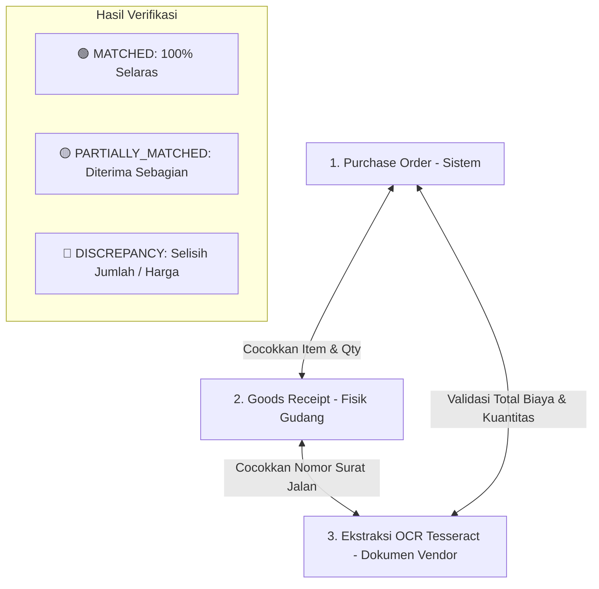

# CHEAT-SHEET REKAYASA SISTEM LOGISTIKKU
## Panduan Pola Desain, Optimasi Database & Integrasi Heterogen (Laravel ⟷ Python)

Dokumen ini merangkum teknik arsitektur lanjutan, trik penanganan konkurensi, optimasi performa query, dan pelajaran teknis berharga (*lessons learned*) yang diimplementasikan pada proyek **LogistikKu**.

---

## 1. Pola State Machine Mandiri (Pure POPO State Machine)

### Masalah Klasik
Di banyak aplikasi Laravel pemula, validasi perpindahan status sering dibuat dengan rantai `if-else` bersarang di dalam Controller atau Model. Akibatnya:
- Rentan terjadi status lompat yang tidak sah (misal: dari `Draft` langsung ke `Completed`).
- Aturan otorisasi (siapa boleh ubah status apa) tersebar di mana-mana.
- Sangat lambat dan sulit diuji (*hard to test*) karena bergantung pada query database.

### Solusi: Isolated State Machine (`PurchaseOrderStateMachine.php`)
Buat State Machine sebagai kelas PHP murni (*Plain Old PHP Object* / POPO) tanpa dependensi Eloquent maupun database.

```php
// app/Services/PurchaseOrderStateMachine.php
class PurchaseOrderStateMachine
{
    private const RULES = [
        'draft->pending_approval' => [
            'roles' => ['admin'], 'creator' => true, 'not_creator' => false, 'action' => 'submit',
        ],
        'pending_approval->approved' => [
            'roles' => ['admin', 'manager'], 'creator' => false, 'not_creator' => true, 'action' => 'approve',
        ],
        'pending_approval->rejected' => [
            'roles' => ['admin', 'manager'], 'creator' => false, 'not_creator' => true, 'action' => 'reject',
        ],
    ];

    public function canTransition(string $from, string $to, string $userRole, bool $isCreator): bool
    {
        $key = "{$from}->{$to}";
        if (! isset(self::RULES[$key])) return false;

        $rule = self::RULES[$key];
        
        // Penegakan Maker-Checker (Separation of Duty):
        // Jika not_creator = true, pembuat PO dilarang menyetujui/menolak PO miliknya sendiri!
        if ($rule['not_creator'] && $isCreator) {
            return false;
        }

        return in_array($userRole, $rule['roles'], true) || ($rule['creator'] && $isCreator);
    }
}
```

### 💡 Keuntungan & Trik:
1. **Penegakan Maker-Checker (Separation of Duty)**: Mengurangi risiko *fraud* pengadaan dengan memastikan pengguna penyetuju (`approver`) berbeda dari pembuat (`creator`).
2. **Unit Test Kilat**: Pengujian 50 kombinasi perpindahan status selesai dalam < 50 milidetik karena berjalan murni di memori tanpa I/O database.

---

## 2. Strategi Anti N+1 Query & Pengujian Matematis O(1)

### Masalah
Saat menampilkan daftar Purchase Order yang memiliki relasi `supplier`, `warehouse`, `creator`, dan `items`, query yang ceroboh akan mengeksekusi 1 query untuk header + $N$ query untuk setiap baris relasi ($1 + N$). Jika ada 100 data, sistem mengeksekusi 101 query ke database!

### Solusi Implementasi
1. **Eager Loading Terarah**:
   ```php
   PurchaseOrder::query()
       ->with([
           'supplier:id,kode_supplier,nama_supplier',
           'warehouse:id,kode_gudang,nama_gudang',
           'creator:id,name,role',
           'items.barang:id,kode_barang,nama_barang,satuan',
       ])
       ->withCount('items')
       ->withSum('items as total_qty_dipesan', 'jumlah_pesan')
       ->paginate(10);
   ```
2. **Composite Indexes**: Mempercepat filter majemuk di level database engine:
   ```php
   // database/migrations/...
   $table->index(['supplier_id', 'status', 'tanggal_pesan'], 'idx_po_supplier_status_tanggal');
   $table->index(['purchase_order_id', 'barang_id'], 'idx_poi_po_barang');
   ```

### 💡 Trik Emas: Uji Beban Anti N+1 di PHPUnit
Bagaimana membuktikan secara matematis bahwa kode kita benar-benar bebas dari N+1 query? **Bandingkan jumlah eksekusi query pada volume data yang berbeda!**

```php
public function test_purchase_orders_index_has_zero_n_plus_one_query_leaks(): void
{
    // Skenario A: Muat halaman dengan 3 data PO
    $this->createBatchOfPurchaseOrders(3);
    DB::flushQueryLog();
    DB::enableQueryLog();
    $this->actingAs($this->user)->get(route('purchase-orders.index'));
    $queryCountA = count(DB::getQueryLog());
    DB::disableQueryLog();

    // Skenario B: Tambah 12 data PO lagi (total 15 PO)
    $this->createBatchOfPurchaseOrders(12);
    DB::flushQueryLog();
    DB::enableQueryLog();
    $this->actingAs($this->user)->get(route('purchase-orders.index'));
    $queryCountB = count(DB::getQueryLog());
    DB::disableQueryLog();

    // Bukti Matematis O(1): Jumlah query TIDAK BOLEH bertambah saat data meningkat!
    $this->assertSame(
        $queryCountA, 
        $queryCountB, 
        "N+1 Query Leak Terdeteksi! Query bertambah dari {$queryCountA} ke {$queryCountB}."
    );
}
```

---

## 3. Integrasi Jembatan Heterogen (Laravel ⟷ Python OCR & AI)

### Masalah
PHP sangat unggul untuk API web dan transactional backend, namun Python memiliki ekosistem visi komputer & OCR (Tesseract, OpenCV, NumPy, ELA) yang jauh lebih matang. Menghubungkan keduanya membutuhkan jembatan yang andal dan aman.

### Solusi Jembatan Subprocess (`DocumentVerificationService.php`)
Gunakan `Symfony\Component\Process\Process` dengan isolasi kontrak JSON dan penanganan kegagalan (*fail-safe*).

```php
use Symfony\Component\Process\Process;

$process = new Process([
    config('services.document_checker.python_executable'),
    base_path('python/document_checker.py'),
    $documentPath,
    '--document-type', $documentType,
]);

// ⚠️ GOTCHA BESAR WINDOWS & WEBSERVER:
// Apache/Nginx di Windows sering menjalankan PHP tanpa variabel environment OS lengkap.
// Tanpa SYSTEMROOT & WINDIR, Python & NumPy gagal menginisialisasi cryptographic provider!
$windowsDirectory = getenv('SystemRoot') ?: 'C:\\Windows';
$process->setEnv([
    'SYSTEMROOT' => $windowsDirectory,
    'WINDIR' => $windowsDirectory,
    'PYTHONHASHSEED' => '0',
]);

$process->setTimeout(240); // 4 menit timeout aman untuk OCR scan beresolusi tinggi
$process->run();

if (! $process->isSuccessful()) {
    throw new RuntimeException("Gagal menganalisis dokumen: " . $process->getErrorOutput());
}

$payload = json_decode(trim($process->getOutput()), true);
```

### 💡 Aturan Pengaturan Timeout Berlapis:
```text
Process Timeout (240 detik) < Queue Job Timeout (300 detik) < Database retry_after (360 detik)
```
*Tujuan*: Jika proses Python macet, Process PHP akan membatalkannya sebelum Queue Worker membunuh job, dan Worker tidak akan menganggap job *stale* secara prematur.

---

## 4. Proteksi Konkurensi & Anti-Deadlock 2 Lapis

Saat beberapa staf gudang menerima barang fisik (*Goods Receipt*) secara bersamaan untuk PO yang sama, potensi terjadi *race condition* (over-receipt) atau *database deadlock* sangat tinggi.

### Arsitektur Pengamanan 2 Lapis:
1. **Layer 1: Distributed Atomic Lock (Mencegah Double-Submit)**
   ```php
   $lockKey = "purchase-order:receive:{$po->id}";
   $lock = Cache::lock($lockKey, 15); // Kunci selama 15 detik

   if (! $lock->get()) {
       throw new ConflictHttpException('Penerimaan untuk PO ini sedang diproses pengguna lain.');
   }

   try {
       // Jalankan Layer 2
   } finally {
       $lock->release();
   }
   ```

2. **Layer 2: Pessimistic Locking dengan Urutan Deterministik (Anti-Deadlock)**
   ```php
   DB::transaction(function () use ($po, $itemsToReceive) {
       // Kunci header PO
       $lockedPo = PurchaseOrder::where('id', $po->id)->lockForUpdate()->firstOrFail();

       // ⚠️ TRIK EMAS ANTI DEADLOCK:
       // Jika mengunci banyak baris di purchase_order_items, SELALU urutkan berdasarkan ID!
       // Jika Transaksi A mengunci (ID 1 lalu ID 2) dan Transaksi B mengunci (ID 2 lalu ID 1),
       // database akan mengalami DEADLOCK. Urutan seragam mencegah lingkaran tunggu!
       $lockedItems = PurchaseOrderItem::where('purchase_order_id', $lockedPo->id)
           ->orderBy('id', 'asc') // Urutan deterministik
           ->lockForUpdate()
           ->get()
           ->keyBy('id');

       // Proses saldo stok...
   }, 3); // Auto-retry hingga 3 kali jika deadlock terdeteksi di level engine
   ```

---

## 5. Three-Way Matching Logistik (PO vs GRN vs Dokumen OCR)

Pola verifikasi segitiga untuk mencegah kebocoran anggaran pengadaan:
1. **Purchase Order (PO)**: Apa yang disetujui untuk dibeli (kuantitas & harga kesepakatan).
2. **Goods Receipt Note (GRN)**: Apa yang dihitung secara fisik saat truk tiba di gudang.
3. **Dokumen Vendor (OCR Invoice / Surat Jalan)**: Apa yang ditagihkan oleh supplier melalui dokumen fisik/PDF.



### Toleransi & Ambang Batas:
- Jika kuantitas fisik diterima < kuantitas pesanan: Status `PARTIALLY_MATCHED` (PO tetap terbuka untuk pengiriman susulan).
- Jika nomor surat jalan pada OCR tidak sesuai atau terdapat selisih jumlah: Sistem memberi tanda bahaya `DISCREPANCY` sehingga bagian keuangan (*finance*) menahan pembayaran tagihan.

---

## 6. Ringkasan Prinsip Bersih (*Clean Code Checklist*)

- [x] **Zero Raw SQL di Controller**: Gunakan Eloquent ORM atau Query Builder terparameterisasi penuh.
- [x] **Single Responsibility FormRequest**: Jangan validasi data di Controller; delegasikan ke `Store...Request` atau `Update...Request`.
- [x] **Enums for Strict Typings**: Manfaatkan PHP 8.1+ Enums (`PurchaseOrderStatus::cases()`) untuk menggantikan nilai string acak (*magic string*).
- [x] **Automated Code Styling**: Jalankan `php vendor/bin/pint` sebelum melakukan commit agar pipeline CI selalu hijau.
