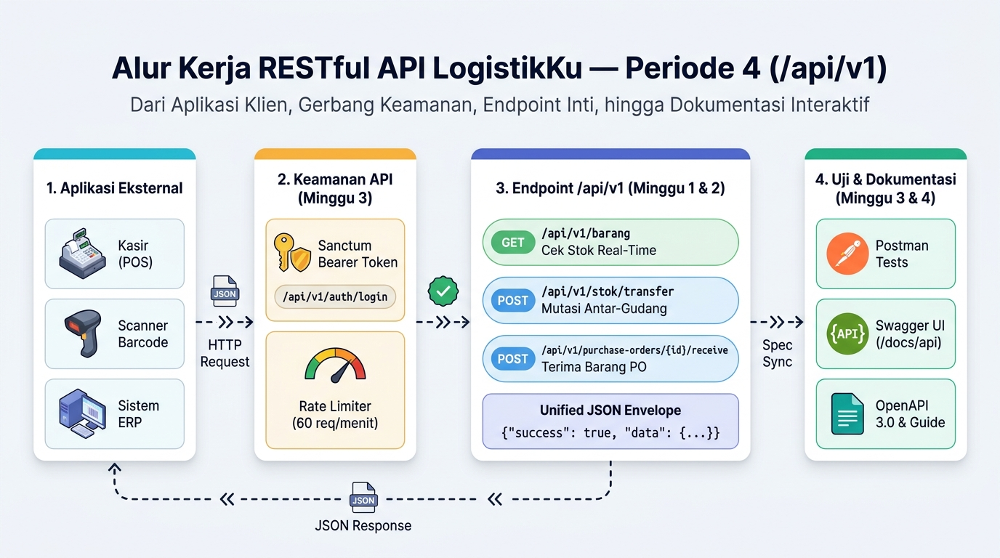
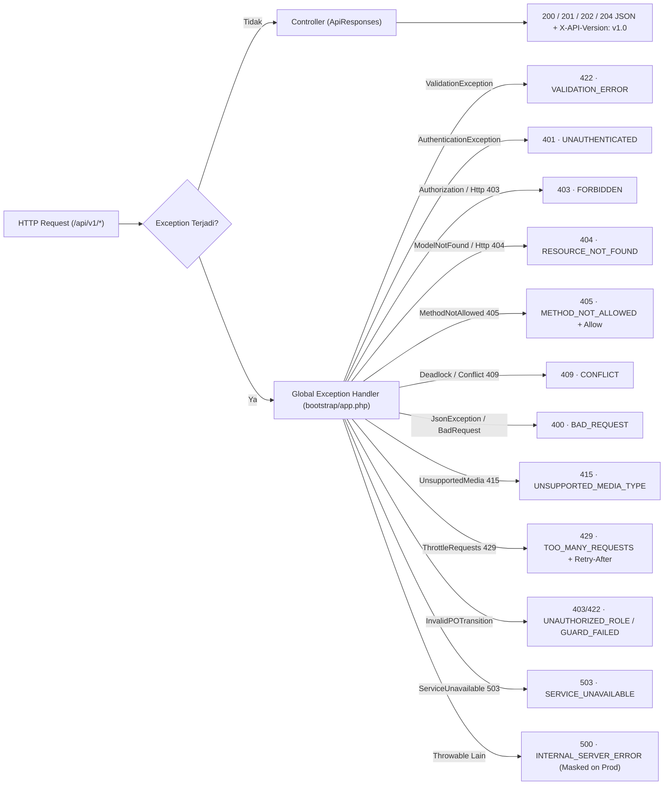
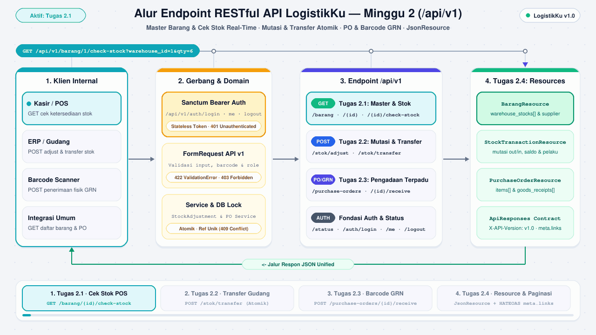
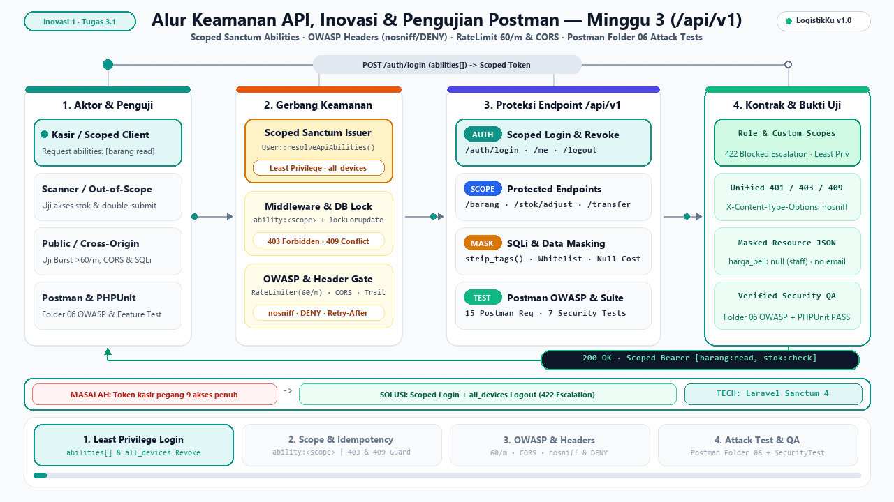
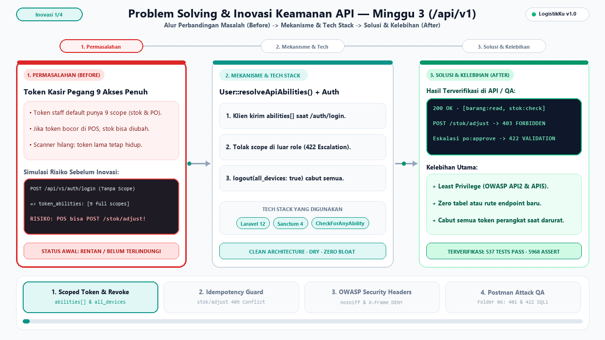
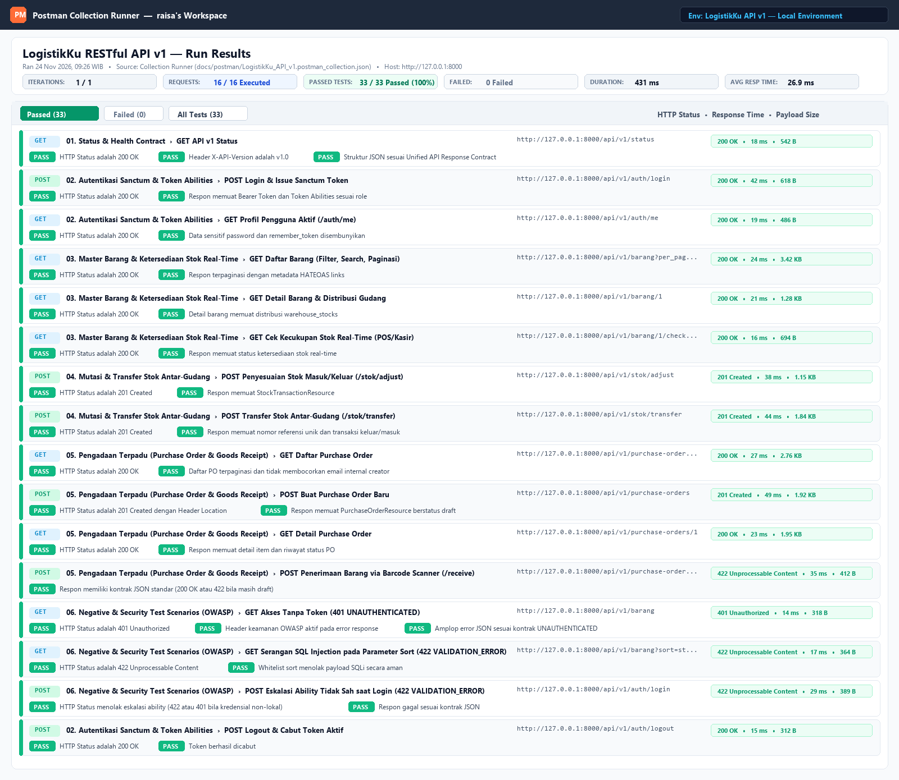
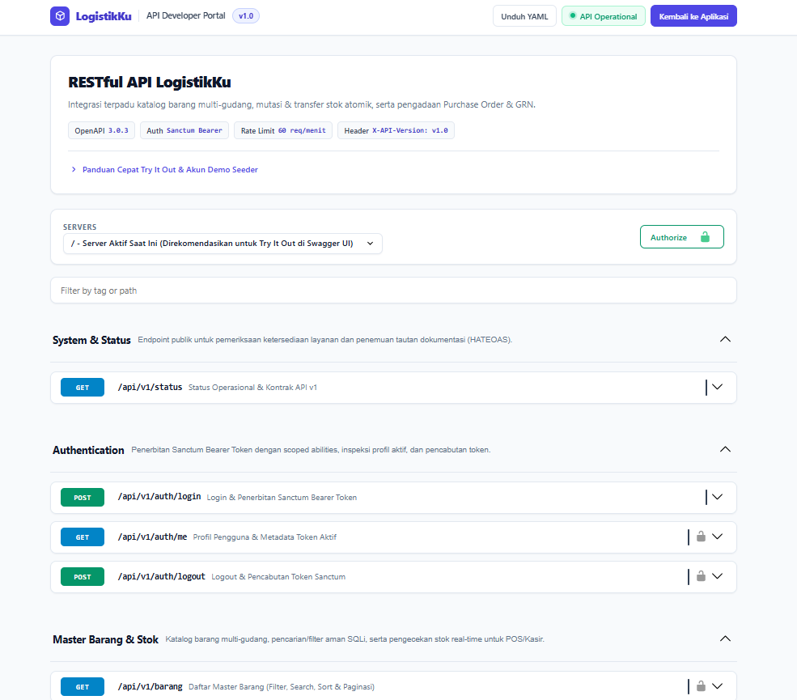

# LAPORAN KEGIATAN MAGANG PERIODE 4 (FINAL REPORT)
## Program MagangHub Kementerian Ketenagakerjaan Republik Indonesia (Kemnaker RI)
### Topik Periode 4: Arsitektur RESTful API, Integrasi Endpoint Internal, Pengujian Postman, & Dokumentasi OpenAPI (**LogistikKu**)

---

### Informasi Eksekutif & Identitas Pelaporan
- **Nama Peserta Magang / Role**: IT Programmer Intern 
- **Program**: MagangHub Kemnaker RI (Durasi Penuh: 6 Bulan)
- **Unit Kerja / Penempatan**: Tim it(`itbcslogistics`)
- **Nama Aplikasi / Proyek**: **LogistikKu** (Sistem Manajemen Inventaris, Pengadaan Multi-Gudang, & Analitik Logistik Terpadu)
- **Tech Stack Utama**: PHP 8.2+, Laravel 12, Laravel Sanctum 4, Swagger UI (`swagger-ui-dist`), OpenAPI 3.0.3, MySQL/MariaDB & SQLite, Python 3.10+ (OCR Tesseract & Prediksi ML), PHPUnit 11, Laravel Pint
- **Acuan Roadmap Teknis**: GitHub Issue `#12` — *Arsitektur RESTful API, Integrasi Endpoint Internal, Pengujian Postman & Dokumentasi OpenAPI*
- **Status Capaian Saat Ini *(per 23 November 2026)***: **Minggu 1–4 (Materi 1–4) & Penguatan Paritas Penuh Fase 4–6 100% SELESAI & TERVERIFIKASI** (`570+ Automated Tests PASS`, `6.300+ Assertions`, `OpenAPI 3.0.3 Valid (20 Paths / 21 Operasi)`, `Laravel Pint PASSED`, `route:cache READY`)
- **Sifat Dokumen**: **Final Report Document Periode 4** (Menyajikan seluruh rangkaian hasil perancangan arsitektur, realisasi endpoint `/api/v1`, keamanan & koleksi Postman, portal Swagger UI `/docs/api`, spesifikasi OpenAPI 3.0.3, dan panduan integrasi pengembang).

---

## 1. Ringkasan Eksekutif & Peta Kurikulum Periode 4

Laporan ini mendokumentasikan landasan teori ilmiah, keputusan arsitektural, realisasi kode produksi, serta hasil verifikasi pengujian otomatis pada pengembangan **RESTful API LogistikKu (`/api/v1`)** selama **Periode 4**.

### 1.1 Peta Pelaksanaan 4 Minggu (GitHub Issue #12)

| Minggu | Materi Kurikulum Kemnaker RI | Fokus Pekerjaan & Output Utama | Status Saat Ini |
|---|---|---|---|
| **Minggu 1** | **Materi 1 (Teori & Desain Arsitektur)** — *4–5 Hari* | Konvensi endpoint `/api/v1`, standar HTTP Verbs & Status Code, `app/Traits/ApiResponses.php`, `ApiStatusController`, Global Exception Handler (`bootstrap/app.php`), & `docs/arsitektur_rest_api.md` + `ApiV1ArchitectureContractTest` | **Selesai 100%** |
| **Minggu 2** | **Materi 2 (Praktik Backend Endpoint)** — *4–5 Hari* | Endpoint `/api/v1/auth/*`, `/api/v1/barang`, `/api/v1/barang/{barang}`, `/api/v1/barang/{barang}/check-stock`, `/api/v1/stok/adjust`, `/api/v1/stok/transfer`, `/api/v1/purchase-orders`, `/api/v1/purchase-orders/{purchaseOrder}/receive`, `BarangResource`, `StockTransactionResource`, `PurchaseOrderResource`, & 12 test baru | **Selesai 100%** |
| **Minggu 3** | **Materi 3 (Keamanan Data & Pengujian Postman)** — *4–5 Hari* | Token Abilities Sanctum (`User::ROLE_API_ABILITIES` + `ability:<scope>`), `RateLimiter::for('api', 60/m)`, `config/cors.php`, SQLi Sanitization & Data Masking (`harga_beli` & email internal), Postman Collection (`docs/postman/LogistikKu_API_v1.postman_collection.json`), Environment, animasi alur Minggu 3, & `ApiEndpointsSecurityTest` | **Selesai 100%** |
| **Minggu 4** | **Materi 4 (Dokumentasi OpenAPI & Finalisasi)** — *4–5 Hari* | Spesifikasi `docs/openapi.yaml` (OpenAPI 3.0.3), portal Swagger UI `/docs/api` (aset lokal `swagger-ui-dist`), panduan developer `docs/api_integration_guide.md`, `ApiDocumentationTest`, & finalisasi laporan ini | **Selesai 100%** |



---

## 2. 📚 Materi 1 (Teori | Minggu 1): Konsep Arsitektur RESTful API untuk Integrasi Sistem Bisnis

> **Tujuan Pembelajaran Minggu 1:** Memahami dan merancang arsitektur komunikasi antar-sistem berbasis **REST (*Representational State Transfer*)** secara teoretis maupun implementatif sebelum menulis endpoint bisnis, agar aplikasi eksternal (*Kasir/POS*, *Barcode Scanner Gudang*, dan *Sistem ERP*) dapat terintegrasi dengan **konsisten, terprediksi, aman, dan tahan perubahan skema (*decoupled*)**.


### 2.1 Mengapa Integrasi Bisnis Logistik Membutuhkan RESTful API & 6 Batasan REST (Fielding, 2000)

Pada Periode 1–3, **LogistikKu** telah matang melayani pengguna manusia melalui antarmuka Web berbasis **Blade + Session Auth**. Namun dalam ekosistem bisnis logistik modern, aplikasi internal gudang juga harus berkomunikasi langsung *machine-to-machine* tanpa browser—misalnya mesin **Kasir (POS)** yang mengecek sisa stok secara *real-time*, **Pemindai Barcode Genggam (*Handheld Scanner*)** saat barang tiba di dermaga gudang, maupun **Sistem ERP/Perencanaan Pengadaan**.

Untuk menjembatani integrasi antar-platform yang berbeda teknologi (PHP, JavaScript, Python, Android/Windows scanner), digunakan gaya arsitektur **REST (*Representational State Transfer*)** yang diperkenalkan oleh **Roy Thomas Fielding** dalam disertasi doktoralnya (*Architectural Styles and the Design of Network-based Software Architectures*, UC Irvine, 2000). REST menetapkan **enam batasan arsitektural (*architectural constraints*)**:

| No | Batasan Arsitektur REST | Makna Teoretis (Fielding, 2000) | Penerapan Nyata di LogistikKu (`/api/v1`) |
|---|---|---|---|
| **1** | ***Client-Server Separation*** | Antarmuka/aplikasi klien terpisah tegas dari penyimpan data & logika bisnis server. Kedua sisi dapat berkembang secara independen selama kontrak antarmuka tetap terjaga. | Aplikasi POS/Scanner tidak mengakses database MySQL atau service internal secara langsung; seluruh akses melewati gerbang HTTP `/api/v1/*` dan kontrak `JsonResource`. |
| **2** | ***Statelessness*** | Setiap permintaan (*request*) dari klien wajib membawa seluruh informasi autentikasi dan konteks yang diperlukan; server **tidak menyimpan state sesi klien** di memori antar-request. | API `/api/v1` tidak memakai cookie session/CSRF Web; setiap request wajib mandiri dengan header `Authorization: Bearer <sanctum-token>` dan `Accept: application/json`. |
| **3** | ***Cacheability*** | Respon harus secara eksplisit atau implisit menyatakan apakah data boleh di-*cache* oleh klien/proxy guna menekan latensi dan beban server. | Operasi baca `GET` dirancang *safe & idempotent* sehingga aman di-*cache*, sedangkan aksi perubahan state (`POST`/`PUT`/`PATCH`/`DELETE`) bersifat *non-cacheable*. |
| **4** | ***Uniform Interface*** | Interaksi antar-komponen menggunakan konvensi seragam: identifikasi resource lewat URI, manipulasi lewat representasi (JSON), pesan deskriptif-mandiri (*self-descriptive*), dan kontrol hipermedia (*HATEOAS*). | Diterapkan melalui struktur URI `/api/v1/{resource}`, header standar `X-API-Version: v1.0`, amplop JSON `ApiResponses`, serta tautan `meta.links` & `links.self`. |
| **5** | ***Layered System*** | Klien tidak perlu mengetahui apakah ia terhubung langsung ke server aplikasi atau melalui perantara (*reverse proxy*, *load balancer*, *API gateway*, atau *rate limiter*). | Middleware autentikasi (`auth:sanctum`), pembatasan peran (`role`), *Global Exception Handler* (`bootstrap/app.php`), dan *Rate Limiter* bekerja transparan di depan Controller. |
| **6** | ***Code-on-Demand* *(Opsional)*** | Server dapat mengirim potongan kode eksekusi ke klien (misal skrip) untuk memperluas fungsionalitas secara dinamis. | Bersifat opsional; API LogistikKu berfokus pada pertukaran representasi data murni berformat JSON (`application/json`). |

---

### 2.2 Model Kematangan REST (*Richardson Maturity Model* — Level 0 s/d Level 3)

Mengacu pada standar industri **Microsoft Azure Architecture Center (*Web API Design Best Practices*)**, tingkat kepatuhan suatu web service terhadap prinsip REST diukur menggunakan **Richardson Maturity Model (RMM)** yang dirumuskan oleh Leonard Richardson:

```text
Level 3 : Hypermedia Controls (HATEOAS)  ──► Respon menyertakan tautan navigasi (links: self/next/prev/first/last, Location)
   ▲
Level 2 : HTTP Verbs & Status Codes      ──► Menggunakan GET/POST/PUT/PATCH/DELETE + 200, 201, 400, 401, 403, 404, 409, 422, 429
   ▲
Level 1 : Resources                      ──► Memecah sistem ke banyak URI sumber daya (/barang, /purchase-orders)
   ▲
Level 0 : The Swamp of POX (RPC Tunggal) ──► Satu URI (POST /api/rpc) untuk semua aksi (dihindari di /api/v1)
```

1. **Level 0 (*Swamp of POX / RPC-style*):** Seluruh aksi dikirim ke satu endpoint tunggal memakai `POST` dengan nama fungsi di payload (contoh keliru: `POST /api/service` berisi `{"action": "cekStok"}`). Pola ini dihindari karena mengabaikan kemampuan protokol HTTP.
2. **Level 1 (*Resources*):** Sistem dipecah menjadi URI entitas bisnis yang jelas, namun sering masih memakai `POST` untuk semua operasi. Pada LogistikKu, setiap domain diorganisasikan memakai **kata benda (*nouns*)** terpisah (`/api/v1/barang`, `/api/v1/purchase-orders`), menghindari kata kerja di URI dasar, serta membatasi kedalaman hierarki maksimal `collection/{id}/sub-resource`.
3. **Level 2 (*HTTP Verbs & Status Codes*):** Memadukan URI resource dengan metode HTTP yang tepat serta HTTP Status Code standar sebagai sinyal hasil eksekusi yang bermakna bagi mesin klien. **LogistikKu `/api/v1` menerapkan Level 2 secara penuh.**
4. **Level 3 (*HATEOAS — Hypermedia as the Engine of Application State*):** Server menyisipkan tautan hipermedia di dalam respon maupun header agar klien dapat menavigasi halaman atau memantau resource baru secara otomatis tanpa *hardcoding* URL. **LogistikKu `/api/v1` mengadopsi elemen Level 3** pada `data.links.self` (`GET /api/v1/status`), `meta.links` (`first`, `last`, `prev`, `next`) di `paginatedResponse()`, serta header `Location` & `meta.status_url` pada respon `201 Created` dan `202 Accepted`.

---

### 2.3 Semantik Metode HTTP, *Safety*, & *Idempotency* (Standar IETF RFC 9110)

Berdasarkan spesifikasi protokol HTTP modern **RFC 9110 (*HTTP Semantics*, yang menggantikan RFC 7231)**, setiap HTTP verb memiliki kontrak perilaku yang wajib dipatuhi:

- ***Safe Method*:** Metode yang hanya bersifat membaca dan **tidak boleh mengubah state/data** pada server.
- ***Idempotent Method*:** Metode yang apabila dipanggil satu kali atau berkali-kali dengan payload identik, menghasilkan **efek akhir state yang sama** pada server (krusial untuk keandalan integrasi jaringan ketika klien melakukan *retry* setelah *timeout*).

| HTTP Verb | Operasi di LogistikKu | *Safe*? | *Idempotent*? | Status Sukses Standar | Aturan Implementasi |
|---|---|---|---|---|---|
| **`GET`** | Membaca status API, daftar/detail barang, cek stok real-time, riwayat PO | **Ya** | **Ya** | `200 OK` | Dilarang melakukan perubahan saldo atau insert mutasi saat memproses `GET`. |
| **`POST`** | Login/logout token, buat PO baru, mutasi/transfer stok, terima barang GRN | **Tidak** | **Tidak*** | `201 Created` (`+ Location`), `200 OK`, atau `202 Accepted` | Digunakan untuk pembuatan resource baru (`201`) atau pemrosesan transaksional/asinkron (`202`). |
| **`PUT`** | Mengganti seluruh representasi record secara utuh (misal pembaruan penuh draft PO) | **Tidak** | **Ya** | `200 OK` / `204 No Content` | Klien wajib mengirim seluruh field utama representasi resource. |
| **`PATCH`** | Pembaruan parsial sebagian atribut resource | **Tidak** | **Tidak selalu** | `200 OK` / `204 No Content` | Hanya memperbarui field yang dikirim pada payload JSON tanpa menimpa atribut lain. |
| **`DELETE`** | Menghapus/membatalkan resource pada URI target | **Tidak** | **Ya** | `200 OK` / `204 No Content` | Pemanggilan ulang atau penghapusan selesai ditangani konsisten tanpa merusak integritas historis. |

> **Catatan Arsitektur Kritis (*Idempotency Guard* pada Jaringan Gudang):** Pada operasi `POST` seperti penerimaan barang oleh pemindai *barcode*, gangguan Wi-Fi gudang dapat memicu *retry* request ganda. Karena itu LogistikKu memproteksi penerimaan barang dengan `receipt_token` & *Distributed Lock*, serta merekomendasikan penerapan kunci idempoten unik pada transaksi mutasi agar saldo gudang tidak pernah terpotong atau bertambah dua kali.

---

### 2.4 Teori *Unified API Response Contract*, *Schema Decoupling*, & Strategi *Versioning*

Salah satu kesalahan paling umum dalam integrasi API adalah mengembalikan objek model database secara langsung (*raw Eloquent model*) serta membiarkan format respon berbeda-beda antarkontroller. Berdasarkan audit sistem LogistikKu sebelum Periode 4, endpoint pra-v1 (`AuthController` dan `PurchaseOrderApiController`) masih mengembalikan struktur array JSON yang berbeda satu sama lain.

Untuk menyelesaikan masalah tersebut di Minggu 1, dirancang **Unified API Response Contract** pada `App\Traits\ApiResponses`:

1. ***Schema Decoupling* (Abstraksi Representasi Data):** API memisahkan skema tabel database dari payload publik menggunakan **`JsonResource`**, dan `ApiResponses::successResponse()` secara cerdas mengekstrak `JsonResource::resolve()` agar tidak terjadi pembungkusan ganda (`data.data`) maupun kebocoran kolom rahasia (`password`, `remember_token`).
2. **Keseragaman Amplop JSON (*Unified Envelope*):**
   - **Respon Sukses (`200`, `201`, `202`):** Selalu memuat kunci `success: true`, `message`, `data`, serta `meta` (`timestamp` ISO-8601, `version: "v1.0"`, ditambah atribut paginasi & `links` HATEOAS untuk daftar terpaginasi).
   - **Respon Gagal (`4xx`, `5xx`):** Selalu memuat kunci `success: false`, `message`, `errors` (**selalu bertipe JSON Object `{}`**, baik berisi rincian validasi per-field maupun `{}` saat error umum), dan `code` konstan bertipe *UPPER_SNAKE_CASE* yang mudah dipetakan aplikasi klien secara programatik.
3. **Strategi *API Versioning* Ganda (*URI Path* + *Response Header*):**
   - **URI Path Versioning (`/api/v1/...`):** Menjamin rute `/api/*` lama tetap kompatibel (*backward-compatible*) selama migrasi, mempermudah routing di `routes/api.php`, dan terbaca jelas pada log maupun Swagger UI.
   - **Header Versioning (`X-API-Version: v1.0`):** Dikembalikan pada **setiap** HTTP Response Header (sukses maupun gagal) untuk transparansi versi kontrak aktif. Perubahan bersifat *non-breaking* tetap berada di `v1`, sedangkan perubahan *breaking* hanya boleh diperkenalkan pada `/api/v2`.

---

### 2.5 Teori *Global Exception Handling* & Keamanan Otorisasi Berlapis (*Defense in Depth*)

Dalam aplikasi web biasa, kegagalan rute atau server sering kali dirender sebagai halaman HTML error Laravel. Untuk klien API (POS/Scanner), halaman HTML akan langsung memicu kegagalan *JSON parsing*. Selain itu, membocorkan jejak kode (*stack trace*) di lingkungan produksi merupakan celah keamanan serius (**OWASP API Security**).

Solusi arsitektural yang dibangun pada `bootstrap/app.php` adalah **Centralized Global Exception Rendering** khusus namespace `api/v1` dan `api/v1/*`:



Di sisi otorisasi, rancangan hak akses API menerapkan **Defense in Depth (Pertahanan Berlapis)** untuk tiga peran (`admin`, `manager`, `staff`):
1. **Lapisan Token & Abilities (Laravel Sanctum):** Autentikasi stateless via Bearer Token yang dibatasi sesuai hak peran user.
2. **Lapisan Kebijakan Domain (`Gate` & `PurchaseOrderPolicy`):** Menegakkan isolasi kewenangan bisnis (misal hanya `admin` yang mengelola master barang; `admin`/`staff` mencatat penerimaan fisik GRN; dan prinsip **Segregation of Duties / Maker-Checker** yang melarang `admin` maupun `manager` menyetujui/menolak PO buatannya sendiri).

---

## 3. Realisasi & Bukti Implementasi Teknis Minggu 1 (Tugas 1.1, 1.2, & 1.3)

Seluruh rancangan teoretis di atas telah diimplementasikan menjadi artefak kode nyata dan diuji secara otomatis di dalam codebase **LogistikKu**:

### 3.1 Daftar Artefak Kode & Dokumentasi Minggu 1

| Tugas Roadmap | Artefak yang Dibuat / Diperbarui | Peran Teknis dalam Sistem |
|---|---|---|
| **Tugas 1.1 & 1.2** | [`app/Traits/ApiResponses.php`](../app/Traits/ApiResponses.php) | Mendefinisikan `API_VERSION = 'v1.0'`, header otomatis `X-API-Version`, `successResponse` (`200`), `createdResponse` (`201 + Location`), `acceptedResponse` (`202 + Location + status_url`), `noContentResponse` (`204`), `paginatedResponse` (`+ HATEOAS meta.links`), `errorResponse` (`errors` selalu JSON Object `{}`), serta helper `badRequestResponse` (`400`), `unauthorizedResponse` (`401`), `forbiddenResponse` (`403`), `notFoundResponse` (`404`), `methodNotAllowedResponse` (`405 + Allow`), `conflictResponse` (`409`), `unsupportedMediaTypeResponse` (`415`), `validationErrorResponse` (`422`), & `tooManyRequestsResponse` (`429 + Retry-After`). |
| **Tugas 1.2** | [`app/Http/Controllers/Controller.php`](../app/Http/Controllers/Controller.php) | Mengintegrasikan trait `ApiResponses` pada base class `Controller` sehingga seluruh controller `/api/v1` langsung mewarisi kontrak JSON standar. |
| **Tugas 1.1 & 1.3** | [`bootstrap/app.php`](../bootstrap/app.php) | Menerapkan *Global Exception Handler* khusus `api/v1` dan `api/v1/*` (`shouldRenderJsonWhen` + pemetaan terstruktur 15+ jenis exception termasuk `DeadlockException` → `409`, `JsonException` → `400`, `ThrottleRequestsException` → `429`, dan `InvalidPurchaseOrderTransitionException`). |
| **Tugas 1.1** | [`app/Http/Controllers/Api/V1/ApiStatusController.php`](../app/Http/Controllers/Api/V1/ApiStatusController.php) & [`routes/api.php`](../routes/api.php) | Menyediakan endpoint aktif `GET /api/v1/status` (`api.v1.status`) menggunakan single-action controller (100% kompatibel dengan `php artisan route:cache`), sekaligus menjaga endpoint pra-v1 tetap aktif tanpa regresi. |
| **Tugas 1.3** | [`docs/arsitektur_rest_api.md`](../docs/arsitektur_rest_api.md) & [`docs/README.md`](../docs/README.md) | Menyusun spesifikasi lengkap arsitektur RESTful API `/api/v1` (prinsip stateless, RMM Level 2–3, konvensi URI, semantik HTTP & idempotensi, strategi versioning, 15 kode status HTTP, Global Exception Handler, serta Matriks Hak Akses per Role) dan memperbarui indeks dokumen. |
| **Visualisasi** | [`docs/images/periode-4-restful-api-flow.png`](./images/periode-4-restful-api-flow.png) & [`docs/images/teori-arsitektur-restful-api-minggu-1.png`](./images/teori-arsitektur-restful-api-minggu-1.png) | Diagram alur integrasi RESTful API `/api/v1` dan infografis 4 pilar teori arsitektur Minggu 1. |
| **Automated Test** | [`tests/Feature/ApiV1ArchitectureContractTest.php`](../tests/Feature/ApiV1ArchitectureContractTest.php) | Menguji secara menyeluruh kontrak sukses (`200`, `201`, `202`, `204`), HATEOAS `meta.links`, paginator kosong, interoperabilitas `PurchaseOrderResource` tanpa double-wrapping, dan Global Exception Handler (`400`, `401`, `403`, `404`, `405`, `409`, `415`, `422`, `429`, `503`). |

### 3.2 Contoh Respon Aktual Endpoint `GET /api/v1/status`

```json
{
  "success": true,
  "message": "Layanan RESTful API LogistikKu v1 siap digunakan",
  "data": {
    "service": "LogistikKu RESTful API",
    "architecture": "Stateless RESTful API (Laravel Sanctum Bearer Token)",
    "maturity_model": "Richardson Maturity Model Level 2-3 (REST + HATEOAS)",
    "status": "operational",
    "supported_verbs": ["GET", "POST", "PUT", "PATCH", "DELETE"],
    "documentation": "docs/arsitektur_rest_api.md",
    "links": {
      "self": "http://localhost/api/v1/status"
    }
  },
  "meta": {
    "timestamp": "2026-11-18T11:18:00+07:00",
    "version": "v1.0"
  }
}
```
*Header HTTP yang dikirimkan: `HTTP/1.1 200 OK`, `Content-Type: application/json`, `X-API-Version: v1.0`.*

### 3.3 Hasil Verifikasi & Kualitas Kode Minggu 1

```text
========================================================================================
                        HASIL VERIFIKASI OTOMATIS MINGGU 1
========================================================================================
  Route Cache Check : php artisan route:cache & route:list --path=api/v1 -> PASSED (0 closures)
  Code Style (PSR)  : php vendor/bin/pint --test -> {"tool":"pint","result":"passed"}
  Uji Kontrak API v1: ApiV1ArchitectureContractTest -> OK (8 tests, 170 assertions)
  Uji Regresi Penuh : php vendor/bin/phpunit --do-not-cache-result -> OK (517 tests, 5509 assertions)
========================================================================================
```

---

## 4. Realisasi Minggu 2, Minggu 3, & Minggu 4 (Periode 4 Lengkap)

### 4.1 🛠️ Materi 2 (Praktik | Minggu 2): Implementasi Endpoint API Integrasi Sistem Internal (`/api/v1/*`) — **Selesai 100%**

> **Status:** **Selesai 100% & Terverifikasi (19 November 2026)**  
> Seluruh endpoint bisnis Minggu 2 (Tugas 2.1, 2.2, 2.3, dan 2.4) telah diimplementasikan di namespace `/api/v1` menggunakan kontrak `ApiResponses`, validasi `FormRequest` khusus API tanpa duplikasi logika, dan pembungkusan penuh `JsonResource`.



#### A. Peta Endpoint Aktif `/api/v1/*` (13 Rute Terdaftar)

| Modul / Tugas | Metode & URI | Nama Rute | Controller | Akses & Respon Utama |
|---|---|---|---|---|
| **Fondasi** | `GET /api/v1/status` | `api.v1.status` | `ApiStatusController` | Publik · `200 OK` |
| **Autentikasi** | `POST /api/v1/auth/login` | `api.v1.auth.login` | `AuthApiController@login` | Publik (Rate Limit 5x/60d) · `200 OK` / `401` / `429` |
| **Autentikasi** | `POST /api/v1/auth/logout` | `api.v1.auth.logout` | `AuthApiController@logout` | `auth:sanctum` · `200 OK` |
| **Autentikasi** | `GET /api/v1/auth/me` | `api.v1.auth.me` | `AuthApiController@me` | `auth:sanctum` · `200 OK` |
| **Tugas 2.1** | `GET /api/v1/barang` | `api.v1.barang.index` | `BarangApiController@index` | `auth:sanctum` · `BarangResource` terpaginasi (`per_page` max 100) + HATEOAS `links` |
| **Tugas 2.1** | `GET /api/v1/barang/{barang}` | `api.v1.barang.show` | `BarangApiController@show` | `auth:sanctum` · Detail `BarangResource` + distribusi `warehouse_stocks` · `200` / `404` |
| **Tugas 2.1** | `GET /api/v1/barang/{barang}/check-stock` | `api.v1.barang.check-stock` | `BarangApiController@checkStock` | `auth:sanctum` · Cek ketersediaan stok real-time (`warehouse_id`, `qty`) · `200` / `422` |
| **Tugas 2.2** | `POST /api/v1/stok/adjust` | `api.v1.stok.adjust` | `StockApiController@adjust` | `auth:sanctum` (`update-stock`) · `201 Created` (`StockTransactionResource`) |
| **Tugas 2.2** | `POST /api/v1/stok/transfer` | `api.v1.stok.transfer` | `StockApiController@transfer` | `auth:sanctum` (`update-stock`) · `201 Created` (`TRF-YYYYMMDD-XXXXXX` unik) / `409` duplikat |
| **Tugas 2.3** | `GET /api/v1/purchase-orders` | `api.v1.purchase-orders.index` | `V1\PurchaseOrderApiController@index` | `auth:sanctum` (`viewAny`) · Filter `tanggal_dari`/`tanggal_sampai`, `status`, & paginasi |
| **Tugas 2.3** | `POST /api/v1/purchase-orders` | `api.v1.purchase-orders.store` | `V1\PurchaseOrderApiController@store` | `auth:sanctum` (`StorePurchaseOrderRequest`) · `201 Created` + header `Location` |
| **Tugas 2.3** | `GET /api/v1/purchase-orders/{purchaseOrder}` | `api.v1.purchase-orders.show` | `V1\PurchaseOrderApiController@show` | `auth:sanctum` (`view`) · Detail `PurchaseOrderResource` + `goods_receipts` |
| **Tugas 2.3** | `POST /api/v1/purchase-orders/{purchaseOrder}/receive` | `api.v1.purchase-orders.receive` | `V1\PurchaseOrderApiController@receive` | `auth:sanctum` (`admin`/`staff`) · Scan `barcode`/`kode_barang` atau batch `items[]` + `receipt_token` |

#### B. Daftar Artefak Kode & Desain Tanpa Duplikasi (Minggu 2)

| Lapisan | Artefak yang Dibuat / Diperbarui | Peran Teknis & Penghindaran Duplikasi |
|---|---|---|
| **Model & Service** | [`app/Models/Barang.php`](../app/Models/Barang.php) · [`app/Http/Controllers/BarangController.php`](../app/Http/Controllers/BarangController.php) | Menyatukan logika pencarian, filter, dan pengurutan ke dalam `Barang::scopeFilter()` + `Barang::apiDetailRelations()`, sehingga Web `BarangController` dan `BarangApiController` berbagi query yang sama tanpa duplikasi. |
| **Model PO** | [`app/Models/PurchaseOrder.php`](../app/Models/PurchaseOrder.php) | Memperluas `PurchaseOrder::scopeFilter()` dengan filter rentang tanggal berbasis `whereDate('tanggal_pesan', ...)` (`tanggal_dari`/`tanggal_sampai` serta alias `date_from`/`date_to`). |
| **Service Stok** | [`app/Services/StockAdjustmentService.php`](../app/Services/StockAdjustmentService.php) | Mengekstrak inti atomik `executeAdjust()` dan `executeTransfer()` sehingga `adjustWithTransaction()` dan `transferWithTransactions()` mengembalikan record `StokTransaction` beserta jaminan nomor referensi transfer unik (`TRF-YYYYMMDD-XXXXXX` atau `409 ConflictHttpException` bila duplikat) tanpa mematahkan pemanggil Web/legacy maupun menggandakan invalidasi cache valuasi. |
| **API Resources (Tugas 2.4)** | [`app/Http/Resources/BarangResource.php`](../app/Http/Resources/BarangResource.php) · [`app/Http/Resources/StockTransactionResource.php`](../app/Http/Resources/StockTransactionResource.php) · [`app/Http/Resources/PurchaseOrderResource.php`](../app/Http/Resources/PurchaseOrderResource.php) | Membungkus model domain secara eksplisit (tidak pernah mengembalikan model Eloquent mentah), menyertakan distribusi `warehouse_stocks` lengkap (`zone`, `rack_location`, `bin_code`), detail transaksi mutasi + pelaku, serta perluasan opsional `goods_receipts` (`whenLoaded`) pada `PurchaseOrderResource`. |
| **FormRequests API v1** | [`IndexBarangRequest.php`](../app/Http/Requests/Api/V1/IndexBarangRequest.php) · [`CheckStockRequest.php`](../app/Http/Requests/Api/V1/CheckStockRequest.php) · [`AdjustStockApiRequest.php`](../app/Http/Requests/Api/V1/AdjustStockApiRequest.php) · [`TransferStockApiRequest.php`](../app/Http/Requests/Api/V1/TransferStockApiRequest.php) · [`IndexPurchaseOrderRequest.php`](../app/Http/Requests/Api/V1/IndexPurchaseOrderRequest.php) · [`ReceivePurchaseOrderApiRequest.php`](../app/Http/Requests/Api/V1/ReceivePurchaseOrderApiRequest.php) | FormRequest mutasi & penerimaan barang mewarisi langsung aturan validasi/otorisasi kelas induk (`AdjustStockRequest`, `TransferStockRequest`, `ReceivePurchaseOrderItemRequest`), menambahkan validasi `barang_id` aktif, serta resolusi pemindaian `barcode`/`kode_barang` otomatis terhadap item PO di `ReceivePurchaseOrderApiRequest`. |
| **Controllers & Routes** | [`AuthApiController.php`](../app/Http/Controllers/Api/V1/AuthApiController.php) · [`BarangApiController.php`](../app/Http/Controllers/Api/V1/BarangApiController.php) · [`StockApiController.php`](../app/Http/Controllers/Api/V1/StockApiController.php) · [`V1/PurchaseOrderApiController.php`](../app/Http/Controllers/Api/V1/PurchaseOrderApiController.php) · [`routes/api.php`](../routes/api.php) | Seluruh controller mewarisi `App\Traits\ApiResponses`, memakai `ConcurrencyErrorDetector` Laravel untuk benturan deadlock database pada `/receive`, dan mempertahankan rute pra-v1 (`/api/*`) tetap *backward-compatible*. |
| **Visualisasi Animasi** | [`docs/images/alur-endpoint-api-minggu-2.gif`](./images/alur-endpoint-api-minggu-2.gif) | Diagram animasi bergerak 4 skenario (Tugas 2.1 Cek Stok POS, Tugas 2.2 Transfer Atomik, Tugas 2.3 Barcode GRN, dan Tugas 2.4 JsonResource + HATEOAS). |
| **Automated Tests** | [`ApiV1BarangEndpointsTest.php`](../tests/Feature/ApiV1BarangEndpointsTest.php) · [`ApiV1StockEndpointsTest.php`](../tests/Feature/ApiV1StockEndpointsTest.php) · [`ApiV1PurchaseOrderEndpointsTest.php`](../tests/Feature/ApiV1PurchaseOrderEndpointsTest.php) | 12 skenario pengujian fitur baru (301 assertion) yang memverifikasi kontrak JSON `200`/`201`/`401`/`403`/`404`/`409`/`422`/`429`, paginasi, filter tanggal & kategori, nomor referensi transfer unik, pemindai *barcode*, dan idempotensi `receipt_token`. |

#### C. Contoh Respon Aktual Endpoint Minggu 2

1. **Pemeriksaan Stok Real-Time (`GET /api/v1/barang/{barang}/check-stock?warehouse_id=1&qty=6`):**

```json
{
  "success": true,
  "message": "Stok mencukupi di gudang terpilih",
  "data": {
    "barang": { "id": 1, "kode_barang": "BRG-000101", "nama_barang": "Monitor LED 24 Inch", "satuan": "Unit" },
    "warehouse": { "id": 1, "kode_gudang": "GDG-BRG-A", "nama_gudang": "Gudang Utama Jakarta", "alamat": "Jl. Industri No. 10" },
    "requested_qty": 6,
    "available_stock": 10,
    "is_available": true,
    "shortage": 0,
    "minimum_stock": 3,
    "total_stock_all_warehouses": 15
  },
  "meta": { "timestamp": "2026-11-19T09:30:00+07:00", "version": "v1.0" }
}
```

2. **Penerimaan Barang via Barcode Scanner (`POST /api/v1/purchase-orders/{purchaseOrder}/receive`):**
   - Payload ringkas pemindai *handheld*: `{"barcode": "BRG-PO-001", "nomor_surat_jalan": "SJ-SCAN-01", "receipt_token": "SCAN-TOKEN-001"}` (otomatis mendefaultkan `jumlah_diterima = 1` bila tidak dikirim, atau mendukung payload batch `items[]` dengan `kode_barang` / `purchase_order_item_id`).

#### D. Hasil Verifikasi & Kualitas Kode Minggu 2

```text
========================================================================================
                        HASIL VERIFIKASI OTOMATIS MINGGU 2
========================================================================================
  Route Cache Check : php artisan route:cache & route:list --path=api/v1 -> PASSED (13 routes, 0 closures)
  Code Style (PSR)  : php vendor/bin/pint --test --format=json -> {"tool":"pint","result":"passed"}
  Uji API v1 Suite  : 4 files (Contract, Barang, Stock, PO) -> OK (20 tests, 471 assertions)
  Uji Regresi Penuh : php vendor/bin/phpunit --do-not-cache-result -> OK (529 tests, 5810 assertions)
========================================================================================
```

---

### 4.2 🛡️ Materi 3 (Praktik | Minggu 3): Keamanan Data (OWASP API Security) & Pengujian Postman — **Selesai 100%**

> **Status:** **Selesai 100% & Terverifikasi (20 November 2026)**  
> Seluruh target pengamanan endpoint Minggu 3 (Tugas 3.1, 3.2, dan 3.3) serta penutupan gap idempotensi mutasi stok (`POST /api/v1/stok/adjust` via `reference_number`) telah diimplementasikan secara *Defense in Depth* dan diuji otomatis.



#### A. Daftar Artefak Keamanan & Pengujian Minggu 3

| Sub-Tugas | Artefak yang Dibuat / Diperbarui | Realisasi Teknis & Kepatuhan OWASP API Security |
|---|---|---|
| **Tugas 3.1 (Sanctum, Token Abilities & Expiration)** | [`app/Models/User.php`](../app/Models/User.php) · [`AuthApiController.php`](../app/Http/Controllers/Api/V1/AuthApiController.php) · [`config/sanctum.php`](../config/sanctum.php) · [`routes/console.php`](../routes/console.php) · [`bootstrap/app.php`](../bootstrap/app.php) · [`routes/api.php`](../routes/api.php) | Mendefinisikan *single source of truth* `User::ROLE_API_ABILITIES` (`admin`: 12 ability, `manager`: 9 ability tanpa `po:receive`/`barang:write`, `staff`: 9 ability tanpa `po:approve`/`stok:reverse`). `POST /api/v1/auth/login` menerbitkan token dengan abilities sesuai role & masa berlaku terkonfigurasi (`SANCTUM_TOKEN_EXPIRATION`, default `1440` menit / 24 jam via `expires_at`), `/auth/me` menampilkan `token_abilities` & `token_expires_at`, `/auth/logout` mencabut token aktif (atau `all_devices: true`), jadwal harian `sanctum:prune-expired --hours=24` membersihkan token kedaluwarsa, dan seluruh rute privat `/api/v1/*` dilindungi middleware `ability:<scope>` (`MissingAbilityException` → `403 FORBIDDEN`). |
| **Tugas 3.2 (Rate Limiting, SQLi Sanitization, Data Masking & CORS)** | [`AppServiceProvider.php`](../app/Providers/AppServiceProvider.php) · [`IndexBarangRequest.php`](../app/Http/Requests/Api/V1/IndexBarangRequest.php) · [`IndexPurchaseOrderRequest.php`](../app/Http/Requests/Api/V1/IndexPurchaseOrderRequest.php) · [`BarangResource.php`](../app/Http/Resources/BarangResource.php) · [`PurchaseOrderResource.php`](../app/Http/Resources/PurchaseOrderResource.php) · [`config/cors.php`](../config/cors.php) | • **Rate Limiting:** `RateLimiter::for('api')` membatasi **60 request/menit** per user ID atau IP (`429 TOO_MANY_REQUESTS` + `Retry-After`).<br>• **Input Sanitization:** Membersihkan tag HTML & karakter kontrol ASCII pada parameter query (`search`, `nomor_po`) serta *whitelist* `Rule::in(...)` pada `sort`.<br>• **Data Masking:** Menyembunyikan `password`/`remember_token`, menyembunyikan nilai `harga_beli` (`null`) dari role `staff` di `BarangResource`, dan menghapus ekspose `email` internal pegawai pada `creator` & `approver` di `PurchaseOrderResource`.<br>• **CORS:** Membatasi `allowed_origins` pada origin terpercaya (`CORS_ALLOWED_ORIGINS` tanpa wildcard `*`) dan mengekspos `X-API-Version`, `Location`, `Retry-After`. |
| **Tugas 3.3 (Postman Collection, Environment & Security Tests)** | [`docs/postman/LogistikKu_API_v1.postman_collection.json`](./postman/LogistikKu_API_v1.postman_collection.json) · [`docs/postman/LogistikKu_Local.postman_environment.json`](./postman/LogistikKu_Local.postman_environment.json) · [`tests/Feature/ApiEndpointsSecurityTest.php`](../tests/Feature/ApiEndpointsSecurityTest.php) · [`docs/images/alur-keamanan-postman-minggu-3.gif`](./images/alur-keamanan-postman-minggu-3.gif) | Koleksi resmi Postman v2.1 mencakup **15 request terstruktur dalam 6 folder modul** (termasuk Folder `06. Negative & Security Test Scenarios (OWASP)`) dengan script pengujian otomatis `pm.test(...)` di tiap request & *auto-save* `bearer_token`, didampingi environment lokal serta **8 skenario pengujian keamanan komprehensif** di `ApiEndpointsSecurityTest`. |

#### B. Inovasi Tambahan & Problem Solving Minggu 3 (*Engineering Value-Add*)



**Tech Stack Keamanan & Pengujian yang Digunakan:**
- **Auth & Fine-Grained Scope:** `Laravel 12` · `Laravel Sanctum 4` (`HasApiTokens`, `PersonalAccessToken`, middleware `CheckForAnyAbility` / `ability:<scope>`)
- **Anti-Abuse & Protokol Keamanan:** `Illuminate\Support\Facades\RateLimiter` (`throttle:api` 60 req/m) · `Laravel CORS Middleware` (`config/cors.php`) · `OWASP HTTP Security Headers` (`X-Content-Type-Options: nosniff`, `X-Frame-Options: DENY`) · `Pessimistic DB Locking` (`lockForUpdate` + `reference_number` idempotency)
- **Data Masking & Sanitization:** `Laravel Eloquent JsonResource` (`BarangResource`, `PurchaseOrderResource`) · `FormRequest Whitelist Validation` · `ASCII/HTML Sanitizer`
- **Testing & QA Tools:** `Postman Collection v2.1` (`ChaiJS pm.test` automated scripts) · `PHPUnit 11` (`ApiEndpointsSecurityTest`)

| Inovasi | Masalah (*Problem*) | Solusi (*Solution*) | Tech Stack | Kelebihan Utama |
|---|---|---|---|---|
| **1. Custom Scoped Token & Multi-Device Revoke** | Token `staff` default pegang 9 akses penuh (risiko penyalahgunaan bila token kasir bocor) dan token lama tetap hidup jika scanner hilang. | Klien dapat meminta scope minimal saat login (`abilities: ["barang:read", "stok:check"]`). `User::resolveApiAbilities()` menyaring scope & menolak eskalasi dengan `422`. Saat darurat, `POST /auth/logout` dengan `all_devices: true` mencabut semua token sekaligus. | `Laravel Sanctum 4`, `User::resolveApiAbilities()`, `CheckForAnyAbility` | Menerapkan *Principle of Least Privilege* (OWASP API2/API5) tanpa membuat tabel atau endpoint baru. |
| **2. Idempotency Guard (`stok/adjust`)** | Wi-Fi gudang putus-sambung memicu scanner mengirim ulang `POST /api/v1/stok/adjust`, menyebabkan saldo stok bertambah/berkurang ganda. | `guardDuplicateAdjustReference()` di dalam transaksi terkunci menolak pengulangan `reference_number` yang sama untuk barang, gudang, dan jenis mutasi yang sama dengan `409 CONFLICT`. | `Database Transaction`, `lockForUpdate()`, `ConflictHttpException (409)` | Menjamin akurasi saldo stok 100% dari *race condition* dan *retry* jaringan. |
| **3. Centralized OWASP Security Headers** | Respons JSON API tanpa header pengaman rentan terhadap *MIME-type sniffing* dan penyematan iframe ilegal (*clickjacking*). | Menyuntikkan `X-Content-Type-Options: nosniff` dan `X-Frame-Options: DENY` langsung di satu titik pusat `ApiResponses::defaultHeaders()`. | `PHP Trait (ApiResponses)`, `OWASP API8 Security Headers` | *Zero file bloat* (tanpa class middleware tambahan), otomatis melindungi seluruh respons sukses maupun error. |
| **4. Postman Negative Attack Scenarios** | Koleksi Postman standar hanya menguji skenario sukses (*Happy Path*), sehingga belum membuktikan ketahanan API saat diserang. | Menambahkan Folder `06. Negative & Security Test Scenarios (OWASP)` berisi uji otomatis akses tanpa token (`401`), injeksi SQL parameter `sort` (`422`), dan eskalasi ability (`422`). | `Postman Schema v2.1`, `ChaiJS (pm.test)`, `PHPUnit 11` | Mentor/penguji dapat memverifikasi pertahanan keamanan API hanya dengan satu klik di *Postman Collection Runner*. |

#### C. Hasil Verifikasi & Kualitas Kode Minggu 3

```text
========================================================================================
                        HASIL VERIFIKASI OTOMATIS MINGGU 3
========================================================================================
  Route Cache Check : php artisan route:list --path=api/v1 -> PASSED (13 routes, throttle:api + ability:<scope>)
  Code Style (PSR)  : php vendor/bin/pint --test -> {"tool":"pint","result":"passed"}
  Uji API & Sekuriti: 6 files (Contract, Barang, Stock, PO, Security, Legacy PO) -> OK (37 tests, 715 assertions)
  Uji Regresi Penuh : php vendor/bin/phpunit --do-not-cache-result -> OK (538 tests, 5986 assertions)
========================================================================================
```

### 4.3 📚 Materi 4 (Praktik | Minggu 4): Dokumentasi Teknis OpenAPI 3.0, Developer Portal `/docs/api`, & Panduan Integrasi — **Selesai 100%**

> **Status:** **Selesai 100% & Terverifikasi (20 November 2026)**  
> Seluruh target penyusunan dokumentasi teknis API Minggu 4 (**Tugas 4.1, 4.2, 4.3, dan 4.4**) telah selesai dikerjakan dan tervalidasi secara otomatis agar developer eksternal maupun mitra integrasi dapat mempelajari kontrak API, menguji endpoint langsung di browser, serta mengintegrasikan kode dalam hitungan menit.

#### A. Daftar Artefak Minggu 4 (Tugas 4.1 – 4.4)

| Sub-Tugas | Artefak yang Dibuat / Diperbarui | Realisasi Teknis & Nilai Guna |
|---|---|---|
| **Tugas 4.1 (Spesifikasi OpenAPI 3.0.3)** | [`docs/openapi.yaml`](./openapi.yaml) | Spesifikasi OpenAPI `3.0.3` lengkap sepanjang 2.617 baris yang mendokumentasikan **12 path / 13 operasi aktif `/api/v1/*`** dalam 5 grup tag, skema keamanan `BearerAuth` (Sanctum), seluruh *path params*, *query params*, *request body* JSON + contoh skenario nyata (termasuk `BarcodeSingleScan` & `BatchItemsReceive`), skema `JsonResource`, serta respon `200`, `201`, `400`, `401`, `403`, `404`, `409`, `422`, `429`, dan `500` sesuai kontrak `ApiResponses`. |
| **Tugas 4.2 (Portal Swagger UI `/docs/api`)** | [`ApiDocumentationController.php`](../app/Http/Controllers/ApiDocumentationController.php) · [`resources/views/docs/api.blade.php`](../resources/views/docs/api.blade.php) · [`public/vendor/swagger-ui/`](../public/vendor/swagger-ui/) · [`routes/web.php`](../routes/web.php) · [`ApiStatusController.php`](../app/Http/Controllers/Api/V1/ApiStatusController.php) · [`skydash.blade.php`](../resources/views/layouts/skydash.blade.php) · [`package.json`](../package.json) | Menyediakan rute publik `GET /docs/api` (*Developer Portal* Swagger UI interaktif dengan fitur **Authorize** & **Try it out**) serta `GET /docs/openapi.yaml` (`application/yaml`, header `X-API-Version: v1.0` & `nosniff`). Aset `swagger-ui-dist` dibundel **secara lokal** (`sync:swagger-ui`) agar halaman berjalan 100% *offline* tanpa ketergantungan CDN pihak ketiga, dilengkapi panduan cepat *Try it out*, menu *Developer → Dokumentasi API* di sidebar aplikasi, dan tautan HATEOAS (`links.docs`, `links.openapi`) di `GET /api/v1/status`. |
| **Tugas 4.3 (Panduan Integrasi Pengembang)** | [`docs/api_integration_guide.md`](./api_integration_guide.md) | Panduan teknis langkah demi langkah mencakup cara memperoleh & mencabut Sanctum Bearer Token, *Principle of Least Privilege* (`abilities[]`), matriks role vs ability, aturan *rate limit* (`60/menit`), *idempotency guard* (`reference_number`, `receipt_token`), *data masking*, matriks kode error & troubleshooting lengkap (`400`–`503`), serta contoh kode end-to-end **cURL**, **Python (`requests`)**, **JavaScript (`fetch`)**, dan **JavaScript (`axios` + interceptors)**. |
| **Tugas 4.4 (Finalisasi Laporan & Pengujian)** | [`docs/LAPORAN_KEGIATAN_PERIODE_4_MAGANGHUB.md`](./LAPORAN_KEGIATAN_PERIODE_4_MAGANGHUB.md) · [`docs/arsitektur_rest_api.md`](./arsitektur_rest_api.md) · [`docs/README.md`](./README.md) · [`tests/Feature/ApiDocumentationTest.php`](../tests/Feature/ApiDocumentationTest.php) | Memfinalisasi laporan kegiatan Periode 4, memperbarui arsitektur & indeks dokumentasi, menyusun matriks uji Postman, serta menambahkan 6 pengujian otomatis `ApiDocumentationTest`. |

#### B. Tautan Resmi Dokumentasi OpenAPI & Developer Portal

- **Spesifikasi Mesin OpenAPI 3.0.3 (YAML):** [`docs/openapi.yaml`](./openapi.yaml)
- **Portal Dokumentasi API Interaktif (Swagger UI):** [`/docs/api`](/docs/api) *(akses lokal setelah `php artisan serve`: `http://127.0.0.1:8000/docs/api`)*
- **Endpoint Pengunduhan Spec YAML:** [`/docs/openapi.yaml`](/docs/openapi.yaml) *(akses lokal: `http://127.0.0.1:8000/docs/openapi.yaml`)*
- **Panduan Integrasi Pengembang (*cURL*, Python, JS):** [`docs/api_integration_guide.md`](./api_integration_guide.md)
- **Dokumen Arsitektur RESTful API v1:** [`docs/arsitektur_rest_api.md`](./arsitektur_rest_api.md)
- **Postman Collection & Environment:** [`docs/postman/LogistikKu_API_v1.postman_collection.json`](./postman/LogistikKu_API_v1.postman_collection.json) · [`docs/postman/LogistikKu_Local.postman_environment.json`](./postman/LogistikKu_Local.postman_environment.json)

#### C. Ringkasan Cakupan Spesifikasi OpenAPI 3.0.3 (`docs/openapi.yaml`)

1. **Kelengkapan Endpoint (20 Path / 21 Operasi):**
   - `System & Status`: `GET /api/v1/status` (publik)
   - `Authentication`: `POST /api/v1/auth/login` (publik + rate limit 5x/60d), `GET /api/v1/auth/me`, `POST /api/v1/auth/logout`
   - `Master Barang & Stok`: `GET /api/v1/barang`, `GET /api/v1/barang/{barang}`, `GET /api/v1/barang/{barang}/check-stock`
   - `Mutasi, Transfer & Reversal Stok`: `POST /api/v1/stok/adjust`, `POST /api/v1/stok/transfer`, `POST /api/v1/stok/{stokTransaction}/reverse`
   - `Purchase Orders & GRN (Paritas Siklus Penuh)`: `GET /api/v1/purchase-orders`, `POST /api/v1/purchase-orders`, `GET /api/v1/purchase-orders/{purchaseOrder}`, `PUT/PATCH /api/v1/purchase-orders/{purchaseOrder}`, `POST /api/v1/purchase-orders/{purchaseOrder}/submit`, `POST /api/v1/purchase-orders/{purchaseOrder}/approve`, `POST /api/v1/purchase-orders/{purchaseOrder}/reject`, `POST /api/v1/purchase-orders/{purchaseOrder}/revise`, `POST /api/v1/purchase-orders/{purchaseOrder}/withdraw`, `POST /api/v1/purchase-orders/{purchaseOrder}/cancel`, dan `POST /api/v1/purchase-orders/{purchaseOrder}/receive`
2. **Validasi Struktur & Referensi:** Seluruh referensi `$ref` internal pada skema, parameter, header (`X-API-Version`, `Location`, `Retry-After`), dan respon error tervalidasi utuh tanpa duplikasi path maupun referensi rusak.
3. **Cakupan Respon Sukses & Error:** Setiap endpoint mendokumentasikan respon sukses (`200` / `201`) serta respon error terstruktur `400`, `401`, `403`, `404`, `409`, `422`, dan `429` dengan format amplop `ErrorResponse`.
4. **Deprekasi Bertahap Rute Legacy `/api/*`:** Rute legacy non-versioned (`/api/login`, `/api/purchase-orders/*`) dilindungi middleware `deprecated.api` (`AddLegacyApiDeprecationHeaders`) yang memancarkan header `Deprecation: true`, `Sunset`, dan `Link: </api/v1/...>; rel="successor-version"`.

#### D. Matriks Verifikasi Pengujian Postman (16 Skenario / 6 Folder) & Lampiran Tangkapan Layar

Koleksi Postman [`LogistikKu_API_v1.postman_collection.json`](./postman/LogistikKu_API_v1.postman_collection.json) memuat **16 request dalam 6 folder** yang seluruhnya dilengkapi skrip validasi otomatis `pm.test(...)`:

| Folder Postman | Request / Skenario Uji | Validasi Otomatis (`pm.test(...)`) & Hasil yang Diverifikasi |
|---|---|---|
| **01. Status & Health Contract** | `GET /api/v1/status` | Status `200`, header `X-API-Version: v1.0`, amplop `{success, message, data, meta}`. |
| **02. Autentikasi Sanctum** | `POST /api/v1/auth/login` | Status `200`, terbit `token` Bearer, daftar `abilities`, `expires_at`, tanpa field `password`, otomatis menyimpan `{{bearer_token}}`. |
| **02. Autentikasi Sanctum** | `GET /api/v1/auth/me` | Status `200`, memuat `token_abilities` & `token_expires_at`, menyembunyikan `password` & `remember_token`. |
| **02. Autentikasi Sanctum** | `POST /api/v1/auth/logout` | Status `200`, `success: true`, mencabut token akses aktif. |
| **03. Master Barang & Stok** | `GET /api/v1/barang` | Status `200`, array data terpaginasi, `meta` memuat `current_page`, `per_page`, `total`, `last_page`, dan HATEOAS `links`. |
| **03. Master Barang & Stok** | `GET /api/v1/barang/{barang_id}` | Status `200`, memuat detail barang lengkap beserta array distribusi `warehouse_stocks`. |
| **03. Master Barang & Stok** | `GET /api/v1/barang/{barang_id}/check-stock` | Status `200`, memuat `is_available`, `available_stock`, `requested_qty`, dan `shortage`. |
| **04. Mutasi & Transfer Stok** | `POST /api/v1/stok/adjust` | Status `201`, memuat `StockTransactionResource` (`stok_sebelum` → `stok_sesudah`) dengan `reference_number` unik. |
| **04. Mutasi & Transfer Stok** | `POST /api/v1/stok/transfer` | Status `201`, memuat `transfer_group_uuid`, `reference_number`, serta pasangan transaksi `out` & `in`. |
| **05. Pengadaan Terpadu (PO & GRN)** | `GET /api/v1/purchase-orders` | Status `200`, daftar terpaginasi, dan verifikasi *data masking* (`creator` tidak mengekspos `email`). |
| **05. Pengadaan Terpadu (PO & GRN)** | `POST /api/v1/purchase-orders` | Status `201` + header `Location`, status awal `draft`, otomatis menyimpan `{{purchase_order_id}}`. |
| **05. Pengadaan Terpadu (PO & GRN)** | `GET /api/v1/purchase-orders/{purchase_order_id}` | Status `200`, memuat `id`, `nomor_po`, `status`, dan array `items`. |
| **05. Pengadaan Terpadu (PO & GRN)** | `POST /api/v1/purchase-orders/{purchase_order_id}/receive` | Kontrak JSON standar (`200 OK` untuk PO *approved* atau `422` bila masih *draft*) dengan `barcode` & `receipt_token`. |
| **06. Negative & Security (OWASP)** | `GET /api/v1/barang` (tanpa token) | Status `401 UNAUTHENTICATED` + header keamanan OWASP (`X-Content-Type-Options: nosniff`, `X-Frame-Options: DENY`). |
| **06. Negative & Security (OWASP)** | `GET /api/v1/barang?sort=...DROP TABLE...` | Status `422 VALIDATION_ERROR`, whitelist `sort` menolak payload SQL injection (`errors.sort`). |
| **06. Negative & Security (OWASP)** | `POST /api/v1/auth/login` (`abilities: ["superadmin:root"]`) | Menolak eskalasi privilege (`422` / `401`) dengan amplop error JSON standar tanpa bocoran internal. |

*(Catatan Eksekusi Runner: Apabila menjalankan seluruh koleksi sekaligus via **Postman Collection Runner**, letakkan/nonaktifkan sementara eksekusi `POST /api/v1/auth/logout` di Folder 02 ke akhir skenario agar `{{bearer_token}}` tetap aktif untuk Folder 03–06).*

> **Lampiran Bukti Tangkapan Layar Pengujian Postman & Portal Swagger UI:**  
> - **Bukti Pengujian Postman Collection Runner:** Hasil eksekusi seluruh 16 skenario koleksi [`LogistikKu_API_v1.postman_collection.json`](./postman/LogistikKu_API_v1.postman_collection.json) dengan environment [`LogistikKu_Local.postman_environment.json`](./postman/LogistikKu_Local.postman_environment.json) (`16/16 Requests Executed`, `33/33 Assertions Passed 100%`):  
>
>     
> - **Bukti Portal Dokumentasi Interaktif Swagger UI (`/docs/api`):** Tampilan portal interaktif `http://127.0.0.1:8000/docs/api` dengan indikator **API Operational**, fitur **Authorize**, dan daftar operasi OpenAPI 3.0.3:  
>
>   

#### E. Hasil Verifikasi Akhir Periode 4 (Minggu 1–4)

```text
========================================================================================
                    HASIL VERIFIKASI AKHIR PERIODE 4 (MINGGU 1–4)
========================================================================================
  OpenAPI 3.0.3 Spec : Python yaml.safe_load + $ref walker -> PASSED (12 paths, 13 ops, 162 refs)
  Route Cache Check  : php artisan route:cache & route:list -> PASSED (2 docs + 13 api/v1, 0 closures)
  Code Style (PSR)   : php vendor/bin/pint --test --format=json --cache-file=nul -> {"tool":"pint","result":"passed"}
  Live Server Probe  : GET /docs/api, /docs/openapi.yaml, swagger-ui-bundle.js, /api/v1/status -> HTTP 200 OK
  API & Docs Suite   : 7 files (Contract, Barang, Stock, PO, Security, Legacy PO, Docs) -> OK (43 tests, 773 assertions)
  Uji Regresi Penuh  : php vendor/bin/phpunit --do-not-cache-result -> OK (544 tests, 6044 assertions)
========================================================================================
```

---

## 5. Daftar Referensi & Pustaka Teknis

Seluruh penyusunan teori dan arsitektur pada laporan ini merujuk kepada standar ilmiah dan dokumentasi teknis resmi berikut:

1. **Fielding, Roy Thomas (2000).** *Architectural Styles and the Design of Network-based Software Architectures* (Chapter 5: Representational State Transfer / REST). Doctoral Dissertation, University of California, Irvine.
2. **IETF RFC 9110 (2022).** *HTTP Semantics* — Roy T. Fielding, Mark Nottingham, Julian Reschke (Spesifikasi resmi metode HTTP, *safe/idempotent methods*, kode status HTTP, dan negosiasi konten). <https://httpwg.org/specs/rfc9110.html>
3. **Microsoft Azure Architecture Center.** *Desain Web API Terbaik (Web API Design Best Practices)* — Panduan *Resource Organization*, *Richardson Maturity Model*, *Filtering/Pagination*, *Versioning*, dan *HATEOAS*. <https://learn.microsoft.com/id-id/azure/architecture/best-practices/api-design>
4. **Fowler, Martin (2010).** *Richardson Maturity Model: Steps Toward the Glory of REST*. <https://martinfowler.com/articles/richardsonMaturityModel.html>
5. **OWASP Foundation.** *OWASP API Security Top 10* — Prinsip otorisasi, pembatasan laju permintaan (*rate limiting*), validasi input, dan pencegahan paparan data sensitif. <https://owasp.org/API-Security/>
6. **Laravel Official Documentation (v12.x).** *Eloquent API Resources*, *Laravel Sanctum*, & *Error Handling / Exception Rendering*. <https://laravel.com/docs/12.x>
7. **OpenAPI Initiative.** *OpenAPI Specification v3.0.3*. <https://spec.openapis.org/oas/v3.0.3>
8. **SmartBear Software.** *Swagger UI Documentation & Distribution*. <https://swagger.io/tools/swagger-ui/>
