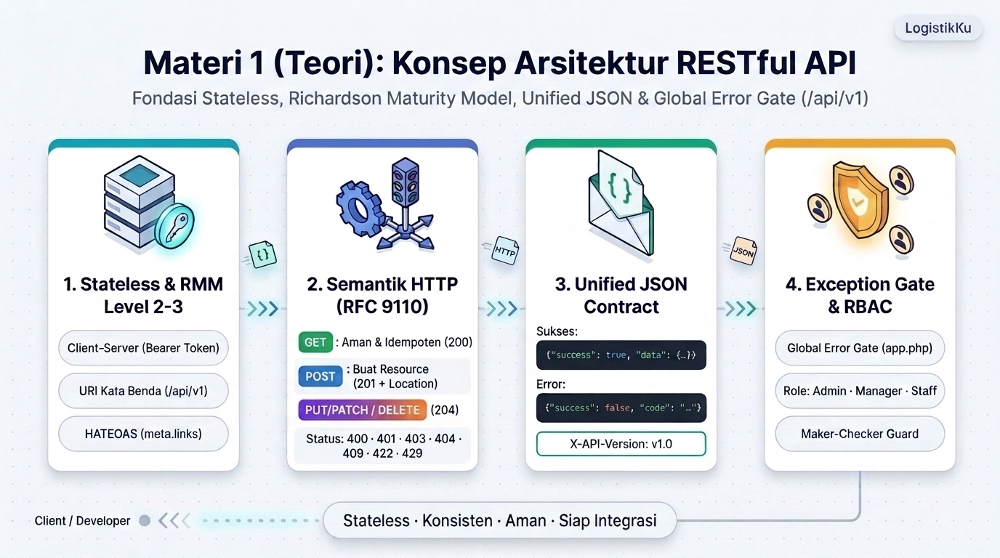
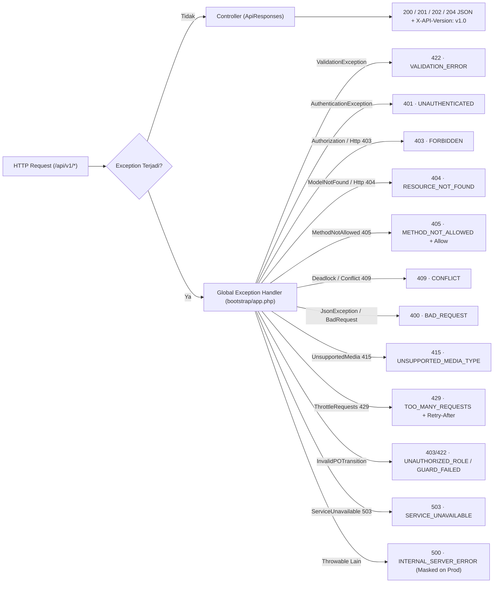

# LAPORAN KEGIATAN MAGANG PERIODE 4 (LIVING REPORT)
## Program MagangHub Kementerian Ketenagakerjaan Republik Indonesia (Kemnaker RI)
### Topik Periode 4: Arsitektur RESTful API, Integrasi Endpoint Internal, Pengujian Postman, & Dokumentasi OpenAPI (**LogistikKu**)

---

### Informasi Eksekutif & Identitas Pelaporan
- **Nama Peserta Magang / Role**: IT Programmer Intern 
- **Program**: MagangHub Kemnaker RI (Durasi Penuh: 6 Bulan)
- **Unit Kerja / Penempatan**: Tim it(`itbcslogistics`)
- **Nama Aplikasi / Proyek**: **LogistikKu** (Sistem Manajemen Inventaris, Pengadaan Multi-Gudang, & Analitik Logistik Terpadu)
- **Tech Stack Utama**: PHP 8.2+, Laravel 12, Laravel Sanctum 4, MySQL/MariaDB & SQLite, Python 3.10+ (OCR Tesseract & Prediksi ML), PHPUnit 11, Laravel Pint
- **Acuan Roadmap Teknis**: GitHub Issue `#12` — *Arsitektur RESTful API, Integrasi Endpoint Internal, Pengujian Postman & Dokumentasi OpenAPI*
- **Status Capaian Saat Ini *(per 18 November 2026)***: **Minggu 1 (Materi 1 — Teori & Desain Arsitektur API) 100% SELESAI & TERVERIFIKASI** (`517 Automated Tests PASS`, `5.509 Assertions`, `Laravel Pint PASSED`, `route:cache READY`)
- **Sifat Dokumen**: **Living Report Document** (Diperbarui bertahap setiap penyelesaian minggu hingga penutupan Periode 4 lengkap dengan bukti Postman & tautan OpenAPI).

---

## 1. Ringkasan Eksekutif & Peta Kurikulum Periode 4

Laporan ini mendokumentasikan landasan teori ilmiah, keputusan arsitektural, realisasi kode produksi, serta hasil verifikasi pengujian otomatis pada pengembangan **RESTful API LogistikKu (`/api/v1`)** selama **Periode 4**.

### 1.1 Peta Pelaksanaan 4 Minggu (GitHub Issue #12)

| Minggu | Materi Kurikulum Kemnaker RI | Fokus Pekerjaan & Output Utama | Status Saat Ini |
|---|---|---|---|
| **Minggu 1** | **Materi 1 (Teori & Desain Arsitektur)** — *4–5 Hari* | Konvensi endpoint `/api/v1`, standar HTTP Verbs & Status Code, `app/Traits/ApiResponses.php`, `ApiStatusController`, Global Exception Handler (`bootstrap/app.php`), & `docs/arsitektur_rest_api.md` + `ApiV1ArchitectureContractTest` | **Selesai 100%** |
| **Minggu 2** | **Materi 2 (Praktik Backend Endpoint)** — *4–5 Hari* | Endpoint `/api/v1/barang`, `/api/v1/barang/{id}/check-stock`, `/api/v1/stok/adjust`, `/api/v1/stok/transfer`, `/api/v1/purchase-orders`, & `JsonResource` | *Tahap Berikutnya* |
| **Minggu 3** | **Materi 3 (Keamanan Data & Pengujian Postman)** — *4–5 Hari* | Token Abilities Sanctum `/api/v1/auth/login`, Rate Limiter global, `config/cors.php`, Data Masking, Postman Collection (`docs/postman/LogistikKu_API_v1.postman_collection.json`), & `ApiEndpointsSecurityTest` | *Tahap Berikutnya* |
| **Minggu 4** | **Materi 4 (Dokumentasi OpenAPI & Finalisasi)** — *4–5 Hari* | Spesifikasi `docs/openapi.yaml`, Swagger UI `/docs/api`, Panduan Developer `docs/api_integration_guide.md`, & kelengkapan akhir laporan ini | *Tahap Berikutnya* |


---

## 2. 📚 Materi 1 (Teori | Minggu 1): Konsep Arsitektur RESTful API untuk Integrasi Sistem Bisnis

> **Tujuan Pembelajaran Minggu 1:** Memahami dan merancang arsitektur komunikasi antar-sistem berbasis **REST (*Representational State Transfer*)** secara teoretis maupun implementatif sebelum menulis endpoint bisnis, agar aplikasi eksternal (*Kasir/POS*, *Barcode Scanner Gudang*, dan *Sistem ERP*) dapat terintegrasi dengan **konsisten, terprediksi, aman, dan tahan perubahan skema (*decoupled*)**.



### 2.1 Mengapa Integrasi Bisnis Logistik Membutuhkan RESTful API & 6 Batasan REST (Fielding, 2000)

Pada Periode 1–3, **LogistikKu** telah matang melayani pengguna manusia melalui antarmuka Web berbasis **Blade + Session Auth**. Namun dalam ekosistem bisnis logistik modern, aplikasi internal gudang juga harus berkomunikasi langsung *machine-to-machine* tanpa browser—misalnya mesin **Kasir (POS)** yang mengecek sisa stok secara *real-time*, **Pemindai Barcode Genggam (*Handheld Scanner*)** saat barang tiba di dermaga gudang, maupun **Sistem ERP/Perencanaan Pengadaan**.

Untuk menjembatani integrasi antar-platform yang berbeda teknologi (PHP, JavaScript, Python, Android/Windows scanner), digunakan gaya arsitektur **REST (*Representational State Transfer*)** yang diperkenalkan oleh **Roy Thomas Fielding** dalam disertasi doktoralnya (*Architectural Styles and the Design of Network-based Software Architectures*, UC Irvine, 2000). REST menetapkan **enam batasan arsitektural (*architectural constraints*)**:

| No | Batasan Arsitektur REST | Makna Teoretis (Fielding, 2000) | Penerapan Nyata di LogistikKu (`/api/v1`) |
|---|---|---|---|
| **1** | ***Client-Server Separation*** | Antarmuka/aplikasi klien terpisah tegas dari penyimpan data & logika bisnis server. Kedua sisi dapat berkembang secara independen selama kontrak antarmuka tetap terjaga. | Aplikasi POS/Scanner tidak mengakses database MySQL atau service internal secara langsung; seluruh akses melewati gerbang HTTP `/api/v1/*` dan kontrak `JsonResource`. |
| **2** | ***Statelessness*** | Setiap permintaan (*request*) dari klien wajib membawa seluruh informasi autentikasi dan konteks yang diperlukan; server **tidak menyimpan state sesi klien** di memori antar-request. | API `/api/v1` tidak memakai cookie session/CSRF Web; setiap request wajib mandiri dengan header `Authorization: Bearer <sanctum-token>` dan `Accept: application/json`. |
| **3** | ***Cacheability*** | Respon harus secara eksplisit atau implisit menyatakan apakah data boleh di-*cache* oleh klien/proxy guna menekan latensi dan beban server. | Operasi baca `GET` dirancang *safe & idempotent* sehingga aman di-*cache*, sedangkan aksi perubahan state (`POST`/`PUT`/`PATCH`/`DELETE`) bersifat *non-cacheable*. |
| **4** | ***Uniform Interface*** | Interaksi antar-komponen menggunakan konvensi seragam: identifikasi resource lewat URI, manipulasi lewat representasi (JSON), pesan deskriptif-mandiri (*self-descriptive*), dan kontrol hipermedia (*HATEOAS*). | Diterapkan melalui struktur URI `/api/v1/{resource}`, header standar `X-API-Version: v1.0`, amplop JSON `ApiResponses`, serta tautan `meta.links` & `links.self`. |
| **5** | ***Layered System*** | Klien tidak perlu mengetahui apakah ia terhubung langsung ke server aplikasi atau melalui perantara (*reverse proxy*, *load balancer*, *API gateway*, atau *rate limiter*). | Middleware autentikasi (`auth:sanctum`), pembatasan peran (`role`), *Global Exception Handler* (`bootstrap/app.php`), dan *Rate Limiter* bekerja transparan di depan Controller. |
| **6** | ***Code-on-Demand* *(Opsional)*** | Server dapat mengirim potongan kode eksekusi ke klien (misal skrip) untuk memperluas fungsionalitas secara dinamis. | Bersifat opsional; API LogistikKu berfokus pada pertukaran representasi data murni berformat JSON (`application/json`). |

---

### 2.2 Model Kematangan REST (*Richardson Maturity Model* — Level 0 s/d Level 3)

Mengacu pada standar industri **Microsoft Azure Architecture Center (*Web API Design Best Practices*)**, tingkat kepatuhan suatu web service terhadap prinsip REST diukur menggunakan **Richardson Maturity Model (RMM)** yang dirumuskan oleh Leonard Richardson:

```text
Level 3 : Hypermedia Controls (HATEOAS)  ──► Respon menyertakan tautan navigasi (links: self/next/prev/first/last, Location)
   ▲
Level 2 : HTTP Verbs & Status Codes      ──► Menggunakan GET/POST/PUT/PATCH/DELETE + 200, 201, 400, 401, 403, 404, 409, 422, 429
   ▲
Level 1 : Resources                      ──► Memecah sistem ke banyak URI sumber daya (/barang, /purchase-orders)
   ▲
Level 0 : The Swamp of POX (RPC Tunggal) ──► Satu URI (POST /api/rpc) untuk semua aksi (dihindari di /api/v1)
```

1. **Level 0 (*Swamp of POX / RPC-style*):** Seluruh aksi dikirim ke satu endpoint tunggal memakai `POST` dengan nama fungsi di payload (contoh keliru: `POST /api/service` berisi `{"action": "cekStok"}`). Pola ini dihindari karena mengabaikan kemampuan protokol HTTP.
2. **Level 1 (*Resources*):** Sistem dipecah menjadi URI entitas bisnis yang jelas, namun sering masih memakai `POST` untuk semua operasi. Pada LogistikKu, setiap domain diorganisasikan memakai **kata benda (*nouns*)** terpisah (`/api/v1/barang`, `/api/v1/purchase-orders`), menghindari kata kerja di URI dasar, serta membatasi kedalaman hierarki maksimal `collection/{id}/sub-resource`.
3. **Level 2 (*HTTP Verbs & Status Codes*):** Memadukan URI resource dengan metode HTTP yang tepat serta HTTP Status Code standar sebagai sinyal hasil eksekusi yang bermakna bagi mesin klien. **LogistikKu `/api/v1` menerapkan Level 2 secara penuh.**
4. **Level 3 (*HATEOAS — Hypermedia as the Engine of Application State*):** Server menyisipkan tautan hipermedia di dalam respon maupun header agar klien dapat menavigasi halaman atau memantau resource baru secara otomatis tanpa *hardcoding* URL. **LogistikKu `/api/v1` mengadopsi elemen Level 3** pada `data.links.self` (`GET /api/v1/status`), `meta.links` (`first`, `last`, `prev`, `next`) di `paginatedResponse()`, serta header `Location` & `meta.status_url` pada respon `201 Created` dan `202 Accepted`.

---

### 2.3 Semantik Metode HTTP, *Safety*, & *Idempotency* (Standar IETF RFC 9110)

Berdasarkan spesifikasi protokol HTTP modern **RFC 9110 (*HTTP Semantics*, yang menggantikan RFC 7231)**, setiap HTTP verb memiliki kontrak perilaku yang wajib dipatuhi:

- ***Safe Method*:** Metode yang hanya bersifat membaca dan **tidak boleh mengubah state/data** pada server.
- ***Idempotent Method*:** Metode yang apabila dipanggil satu kali atau berkali-kali dengan payload identik, menghasilkan **efek akhir state yang sama** pada server (krusial untuk keandalan integrasi jaringan ketika klien melakukan *retry* setelah *timeout*).

| HTTP Verb | Operasi di LogistikKu | *Safe*? | *Idempotent*? | Status Sukses Standar | Aturan Implementasi |
|---|---|---|---|---|---|
| **`GET`** | Membaca status API, daftar/detail barang, cek stok real-time, riwayat PO | **Ya** | **Ya** | `200 OK` | Dilarang melakukan perubahan saldo atau insert mutasi saat memproses `GET`. |
| **`POST`** | Login/logout token, buat PO baru, mutasi/transfer stok, terima barang GRN | **Tidak** | **Tidak*** | `201 Created` (`+ Location`), `200 OK`, atau `202 Accepted` | Digunakan untuk pembuatan resource baru (`201`) atau pemrosesan transaksional/asinkron (`202`). |
| **`PUT`** | Mengganti seluruh representasi record secara utuh (misal pembaruan penuh draft PO) | **Tidak** | **Ya** | `200 OK` / `204 No Content` | Klien wajib mengirim seluruh field utama representasi resource. |
| **`PATCH`** | Pembaruan parsial sebagian atribut resource | **Tidak** | **Tidak selalu** | `200 OK` / `204 No Content` | Hanya memperbarui field yang dikirim pada payload JSON tanpa menimpa atribut lain. |
| **`DELETE`** | Menghapus/membatalkan resource pada URI target | **Tidak** | **Ya** | `200 OK` / `204 No Content` | Pemanggilan ulang atau penghapusan selesai ditangani konsisten tanpa merusak integritas historis. |

> **Catatan Arsitektur Kritis (*Idempotency Guard* pada Jaringan Gudang):** Pada operasi `POST` seperti penerimaan barang oleh pemindai *barcode*, gangguan Wi-Fi gudang dapat memicu *retry* request ganda. Karena itu LogistikKu memproteksi penerimaan barang dengan `receipt_token` & *Distributed Lock*, serta merekomendasikan penerapan kunci idempoten unik pada transaksi mutasi agar saldo gudang tidak pernah terpotong atau bertambah dua kali.

---

### 2.4 Teori *Unified API Response Contract*, *Schema Decoupling*, & Strategi *Versioning*

Salah satu kesalahan paling umum dalam integrasi API adalah mengembalikan objek model database secara langsung (*raw Eloquent model*) serta membiarkan format respon berbeda-beda antarkontroller. Berdasarkan audit sistem LogistikKu sebelum Periode 4, endpoint pra-v1 (`AuthController` dan `PurchaseOrderApiController`) masih mengembalikan struktur array JSON yang berbeda satu sama lain.

Untuk menyelesaikan masalah tersebut di Minggu 1, dirancang **Unified API Response Contract** pada `App\Traits\ApiResponses`:

1. ***Schema Decoupling* (Abstraksi Representasi Data):** API memisahkan skema tabel database dari payload publik menggunakan **`JsonResource`**, dan `ApiResponses::successResponse()` secara cerdas mengekstrak `JsonResource::resolve()` agar tidak terjadi pembungkusan ganda (`data.data`) maupun kebocoran kolom rahasia (`password`, `remember_token`).
2. **Keseragaman Amplop JSON (*Unified Envelope*):**
   - **Respon Sukses (`200`, `201`, `202`):** Selalu memuat kunci `success: true`, `message`, `data`, serta `meta` (`timestamp` ISO-8601, `version: "v1.0"`, ditambah atribut paginasi & `links` HATEOAS untuk daftar terpaginasi).
   - **Respon Gagal (`4xx`, `5xx`):** Selalu memuat kunci `success: false`, `message`, `errors` (**selalu bertipe JSON Object `{}`**, baik berisi rincian validasi per-field maupun `{}` saat error umum), dan `code` konstan bertipe *UPPER_SNAKE_CASE* yang mudah dipetakan aplikasi klien secara programatik.
3. **Strategi *API Versioning* Ganda (*URI Path* + *Response Header*):**
   - **URI Path Versioning (`/api/v1/...`):** Menjamin rute `/api/*` lama tetap kompatibel (*backward-compatible*) selama migrasi, mempermudah routing di `routes/api.php`, dan terbaca jelas pada log maupun Swagger UI.
   - **Header Versioning (`X-API-Version: v1.0`):** Dikembalikan pada **setiap** HTTP Response Header (sukses maupun gagal) untuk transparansi versi kontrak aktif. Perubahan bersifat *non-breaking* tetap berada di `v1`, sedangkan perubahan *breaking* hanya boleh diperkenalkan pada `/api/v2`.

---

### 2.5 Teori *Global Exception Handling* & Keamanan Otorisasi Berlapis (*Defense in Depth*)

Dalam aplikasi web biasa, kegagalan rute atau server sering kali dirender sebagai halaman HTML error Laravel. Untuk klien API (POS/Scanner), halaman HTML akan langsung memicu kegagalan *JSON parsing*. Selain itu, membocorkan jejak kode (*stack trace*) di lingkungan produksi merupakan celah keamanan serius (**OWASP API Security**).

Solusi arsitektural yang dibangun pada `bootstrap/app.php` adalah **Centralized Global Exception Rendering** khusus namespace `api/v1` dan `api/v1/*`:



Di sisi otorisasi, rancangan hak akses API menerapkan **Defense in Depth (Pertahanan Berlapis)** untuk tiga peran (`admin`, `manager`, `staff`):
1. **Lapisan Token & Abilities (Laravel Sanctum):** Autentikasi stateless via Bearer Token yang dibatasi sesuai hak peran user.
2. **Lapisan Kebijakan Domain (`Gate` & `PurchaseOrderPolicy`):** Menegakkan isolasi kewenangan bisnis (misal hanya `admin` yang mengelola master barang; `admin`/`staff` mencatat penerimaan fisik GRN; dan prinsip **Segregation of Duties / Maker-Checker** yang melarang `admin` maupun `manager` menyetujui/menolak PO buatannya sendiri).

---

## 3. Realisasi & Bukti Implementasi Teknis Minggu 1 (Tugas 1.1, 1.2, & 1.3)

Seluruh rancangan teoretis di atas telah diimplementasikan menjadi artefak kode nyata dan diuji secara otomatis di dalam codebase **LogistikKu**:

### 3.1 Daftar Artefak Kode & Dokumentasi Minggu 1

| Tugas Roadmap | Artefak yang Dibuat / Diperbarui | Peran Teknis dalam Sistem |
|---|---|---|
| **Tugas 1.1 & 1.2** | [`app/Traits/ApiResponses.php`](../app/Traits/ApiResponses.php) | Mendefinisikan `API_VERSION = 'v1.0'`, header otomatis `X-API-Version`, `successResponse` (`200`), `createdResponse` (`201 + Location`), `acceptedResponse` (`202 + Location + status_url`), `noContentResponse` (`204`), `paginatedResponse` (`+ HATEOAS meta.links`), `errorResponse` (`errors` selalu JSON Object `{}`), serta helper `badRequestResponse` (`400`), `unauthorizedResponse` (`401`), `forbiddenResponse` (`403`), `notFoundResponse` (`404`), `methodNotAllowedResponse` (`405 + Allow`), `conflictResponse` (`409`), `unsupportedMediaTypeResponse` (`415`), `validationErrorResponse` (`422`), & `tooManyRequestsResponse` (`429 + Retry-After`). |
| **Tugas 1.2** | [`app/Http/Controllers/Controller.php`](../app/Http/Controllers/Controller.php) | Mengintegrasikan trait `ApiResponses` pada base class `Controller` sehingga seluruh controller `/api/v1` langsung mewarisi kontrak JSON standar. |
| **Tugas 1.1 & 1.3** | [`bootstrap/app.php`](../bootstrap/app.php) | Menerapkan *Global Exception Handler* khusus `api/v1` dan `api/v1/*` (`shouldRenderJsonWhen` + pemetaan terstruktur 15+ jenis exception termasuk `DeadlockException` → `409`, `JsonException` → `400`, `ThrottleRequestsException` → `429`, dan `InvalidPurchaseOrderTransitionException`). |
| **Tugas 1.1** | [`app/Http/Controllers/Api/V1/ApiStatusController.php`](../app/Http/Controllers/Api/V1/ApiStatusController.php) & [`routes/api.php`](../routes/api.php) | Menyediakan endpoint aktif `GET /api/v1/status` (`api.v1.status`) menggunakan single-action controller (100% kompatibel dengan `php artisan route:cache`), sekaligus menjaga endpoint pra-v1 tetap aktif tanpa regresi. |
| **Tugas 1.3** | [`docs/arsitektur_rest_api.md`](../docs/arsitektur_rest_api.md) & [`docs/README.md`](../docs/README.md) | Menyusun spesifikasi lengkap arsitektur RESTful API `/api/v1` (prinsip stateless, RMM Level 2–3, konvensi URI, semantik HTTP & idempotensi, strategi versioning, 15 kode status HTTP, Global Exception Handler, serta Matriks Hak Akses per Role) dan memperbarui indeks dokumen. |
| **Visualisasi** | [`docs/images/periode-4-restful-api-flow.png`](./images/periode-4-restful-api-flow.png) & [`docs/images/teori-arsitektur-restful-api-minggu-1.png`](./images/teori-arsitektur-restful-api-minggu-1.png) | Diagram alur integrasi RESTful API `/api/v1` dan infografis 4 pilar teori arsitektur Minggu 1. |
| **Automated Test** | [`tests/Feature/ApiV1ArchitectureContractTest.php`](../tests/Feature/ApiV1ArchitectureContractTest.php) | Menguji secara menyeluruh kontrak sukses (`200`, `201`, `202`, `204`), HATEOAS `meta.links`, paginator kosong, interoperabilitas `PurchaseOrderResource` tanpa double-wrapping, dan Global Exception Handler (`400`, `401`, `403`, `404`, `405`, `409`, `415`, `422`, `429`, `503`). |

### 3.2 Contoh Respon Aktual Endpoint `GET /api/v1/status`

```json
{
  "success": true,
  "message": "Layanan RESTful API LogistikKu v1 siap digunakan",
  "data": {
    "service": "LogistikKu RESTful API",
    "architecture": "Stateless RESTful API (Laravel Sanctum Bearer Token)",
    "maturity_model": "Richardson Maturity Model Level 2-3 (REST + HATEOAS)",
    "status": "operational",
    "supported_verbs": ["GET", "POST", "PUT", "PATCH", "DELETE"],
    "documentation": "docs/arsitektur_rest_api.md",
    "links": {
      "self": "http://localhost/api/v1/status"
    }
  },
  "meta": {
    "timestamp": "2026-11-18T11:18:00+07:00",
    "version": "v1.0"
  }
}
```
*Header HTTP yang dikirimkan: `HTTP/1.1 200 OK`, `Content-Type: application/json`, `X-API-Version: v1.0`.*

### 3.3 Hasil Verifikasi & Kualitas Kode Minggu 1

```text
========================================================================================
                        HASIL VERIFIKASI OTOMATIS MINGGU 1
========================================================================================
  Route Cache Check : php artisan route:cache & route:list --path=api/v1 -> PASSED (0 closures)
  Code Style (PSR)  : php vendor/bin/pint --test -> {"tool":"pint","result":"passed"}
  Uji Kontrak API v1: ApiV1ArchitectureContractTest -> OK (8 tests, 170 assertions)
  Uji Regresi Penuh : php vendor/bin/phpunit --do-not-cache-result -> OK (517 tests, 5509 assertions)
========================================================================================
```

---

## 4. Rangkuman Lanjutan Periode 4 *(Tahap Minggu 2 s/d Minggu 4)*

Bagian ini disiapkan sesuai ketentuan **Tugas 4.4** untuk melengkapi laporan akhir Periode 4 seiring penyelesaian minggu berikutnya:

### 4.1 Minggu 2 — Implementasi Endpoint Integrasi Sistem Internal (`/api/v1/*`)
- *Status: Menunggu eksekusi Minggu 2.*
- Target cakupan:
  - API Master Barang & Cek Stok Real-Time (`GET /api/v1/barang`, `/api/v1/barang/{id}`, `/api/v1/barang/{id}/check-stock`).
  - API Mutasi & Transfer Stok Antar-Gudang (`POST /api/v1/stok/adjust`, `/api/v1/stok/transfer`).
  - API Pengadaan & Goods Receipt Scanner (`GET/POST /api/v1/purchase-orders`, `POST /api/v1/purchase-orders/{id}/receive`) dengan pembungkusan penuh `JsonResource`.

### 4.2 Minggu 3 — Keamanan Data & Bukti Pengujian Postman
- *Status: Menunggu eksekusi Minggu 3.*
- Target dokumen & bukti yang akan dilampirkan di bagian ini:
  - Koleksi Postman & Environment: `docs/postman/LogistikKu_API_v1.postman_collection.json`.
  - Tangkapan layar (*screenshot*) hasil eksekusi **Postman Collection Runner** (status test script `200`, `201`, `401`, `403`, `422`, `429`).
  - Ringkasan hasil uji keamanan otomatis (`tests/Feature/ApiEndpointsSecurityTest.php`), konfigurasi `config/cors.php`, `RateLimiter::for('api', ...)`, serta *token abilities* Laravel Sanctum.

### 4.3 Minggu 4 — Tautan Dokumentasi OpenAPI 3.0 & Panduan Developer
- *Status: Menunggu eksekusi Minggu 4.*
- Target tautan yang akan dilampirkan di bagian ini:
  - Spesifikasi OpenAPI 3.0 / Swagger: `docs/openapi.yaml`
  - Portal Dokumentasi API Interaktif (Swagger UI): `/docs/api`
  - Panduan Integrasi Pengembang (*cURL*, Python `requests`, JavaScript `fetch`/`axios`): `docs/api_integration_guide.md`

---

## 5. Daftar Referensi & Pustaka Teknis

Seluruh penyusunan teori dan arsitektur pada laporan ini merujuk kepada standar ilmiah dan dokumentasi teknis resmi berikut:

1. **Fielding, Roy Thomas (2000).** *Architectural Styles and the Design of Network-based Software Architectures* (Chapter 5: Representational State Transfer / REST). Doctoral Dissertation, University of California, Irvine.
2. **IETF RFC 9110 (2022).** *HTTP Semantics* — Roy T. Fielding, Mark Nottingham, Julian Reschke (Spesifikasi resmi metode HTTP, *safe/idempotent methods*, kode status HTTP, dan negosiasi konten). <https://httpwg.org/specs/rfc9110.html>
3. **Microsoft Azure Architecture Center.** *Desain Web API Terbaik (Web API Design Best Practices)* — Panduan *Resource Organization*, *Richardson Maturity Model*, *Filtering/Pagination*, *Versioning*, dan *HATEOAS*. <https://learn.microsoft.com/id-id/azure/architecture/best-practices/api-design>
4. **Fowler, Martin (2010).** *Richardson Maturity Model: Steps Toward the Glory of REST*. <https://martinfowler.com/articles/richardsonMaturityModel.html>
5. **OWASP Foundation.** *OWASP API Security Top 10* — Prinsip otorisasi, pembatasan laju permintaan (*rate limiting*), validasi input, dan pencegahan paparan data sensitif. <https://owasp.org/API-Security/>
6. **Laravel Official Documentation (v12.x).** *Eloquent API Resources*, *Laravel Sanctum*, & *Error Handling / Exception Rendering*. <https://laravel.com/docs/12.x>
