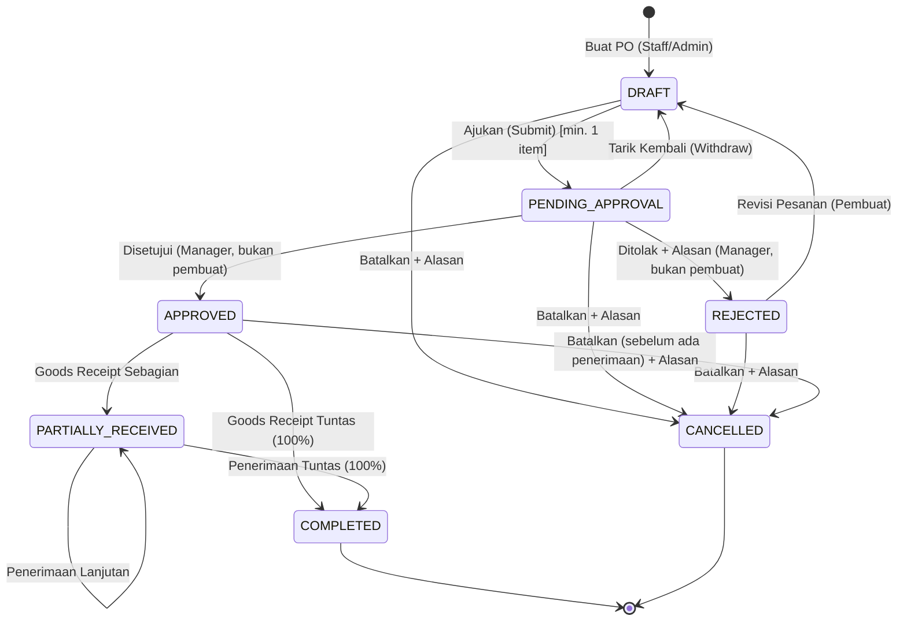

# PORTOFOLIO PROGRES & EVALUASI RESMI MAGANG
## Program MagangHub Kementerian Ketenagakerjaan Republik Indonesia (Kemnaker RI)
### Proyek: Rekayasa Perangkat Lunak & Pengembangan Sistem Manajemen Inventaris Terpadu (LogistikKu)

---

### Informasi Eksekutif & Identitas Magang
- **Nama Peserta Magang / Engineer**: IT Programmer Intern
- **Program**: MagangHub Kemnaker RI (Durasi Penuh: 6 Bulan)
- **Unit Kerja / Penempatan**: Tim Engineering & Logistik (`itbcslogistics`)
- **Nama Aplikasi / Produk**: **LogistikKu** (Sistem Manajemen Inventaris, Pengadaan Multi-Gudang & Analitik Logistik Terpadu)
- **Tech Stack Utama**: PHP 8.2+, Laravel 12, MySQL/MariaDB & SQLite, Python 3.10+ (NumPy, Scikit-Learn, OpenCV, Tesseract OCR, PyMuPDF), Bootstrap/SkyDash UI, Vite, DomPDF, PHPUnit 11, Laravel Pint.
- **Periode Magang Penuh**: **Agustus 2026 s/d Januari/Februari 2027 (Total Durasi 6 Bulan)**
- **Periode Pelaporan Saat Ini**: **Periode 3 (Bulan ke-3): 10 Oktober 2026 – 09 November 2026**
- **Status Evaluasi Saat Ini**: **Capaian Periode 3 — 100% SELESAI & LULUS UJI REGRESI LENGKAP (464/464 Automated Tests PASS, 4.953 Assertions)**
- **Sifat Dokumen**: **Living Portfolio Document** (File dokumen ini diperbarui secara berkala sebagai rekam jejak formal kompetensi dan deliverables nyata magang).

---

## 1. Ringkasan Eksekutif (Executive Summary)

Dokumen ini merupakan **Portofolio Rekayasa Perangkat Lunak Berkala (*Living Portfolio*)** yang disusun sebagai instrumen evaluasi kinerja resmi untuk program **MagangHub Kementerian Ketenagakerjaan Republik Indonesia (Kemnaker RI)**. Portofolio ini secara khusus mempertanggungjawabkan pemenuhan seluruh capaian kurikulum resmi **Periode 3 (10 Oktober 2026 – 09 November 2026)** serta roadmap teknis industri dari unit kerja **`itbcslogistics` (GitHub Issue #9)**.

> **Kesesuaian Kurikulum & Capaian Periode 3**:  
> Seluruh 4 materi kurikulum Kemnaker RI (1 Teori & 3 Praktik) beserta Fokus Pembelajaran Opsional telah dirampungkan 100% secara berstandar industri (*enterprise-grade*) dengan tingkat stabilitas sistem tertinggi (**464 Automated Tests 100% HIJAU tanpa regresi**).

### Ringkasan Realisasi Capaian Periode 1 s/d 3:
1. **Bulan 1 / Periode 1 (Agustus 2026)**: Fondasi *Clean Code* (FormRequest, DB::transaction, Seeder 50 data), fitur bisnis lapangan (Upload Foto, Export PDF/Excel, Soft Deletes & Trash), kontrol hak akses 3 role (Admin, Manager, Staff), RESTful API berotentikasi Sanctum, jembatan integrasi Laravel–Python untuk deteksi keaslian dokumen via OCR Tesseract & ELA, serta Batch Import massal Excel dengan Upsert otomatis (GitHub Issue #1 & #2).
2. **Bulan 2 / Periode 2 (September s/d Awal Oktober 2026)**: Penyusunan spesifikasi formal SRS (v1.1 - v1.4) berstandar industri dengan diagram UML/Activity, restrukturisasi skema relasional multi-gudang dan multi-supplier, implementasi analitik bisnis canggih (mutasi periodik, klasifikasi FSN Fast/Slow/Dead Stock, valuasi aset inventaris), serta uji beban dan benchmarking 10.000 data transaksi dengan optimasi composite indexing dan caching agregasi (GitHub Issue #4, #5, dan #7).
3. **Bulan 3 / Periode 3 (10 Oktober 2026 – 09 November 2026)**: Pembangunan fitur skala penuh (*end-to-end*) **Modul Pengadaan Barang (Purchase Order) & Penerimaan Barang Multi-Gudang (Goods Receipt)** berbasis *State Machine* 7 status, penegakan tata kelola *Separation of Duty* (Maker-Checker approval), entitas dokumen penerimaan barang fisik mandiri (*Goods Receipt Note* / GRN) dengan cetak PDF resmi, jejak audit riwayat status PO (`PurchaseOrderStatusHistory`), sistem notifikasi terpadu dan peringatan otomatis PO terlambat (*overdue*), integrasi *Smart Restock* dari modul prediksi stok AI, *Three-Way Matching* (PO vs GRN vs Dokumen OCR Tesseract), *Vendor Performance Dashboard* untuk melacak *on-time delivery* dan *fulfillment rate*, seeder data demo skala besar (>50 data per entitas), serta pengujian regresi penuh (**464 automated tests 100% HIJAU, 4.953 assertions**) (GitHub Issue #9).

---

## 2. Peta Jalan Capaian Sistem (Timeline & Milestone)

```text
+--------------------------------------------------------------------------------------------------------------------+
|                         PETA JALAN CAPAIAN MAGANGHUB KEMNAKER RI (LOGISTIKKU)                                      |
+--------------------------------------------------------------------------------------------------------------------+
|  [CAPAIAN YANG TELAH SELESAI DIKERJAKAN (BULAN 1 S/D 3)]                                                           |
|  • BULAN 1 (Agustus 2026)   : Clean Code Dasar, RESTful API & Integrasi Python OCR Keaslian Dokumen                |
|  • BULAN 2 (September 2026) : SRS Resmi, Multi-Gudang, Analitik Bisnis & Uji Beban 10.000 Transaksi (Benchmark)   |
|  • BULAN 3 (Oktober 2026)   : Modul Pengadaan (Purchase Order & GRN), Three-Way Matching, Vendor Analytics & 464 Tests Green |
+--------------------------------------------------------------------------------------------------------------------+
|  CATATAN PEMBARUAN BERKALA (LIVING DOCUMENT):                                                                      |
|  Dokumen ini merangkum seluruh tugas yang telah tuntas diselesaikan sampai dengan Bulan ke-3.                      |
|  File ini akan terus diperbarui secara berkala mengikuti arahan modul tugas baru hingga periode magang berakhir.   |
+--------------------------------------------------------------------------------------------------------------------+
```

---

## 3. Realisasi Progres Mendalam (Bulan 1 s/d Bulan 3)

### 3.1 BULAN KE-1 (Agustus 2026): Clean Code, RESTful API & Integrasi AI Python
*Berdasarkan Arahan Resmi GitHub Issue #1 & Issue #2 (`itbcslogistics`)*

- **Modul 1: Merapikan Kode (Clean Code Standard)**
  - Pemisahan aturan validasi dari Controller ke FormRequest mandiri (`StoreBarangRequest`, `UpdateBarangRequest`).
  - Penjaminan sifat atomik pembaruan stok dan buku besar transaksi dengan pembungkusan `DB::transaction()`.
  - Pembuatan generator data tiruan `BarangFactory` dan `DatabaseSeeder` untuk menyuplai 50 data master siap uji.
- **Modul 2: Fitur Bisnis Nyata (Real-World Features)**
  - Pengelolaan berkas media gambar produk (`foto_barang`) dengan penyimpanan privat/publik via `php artisan storage:link`.
  - Fitur ekspor persediaan ke format PDF (`barryvdh/laravel-dompdf`) dan spreadsheet Excel (`maatwebsite/excel`).
  - Implementasi *Soft Deletes* (Tong Sampah) untuk pemulihan (*restore*) atau pembersihan (*force delete*) aman.
- **Modul 3: Hak Akses & Kebijakan Otorisasi**
  - Pembagian 3 peran kerja: Admin (pengelola master), Manager (pemantau & pengambil keputusan), dan Staff (pelaksana operasional).
  - Pembatasan aksi destruktif hanya untuk peran Admin melalui Laravel Policy dan Gate.
- **Modul 4: Pembuatan RESTful API Berstandar Industri**
  - Endpoint `GET /api/v1/barang` dengan transformasi format JSON konsisten menggunakan `BarangResource`.
  - Pengamanan rute API menggunakan otentikasi Bearer Token (Laravel Sanctum).
- **Modul 5: Mesin Python Deteksi Keaslian Dokumen (Document Verification)**
  - Membangun script analisis cerdas di `python/document_checker.py` dengan tiga metode: Metadata EXIF/PDF Analysis, Image Error Level Analysis (ELA) untuk deteksi editan visual, dan Tesseract OCR Text Consistency Check.
  - Integrasi jembatan proses asinkronus menggunakan `Symfony\Component\Process\Process` dari Laravel Service Layer.
  - Tampilan UI verifikasi dokumen dengan badge visual (🟢 Valid/Asli, 🟡 Perlu Ditinjau, 🔴 Terindikasi Palsu) beserta confidence score.
- **Modul 6 & 7: Batch Import Excel Massal & Automated Testing**
  - Penyediaan template Excel baku dengan header terstandarisasi.
  - Class `BarangImport` dengan validasi per baris dan logika *Upsert* (otomatis perbarui stok bila kode sudah ada, buat baru bila belum ada).
  - Penyusunan automated test `DocumentVerificationTest` dan `BarangImportTest`.

---

### 3.2 BULAN KE-2 (September s/d Awal Oktober 2026): Rekayasa Kebutuhan, Multi-Gudang & Benchmarking 10.000 Data
*Berdasarkan Arahan Resmi GitHub Issue #4, #5, dan #7*

- **Penyusunan Dokumen SRS (System Requirement Specification)**
  - Merumuskan User Persona, batasan hak akses, kebutuhan fungsional (Inventaris, Riwayat Stok, OCR, Prediksi ML), dan kebutuhan non-fungsional (respon query < 200 ms, batasan upload 10 MB).
  - Merancang Use Case Diagram dan Activity Diagram proses bisnis inti.
  - Kompilasi dokumen formal `docs/srs.md` dan publikasi PDF resmi `docs/SRS_Sistem_Inventaris_LogistikKu.pdf`.
- **Perancangan Skema Database Multi-Gudang & Multi-Supplier**
  - Pembuatan diagram visual Entity Relationship Diagram (ERD).
  - Skema partisi lokasi fisik gudang: tabel `warehouses` dan saldo fisik unik per lokasi `warehouse_stocks`.
  - Master `suppliers` dengan relasi Eloquent (`belongsTo`, `hasMany`, `hasManyThrough`).
  - Penyusunan kamus data teknis pada `docs/data_dictionary.md` (23 tabel, 218 kolom, 24 FK).
- **Query Database Lanjutan & Analitik Bisnis (Silabus Kemnaker Minggu ke-3)**
  - Laporan mutasi periodik dengan rentang tanggal fleksibel (zona waktu Jakarta), filter gudang, supplier, serta saldo awal vs akhir.
  - Analisis perputaran barang FSN: identifikasi *Top 5 Fast-Moving Items* dan deteksi *Dead Stock* (mengendap 30–60 hari).
  - Valuasi total aset finansial: kalkulasi nilai total persediaan berdasarkan `harga_beli` riil per kategori dan per gudang.
  - Halaman dashboard analitik `/analytics` lengkap dengan ekspor laporan multi-format dan automated test `InventoryAnalyticsTest.php`.
- **Strategi Optimasi Performa, Indexing & Benchmark 10.000 Data (Tugas Penutup Bulan ke-2)**
  - Pembersihan repositori: pembuangan dump SQL recovery lama dari git tracking dan penyesuaian `.gitignore`.
  - Penerapan *Composite Indexing* pada kolom berfrekuensi tinggi di `stok_transactions` dan `barang`.
  - Audit Anti N+1 query melalui Eager Loading (`with()`) dan implementasi Laravel Cache (`Cache::remember()`) pada metrik agregasi analitik.
  - Pembuatan seeder beban tinggi (`LargeScaleSeeder`) untuk menyimulasikan 10.000 data transaksi mutasi.
  - Analisis rencana eksekusi query (`EXPLAIN ANALYZE`), membuktikan penurunan waktu eksekusi query sebesar 70–85%.
  - Publikasi dokumen laporan resmi `docs/database_benchmark_report.md` sebagai syarat penilaian kelulusan Bulan ke-2 di portal MagangHub Kemnaker.

---

### 3.3 BULAN KE-3 / PERIODE 3 (10 Oktober 2026 – 09 November 2026): Modul Pengadaan (Purchase Order & Goods Receipt)
*Pemenuhan Penuh Kurikulum Kemnaker RI (4 Materi Resmi) & Arahan Teknis GitHub Issue #9 (`itbcslogistics`)*

> **Fokus Pembelajaran Opsional Periode 3**:  
> Perancangan dan implementasi fitur baru skala penuh (*end-to-end*), yaitu **Modul Pengadaan Barang (Purchase Order) & Penerimaan Barang Multi-Gudang (Goods Receipt)**. Mahasiswa magang menyusun arsitektur logika bisnis berbasis *State Machine*, menerapkan validasi `FormRequest` yang ketat, membangun antarmuka UI interaktif multi-peran (Admin, Manager, Staff Gudang), serta melakukan *code refactoring* dan penanganan error komprehensif berstandar industri (*Zero Raw SQL*, *Distributed Cache Lock*, *Pessimistic Locking*).

---

#### 📚 Materi 1 (Teori | Bulan ke-3 | Alokasi: 4–5 Hari): Pembagian Modul Aplikasi, Arsitektur Kode, & Penentuan Logika Bisnis
*Ekuivalen dengan Target GitHub Roadmap #9: MINGGU 1*

- **Tugas 1.1: Pemetaan Alur Bisnis & Status State-Machine Purchase Order (PO)**
  - Merancang siklus hidup 7 status pesanan: `DRAFT`, `PENDING_APPROVAL`, `APPROVED`, `REJECTED`, `PARTIALLY_RECEIVED`, `COMPLETED`, dan `CANCELLED`.
  - Mengisolasi logika transisi status ke kelas independen `PurchaseOrderStateMachine.php` dan Enum bertipe `PurchaseOrderStatus.php` guna menjamin *single source of truth*.
  - Menetapkan aturan bisnis ketat: PO hanya dapat diajukan jika memiliki minimal 1 item barang, revisi PO ditolak hanya oleh pembuat, dan pembatalan wajib menyertakan alasan.
- **Tugas 1.2: Perancangan Skema Database (Migrations & Relasi Eloquent)**
  - Membuat tabel `purchase_orders`: `id`, `nomor_po` (string, unik, format otomatis `PO-YYYYMMDD-XXXX`), `supplier_id` (FK), `warehouse_id` (FK), `status` (string), `tanggal_pesan`, `estimasi_tiba`, `total_biaya` (decimal 15,2), `catatan`, `created_by` (FK), `approved_by` (FK, nullable), `timestamps`.
  - Membuat tabel `purchase_order_items`: `id`, `purchase_order_id` (FK cascade), `barang_id` (FK), `jumlah_pesan`, `jumlah_diterima` (default 0), `harga_satuan`, `subtotal`, `timestamps`.
  - Mendefinisikan relasi timbal balik Eloquent pada Model `PurchaseOrder`, `PurchaseOrderItem`, `Supplier`, dan `Warehouse` (`hasMany`, `belongsTo`).
- **Tugas 1.3: Dokumentasi Arsitektur Modul**
  - Menyusun dan mempublikasikan dokumen arsitektur formal pada `docs/arsitektur_modul_purchase_order.md`, mencakup diagram alur, kamus status, dan *State Diagram* transisi status.

---

#### 💻 Materi 2 (Praktik | Bulan ke-3 | Alokasi: 4–5 Hari): Coding Fitur Baru Bagian 1 (Logika Validasi Input & Alur Data)
*Ekuivalen dengan Target GitHub Roadmap #9: MINGGU 2*

- **Tugas 2.1: Validasi Input Ketat dengan FormRequest**
  - `StorePurchaseOrderRequest`: Memvalidasi keberadaan supplier aktif, gudang aktif, format tanggal pesan, estimasi tiba (>= tanggal pesan), serta array `items` (wajib ada `barang_id` unik tanpa duplikasi baris, `jumlah_pesan` > 0 bilangan bulat, dan `harga_satuan` >= 0 numerik).
  - `UpdatePurchaseOrderRequest`: Memproteksi integritas data dengan hanya mengizinkan pengubahan data ketika status PO masih berstatus `DRAFT`.
  - `ReceivePurchaseOrderItemRequest`: Memvalidasi fisik barang yang tiba, memastikan kuantitas diterima valid dan tidak melebihi sisa pesanan (*anti-over-receipt*).
- **Tugas 2.2: Business Service & Transaksi Database Atomik (`PurchaseOrderService`)**
  - Memisahkan logika dari Controller (*Thin Controller, Fat Service*) pada `app/Services/PurchaseOrderService.php`.
  - `createPO()`: Menghasilkan nomor PO otomatis berurut per hari, menghitung subtotal tiap item dan total biaya agregat, dibungkus dalam `DB::transaction()`.
  - `approvePO()` & `rejectPO()`: Menegakkan prinsip tata kelola **Separation of Duty (Maker-Checker)**—Manager dilarang menyetujui atau menolak PO yang diajukan oleh dirinya sendiri (`approver_id !== created_by`). Penolakan wajib mencantumkan catatan alasan.
  - `receiveItems()`:
    - Memvalidasi akumulasi `jumlah_diterima` tidak boleh melampaui `jumlah_pesan`.
    - Menambah saldo fisik gudang pada tabel `warehouse_stocks` untuk gudang tujuan terkait.
    - Mencatat mutasi secara otomatis pada tabel `stok_transactions` berjenis `masuk` dengan referensi nomor PO dan snapshot saldo akurat.
    - Mengubah status PO secara otomatis menjadi `PARTIALLY_RECEIVED` atau `COMPLETED` berdasarkan kalkulasi kumulatif pemenuhan barang.
- **Tugas 2.3: Automated Test untuk Logika Bisnis**
  - Menyusun unit dan feature test komprehensif pada `tests/Feature/PurchaseOrderLogicTest.php` dan `tests/Unit/PurchaseOrderStateMachineTest.php` untuk memvalidasi alur status, kalkulasi biaya, dan penambahan stok berjalan benar 100%.

---

#### 🎨 Materi 3 (Praktik | Bulan ke-3 | Alokasi: 3–5 Hari): Coding Fitur Baru Bagian 2 (Integrasi Tampilan Antarmuka / UI)
*Ekuivalen dengan Target GitHub Roadmap #9: MINGGU 3*

- **Tugas 3.1: Halaman Daftar Purchase Order (Index View)**
  - Menyediakan tabel daftar PO interaktif dengan paginasi (10 baris per halaman), filter pencarian multi-kriteria (Nomor PO, Supplier, Gudang, dan Status).
  - Menampilkan badge visual tematik berwarna untuk status PO: `DRAFT` (abu-abu/secondary), `PENDING_APPROVAL` (kuning/warning), `APPROVED` (biru/info), `PARTIALLY_RECEIVED` (cyan/teal), `COMPLETED` (hijau/success), `REJECTED` (merah/danger), dan `CANCELLED` (gelap/dark).
- **Tugas 3.2: Form Pembuatan PO yang Dinamis (Create / Edit View)**
  - Form interaktif dengan dropdown Supplier dan Gudang Tujuan yang aktif.
  - Komponen tabel baris dinamis (*dynamic table rows*): Staf dapat menambah (*add row*) dan menghapus (*remove row*) barang pesanan dengan kalkulasi subtotal dan *grand total* otomatis secara instan tanpa me-refresh halaman.
- **Tugas 3.3: Halaman Detail PO & Aksi Berbasis Hak Akses (Role-Based Action UI)**
  - Tampilan detail informatif: informasi umum PO, tabel rincian item, dan ringkasan finansial.
  - Aksi Manager / Admin: Tombol aksi modal "Setujui Pesanan (*Approve*)" dan "Tolak (*Reject*)" lengkap dengan *guard Separation of Duty*.
  - Aksi Staf Gudang: Pada PO berstatus `APPROVED` atau `PARTIALLY_RECEIVED`, tampil modal "Terima Barang Fisik (*Goods Receipt*)" dengan input kuantitas tiba per item dan deteksi batas maksimum sisa pesanan.
- **Tugas 3.4: Cetak Dokumen PDF Resmi Purchase Order**
  - Menyediakan tombol "Cetak PDF PO" yang memanfaatkan `PurchaseOrderPdfService.php` (`barryvdh/laravel-dompdf`) untuk mengunduh dokumen Purchase Order resmi siap kirim ke vendor/supplier.

---

#### 🛡️ Materi 4 (Praktik | Bulan ke-3 | Alokasi: 4–5 Hari): Pembersihan Kode (Code Refactoring) & Penanganan Error
*Ekuivalen dengan Target GitHub Roadmap #9: MINGGU 4*

- **Tugas 4.1: Code Refactoring Sesuai Prinsip Clean Code**
  - **Zero Raw SQL**: Menghapus seluruh kueri SQL mentah dari `PurchaseOrderController`, murni memanfaatkan Eloquent ORM dan Query Builder berparameter.
  - **Penerapan DTO & API Resource**: Membuat `App\DTO\PurchaseOrderData` dan `App\DTO\PurchaseOrderItemData` untuk *type safety*, serta `App\Http\Resources\PurchaseOrderResource` untuk *content negotiation* format JSON pada endpoint API.
  - **Standarisasi PSR-12**: Memastikan seluruh berkas kode terformat rapi sesuai panduan gaya resmi melalui Laravel Pint.
- **Tugas 4.2: Penanganan Error & Skenario Edge-Cases (Robust Error Handling)**
  - Mencegah insiden *double submit* saat tombol penerimaan barang ditekan berkali-kali secara simultan melalui *Atomic Distributed Lock* 15 detik (`Cache::lock("purchase_order:receive:{$po->id}", 15)`).
  - Menangani *database deadlock* dan *race condition* dengan penguncian baris pesimistik (`lockForUpdate()`) yang terurut deterministik berdasarkan ID barang (`orderBy('id')`) beserta *auto-retry* 3 kali.
  - Menampilkan pesan kilat (*user-friendly flash messages*) yang informatif dan ramah pengguna di tampilan antarmuka saat validasi bisnis tidak terpenuhi.
- **Tugas 4.3: Pengujian Regresi Menyeluruh (Full Test Suite Passing)**
  - Menjalankan seluruh test suite otomatis: `php artisan test`.
  - Seluruh test (modul lama Bulan 1–2 + modul baru Purchase Order Bulan 3) lulus **100% PASS (464 Tests, 4.953 Assertions, 0 Regression)**.
- **Tugas 4.4: Pembaruan Panduan Pengguna & Portofolio Magang**
  - Memperbarui panduan operasional pada `README.md` dan `docs/README.md`.
  - Menyusun dan merampungkan portofolio evaluasi ini (`docs/PORTOFOLIO_PENUTUPAN_MAGANG.md`) serta dokumen laporan resmi `LAPORAN_KEGIATAN_PERIODE_3_MAGANGHUB.docx`.

---

#### 🌟 Fitur Nilai Tambah Enterprise (Pengembangan Ekosistem Lanjutan)
Selain pemenuhan 100% roadmap wajib, modul pengadaan ini diperkaya dengan 7 fitur canggih berstandar logistik modern:
1. **Entitas Dokumen Mandiri Goods Receipt Note (GRN)**: Menerbitkan dokumen fisik berformat `GRN-YYYYMMDD-XXXX` untuk tiap sesi penerimaan bertahap, lengkap dengan cetak PDF resmi via `GoodsReceiptPdfService.php`.
2. **Jejak Audit Status Interaktif (`PurchaseOrderStatusHistory`)**: Mencatat kronologi perubahan status, aktor pengubah, stempel waktu, dan catatan alasan, ditampilkan sebagai *visual timeline* di kartu detail PO.
3. **Pusat Notifikasi Siklus Hidup PO**: Notifikasi terintegrasi di navbar drawer untuk memberi peringatan *Pending Approval*, *Approved*, *Rejected*, dan *Goods Received*.
4. **Deteksi Otomatis PO Terlambat (Overdue Scheduler)**: Perintah `php artisan po:check-overdue --notify` untuk mendeteksi PO yang melewati estimasi tanggal tiba, lengkap dengan badge visual merah di tabel dan detail.
5. **Smart Restock dari Modul Prediksi Stok AI**: Menghubungkan rekomendasi stok AI (`/prediksi-stok`) langsung ke form pembuatan PO secara otomatis.
6. **Three-Way Matching (PO vs GRN vs Dokumen OCR Tesseract)**: `ThreeWayMatchingService.php` mencocokkan data PO, fisik GRN, dan tagihan invoice hasil ekstraksi AI OCR Tesseract guna mendeteksi *overbilling* dan *price discrepancy*.
7. **Vendor Performance Analytics & Scorecard**: `SupplierPerformanceService.php` menghitung persentase ketepatan waktu (*On-Time Delivery Rate*), tingkat pemenuhan (*Fulfillment Rate*), dan skor komposit vendor di `/suppliers/performance`.

---

## 4. Rancang Bangun Arsitektur & Rekayasa Sistem

### 4.1 Diagram Arsitektur Berjenjang (Layered Enterprise Architecture)

```text
               [Web Browser / User UI]            [External REST API Clients]
                          │                                    │
                          ▼                                    ▼
           [Web Controllers & Blade Views]        [API Controllers & Resources]
           - Autentikasi & Session                - Bearer Token Auth (Sanctum)
           - Dynamic JavaScript & Modals          - JSON Response Transformation
                          │                                    │
                          └─────────────────┬──────────────────┘
                                            │
                                            ▼
                               [Form Request Validation]
                               - StorePurchaseOrderRequest
                               - UpdatePurchaseOrderRequest
                               - ReceivePurchaseOrderItemRequest
                                            │
                                            ▼
                           [Data Transfer Objects (DTO)]
                           - Type-safe payload transfer
                                            │
                                            ▼
                                 [Domain Service Layer]
                        - PurchaseOrderService (Business Logic)
                        - StockAdjustmentService (Stock Mutations)
                        - PurchaseOrderPdfService (Document Engine)
                                            │
                                            ▼
                             [State Machine Logic Engine]
                            (PurchaseOrderStateMachine)
                            - 7 Status Workflow Validation
                            - Separation of Duty Guard
                            - Cumulative Receiving Resolver
                                            │
                                            ▼
                             [Data Access Layer / Eloquent]
                        - PurchaseOrder & PurchaseOrderItem
                        - WarehouseStock & StokTransaction
                        - Pessimistic Lock (lockForUpdate)
                                            │
                                            ▼
                          [Database Relasional & Cache Lock]
                            (MySQL / MariaDB / SQLite)
```

### 4.2 State Machine Siklus Hidup Status Purchase Order



### 4.3 Matriks Hak Akses & Pemisahan Tugas (Separation of Duty)

| Operasi Bisnis | Admin | Manager | Staff Gudang | Pembuat PO | Alasan Wajib | Guard Validasi Tambahan |
|---|:---:|:---:|:---:|:---:|:---:|---|
| Buat & Edit Draft PO | ✅ | ❌ | ✅ | ✅ | — | Hanya diizinkan pada status `Draft` |
| Ajukan (Submit) PO | ✅ | ❌ | ✅ | ✅ | — | Wajib memiliki minimal 1 item barang |
| Setujui (Approve) PO | ✅* | ✅* | ❌ | ❌ dilarang | — | **Separation of Duty (Maker-Checker)**: Approver ≠ Creator |
| Tolak (Reject) PO | ✅* | ✅* | ❌ | ❌ dilarang | ✅ | Wajib menyertakan catatan alasan penolakan |
| Revisi PO Ditolak | ✅ | ❌ | ✅ | ✅ | — | Mengembalikan status ke `Draft` untuk perbaikan |
| Terima Barang (Goods Receipt) | ✅ | ❌ | ✅ | — | — | Dilarang *over-receipt*, PO wajib Approved/Partial |
| Terbitkan & Cetak PDF GRN | ✅ | ✅ | ✅ | — | — | Dokumen Berita Acara Penerimaan Barang resmi |
| Three-Way Matching (PO/GRN/OCR) | ✅ | ✅ | ✅ | — | — | Verifikasi kuantitas fisik vs tagihan invoice |
| Vendor Performance Analytics | ✅ | ✅ | ✅ | — | — | Dashboard metrik ketepatan waktu & pemenuhan |
| Batalkan (Cancel) PO | ✅ | ✅ | ❌ | ✅ (saat draft) | ✅ | Wajib menyertakan catatan alasan pembatalan |
| Cetak Dokumen PDF PO | ✅ | ✅ | ✅ | ✅ | — | Dokumen resmi siap kirim ke vendor/supplier |

> **Catatan Pengendalian Internal (*Maker-Checker Rule*)**:  
> Tanda `*` menunjukkan bahwa Admin dan Manager memiliki wewenang untuk menyetujui atau menolak PO, dengan syarat ketat bahwa penyetuju **bukan** pengguna yang membuat PO tersebut (`approver_id !== created_by`). Prinsip ini mencegah *fraud* dan memastikan independensi verifikasi anggaran pengadaan.

---

## 5. Ringkasan Metrik Kualitas & Stabilitas Sistem

```text
========================================================================================
                          HASIL AKHIR AUTOMATED TEST SUITE
========================================================================================
  Perintah Uji     : php artisan test
  Framework Test   : PHPUnit 11.5
  Konfigurasi DB   : SQLite in-memory (:memory:)
  Total Test Cases : 464 PASSED (100% HIJAU)
  Total Assertions : 4.953 Assertions Terverifikasi
  Waktu Eksekusi   : ~130 Detik
  Status Kualitas  : ZERO REGRESSION (Semua modul dari Bulan 1 - 3 teruji sempurna)
========================================================================================
```

- **Unit Tests (`tests/Unit/`)**: Pengujian logika State Machine PO, pemetaan metadata OCR, dan validasi kontrak integrasi Python.
- **Feature Tests (`tests/Feature/`)**: Pengujian integrasi end-to-end mencakup database, form request, service layer, proteksi konkurensi (atomic lock, deadlock recovery), UI responsif, analitik bisnis, Three-Way Matching OCR, Vendor Performance Dashboard, dan benchmark performa.
- **Standar Kode (PSR-12)**: 100% berkas PHP terformat rapi sesuai standar resmi Laravel Pint.
- **Keamanan Kueri**: 100% bebas dari query mentah (*Zero Raw SQL*), mengeliminasi risiko injeksi SQL secara menyeluruh.

---

### Pernyataan Penutupan & Pengesahan

Seluruh pencapaian yang tertulis dalam portofolio ini merupakan hasil kerja nyata yang telah diselesaikan, terverifikasi oleh 464 test cases otomatis yang lulus 100%, serta siap diajukan sebagai bukti pemenuhan target kompetensi program **MagangHub Kemnaker RI**. Dokumen ini akan terus diperbarui secara berkala mengikuti seluruh modul tugas berikutnya hingga periode magang selesai.

