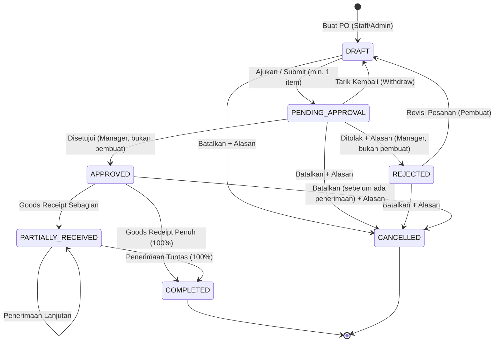

# PORTOFOLIO PENUTUPAN MAGANG
## Rekayasa Perangkat Lunak & Pengembangan Sistem Manajemen Inventaris Terpadu (LogistikKu)

---

### Informasi Dokumen & Profil Pengembang
- **Nama Sistem**: LogistikKu — Sistem Manajemen Inventaris, Pengadaan Multi-Gudang & Analitik Logistik Terpadu
- **Peran**: Software Engineer Intern (Backend & Fullstack Engineering)
- **Teknologi Utama**: PHP 8.2+, Laravel 12, MySQL/MariaDB & SQLite, Python 3.10+ (NumPy, Scikit-Learn, PyMuPDF, Tesseract OCR), Bootstrap/SkyDash UI, Vite, DomPDF, PHPUnit 11, Laravel Pint.
- **Periode Pelaksanaan**: Program Magang Rekayasa Perangkat Lunak Logistik & Rantai Pasok
- **Status Akhir Proyek**: **100% Selesai & Lulus Uji Regresi Penuh (Full Test Suite 439/439 PASS)**

---

## 1. Ringkasan Eksekutif (Executive Summary)

LogistikKu adalah platform enterprise web-based yang dirancang untuk menjawab kompleksitas pengelolaan inventaris modern, pergudangan multi-lokasi (*multi-warehouse*), pemetaan pemasok (*multi-supplier*), otomasi pengadaan barang (*Purchase Order & Goods Receipt*), rekonsiliasi buku besar mutasi stok, hingga integrasi kecerdasan buatan (*AI/ML*) untuk prediksi kebutuhan restock dan verifikasi dokumen logistik berbasis OCR.

Selama program magang berlangsung, kontribusi teknis difokuskan pada perancangan arsitektur berstandar industri (*Enterprise Architecture*), penulisan kode bersih (*Clean Code*), jaminan integritas data tingkat tinggi (*ACID compliance*), mitigasi konkurensi tingkat lanjut (*pessimistic locking, deadlock prevention, double-submit protection*), dan pembangunan rangkaian pengujian otomatis (*Automated Testing Suite*).

Pencapaian puncak modul:
1. **Penyelesaian Modul Pengadaan (Purchase Order & Goods Receipt Multi-Gudang)** dengan alur *state-machine* 7 status, *Separation of Duty*, dan integrasi penambahan saldo gudang fisik secara atomik.
2. **Refactoring Arsitektur Bersih**: 100% *Zero Raw SQL* (menghilangkan celah SQL injection), implementasi *Data Transfer Objects* (DTO), *API Resources*, dan standarisasi kode PSR-12 menggunakan Laravel Pint.
3. **Pengujian Regresi Menyeluruh**: Menjalankan dan meloloskan **439 automated test cases (4.798 assertions)** dengan status **100% HIJAU (PASS)** tanpa ada kegagalan maupun regresi pada fitur lawas.
4. **Dokumentasi Komprehensif**: Penulisan panduan pengguna, spesifikasi teknis arsitektur, dan runbook operasional yang siap diserahterimakan (*handover ready*).

---

## 2. Kilas Balik Milestone Proyek Magang (Fase 1 s/d Fase 4)

```text
+---------------------------------------------------------------------------------------------------+
|                                 MILESTONE TIMELINE LOGISTIKKU                                     |
+---------------------------------------------------------------------------------------------------+
|  FASE 1: Fondasi & Data Master     --> Multi-Gudang, Multi-Supplier, Kode Unik BRG-XXXXXX         |
|  FASE 2: Transaksi & Konkurensi    --> Mutasi Real-Time, Audit Snapshot, Laporan Multi-Format     |
|  FASE 3: Analitik & AI/ML Service  --> Valuasi Stok, FSN Turnover, Prediksi ML & OCR Tesseract    |
|  FASE 4: Pengadaan & Clean Code    --> Purchase Order, Goods Receipt, DTO, 439 Tests 100% PASS    |
+---------------------------------------------------------------------------------------------------+
```

### Fase 1: Fondasi Sistem, Standardisasi Kode & Arsitektur Database Relasional
- Perancangan skema database multi-gudang (`warehouses`, `warehouse_stocks`) dan multi-supplier (`suppliers`).
- Implementasi generator kode barang terstandarisasi format otomatis `BRG-XXXXXX` yang aman dari *race condition* dan pengulangan kode barang yang telah di-*soft-delete*.
- Pengaturan constraint database relasional, *foreign key cascade/restrict/null on delete*, serta integritas saldo non-negatif.
- Fitur import massal berbasis file (XLSX, XLS, CSV) secara atomik dengan rollback otomatis jika ditemukan anomali baris data.

### Fase 2: Transaksi Stok Real-Time, Audit Trail Snapshot & Penanganan Konkurensi
- Implementasi transaksi stok masuk (*incoming*), stok keluar (*outgoing*), dan transfer saldo antar-gudang (*stock transfer*).
- Mekanisme *Audit Trail Snapshot*: setiap mutasi membukukan nama pelaku (`stok_transaction_actors`), data supplier saat transaksi, serta snapshot saldo sebelum dan sesudah mutasi.
- Mekanisme pembalikan transaksi (*reversal*) yang aman bagi role Admin dan Manager tanpa merusak riwayat transaksi historis.
- Pembuatan modul Laporan Mutasi Stok dengan filter canggih (rentang tanggal zona waktu Jakarta, gudang, supplier, kategori) serta kemampuan ekspor ke tiga format resmi: CSV, XLSX, dan PDF.

### Fase 3: Analitik Bisnis Cerdas, Valuasi Finansial & Integrasi AI/ML
- Dashboard analitik bisnis cerdas: klasifikasi barang bergerak cepat (*Fast Moving*), lambat (*Slow Moving*), dan mati (*Dead Stock* / FSN Analysis).
- Kalkulasi valuasi nilai persediaan berbasis harga beli riil, ringkasan per kategori, dan perbandingan saldo master vs saldo gudang.
- Integrasi asinkronus ke mesin Python via Laravel Database Queue dan Symfony Process:
  - **Prediksi Kebutuhan Stok**: Analisis histori pengeluaran stok dengan metode berjenjang (*cold-start*, rata-rata sederhana, dan regresi linear Scikit-Learn) untuk merekomendasikan restock optimal.
  - **Verifikasi Dokumen OCR**: Pemrosesan berkas PDF/gambar Surat Jalan dan Faktur menggunakan OpenCV dan Tesseract OCR, ekstraksi metadata nomor PO, validasi keaslian, dan audit log.
- Pusat Notifikasi terpadu untuk memberikan peringatan dini stok menipis, anomali dokumen, dan hasil rekomendasi prediksi.

### Fase 4: Modul Pengadaan (Purchase Order & Goods Receipt), Clean Code & Regresi Penuh
- **Perancangan Modul Purchase Order**:
  - Penomoran otomatis berurutan format `PO-YYYYMMDD-XXXX`.
  - Formulir dinamis penambahan multi-item pesanan dengan kalkulasi subtotal dan akumulasi total biaya *real-time*.
  - *State Machine* 7 status (`draft`, `pending_approval`, `approved`, `rejected`, `partially_received`, `completed`, `cancelled`).
  - Aturan *Separation of Duty*: Manager dilarang menyetujui atau menolak PO yang diajukan oleh dirinya sendiri.
  - *Goods Receipt*: Pencatatan fisik kedatangan barang di gudang tujuan dengan pemutakhiran saldo `warehouse_stocks` dan pencatatan mutasi masuk secara atomik.
  - Validasi pencegahan *over-receipt* (kuantitas diterima tidak boleh melampaui sisa pesanan).
  - Cetak dokumen resmi Purchase Order format PDF.
- **Refactoring Arsitektur Bersih (Clean Code)**:
  - *Zero Raw SQL*: Mengubah seluruh query `DB::select` dan `DB::statement` menjadi ekspresi Eloquent dan Query Builder yang terkompilasi aman dan berparameter.
  - *Data Transfer Objects* (`PurchaseOrderData`, `PurchaseOrderItemData`) untuk tipe data yang ketat (*type-safe*).
  - *API Resources* (`PurchaseOrderResource`, `PurchaseOrderItemResource`) untuk standardisasi respons antarmuka internal dan REST API.
  - Penyesuaian standar gaya kode PSR-12 secara otomatis dengan Laravel Pint.
- **Mitigasi Konkurensi & Error Handling Ramah Pengguna**:
  - *Pessimistic Locking* (`lockForUpdate`) dengan urutan penguncian deterministik berdasarkan `id` barang untuk mengeliminasi potensi *deadlock*.
  - *Atomic Cache Lock* (15 detik) untuk mencegah insiden *double submit* saat jaringan lambat atau penekanan berulang oleh pengguna.
  - Penyampaian pesan error yang humanis (*user-friendly flash messages*) menggantikan pesan teknis database.
- **Pengujian Regresi Menyeluruh (Full Test Suite Passing)**:
  - Menjalankan 439 automated test cases; seluruhnya lulus 100% HIJAU.

---

## 3. Rancang Bangun & Arsitektur Perangkat Lunak

### 3.1 Pola Desain Berjenjang (Layered Architecture)

Aplikasi LogistikKu dibangun dengan pemisahan tanggung jawab yang tegas:

```text
[HTTP Requests / Web Browser / API Clients]
                    │
                    ▼
       [Controllers / FormRequests]
       - Validasi payload & otorisasi peran
       - Mengonversi request ke DTO
                    │
                    ▼
         [Domain Service Layer]
  (PurchaseOrderService, StockAdjustmentService)
  - Mengelola transaksi database (DB::transaction)
  - Koordinasi atomic lock & pessimistic lock
                    │
                    ▼
        [State Machine Engine]
    (PurchaseOrderStateMachine)
    - Validasi aturan transisi 7 status
    - Guard bisnis & Separation of Duty
                    │
                    ▼
         [Data Layer / Eloquent]
    (PurchaseOrder, PurchaseOrderItem, etc.)
    - Relasi tabel, scoping query, soft delete
                    │
                    ▼
          [Database Relasional]
       (SQLite / MySQL / MariaDB)
```

### 3.2 State Machine Siklus Hidup Purchase Order



### 3.3 Matriks Hak Akses & Pemisahan Tugas (Separation of Duty)

| Operasi Bisnis | Admin | Manager | Staff Gudang | Pembuat PO | Alasan Wajib | Guard Tambahan |
|---|:---:|:---:|:---:|:---:|:---:|---|
| Buat & Edit Draft PO | ✅ | ❌ | ✅ | ✅ | — | Hanya saat berstatus `Draft` |
| Ajukan (Submit) PO | ✅ | ❌ | ✅ | ✅ | — | Minimal terdapat 1 item barang |
| Setujui (Approve) PO | ❌ | ✅ | ❌ | ❌ dilarang | — | **Separation of Duty**: Approver ≠ Creator |
| Tolak (Reject) PO | ❌ | ✅ | ❌ | ❌ dilarang | ✅ | Wajib mengisi alasan penolakan |
| Revisi (Revise) PO Ditolak | ✅ | ❌ | ✅ | ✅ | — | Mengembalikan status ke `Draft` |
| Terima Barang (Goods Receipt)| ✅ | ❌ | ✅ | — | — | Dilarang *over-receipt*, PO wajib Approved/Partial |
| Batalkan (Cancel) PO | ✅ | ✅ | ❌ | ✅ (saat draft) | ✅ | Wajib mengisi alasan pembatalan |
| Cetak Dokumen PDF PO | ✅ | ✅ | ✅ | ✅ | — | Dokumen resmi siap cetak |

---

## 4. Rekayasa Integritas Data & Penanganan Konkurensi

Dalam ekosistem pergudangan dengan banyak staf dan transaksi paralel, anomali data seperti *race condition*, *deadlock*, dan *double submit* dapat menyebabkan selisih persediaan fisik yang fatal. Modul yang dibangun mengimplementasikan pertahanan tiga lapis:

1. **Pencegahan Double Submit (Atomic Cache Lock)**:
   - Pada metode `PurchaseOrderService::receiveItems()`, sistem meminta kunci atomik `purchase_order:receive:{id}` berdurasi 15 detik menggunakan `Cache::lock(..., 15)->get()`.
   - Jika request kedua tiba saat request pertama masih dieksekusi (misalnya pengguna mengklik ganda tombol akibat koneksi lambat), request kedua langsung ditolak dengan pesan validasi yang ramah tanpa menimbulkan mutasi ganda.
2. **Pessimistic Locking & Urutan Deterministik Anti-Deadlock**:
   - Header PO dikunci menggunakan `PurchaseOrder::lockForUpdate()`.
   - Item-item pesanan dikunci dengan urutan seragam: `PurchaseOrderItem::where(...)->orderBy('id')->lockForUpdate()`.
   - Urutan penguncian deterministik ini menjamin tidak terjadinya siklus tunggu melingkar (*circular wait*) yang menjadi akar penyebab *deadlock* pada transaksi konkuren.
3. **Pencegahan Over-Receipt**:
   - Sistem memvalidasi akumulasi penerimaan fisik secara ketat: `(jumlah_diterima_sebelumnya + jumlah_diterima_baru) <= jumlah_pesan`.
   - Setiap upaya penerimaan melebihi kuantitas pesanan digagalkan secara otomatis dan transaksi di-*rollback*.

---

## 5. Metrik Kualitas & Hasil Pengujian Regresi (Regression Testing)

Pengujian kualitas dilakukan secara menyeluruh menggunakan PHPUnit 11 dan Laravel Test Suite:

```text
========================================================================================
                          HASIL PENGUJIAN REGRESI OTOMATIS
========================================================================================
  Perintah Uji     : php artisan test
  Konfigurasi DB   : SQLite in-memory (:memory:)
  Total Test Cases : 439 PASSED (100% HIJAU)
  Total Assertions : 4.798 Assertions
  Durasi Eksekusi  : ~126 Detik
  Status Regresi   : ZERO REGRESSION (Fitur lama & Fitur baru berfungsi sempurna)
========================================================================================
```

### Rincian Cakupan Modul Test Suite
- **Unit Tests (`tests/Unit/`)**:
  - `PurchaseOrderStateMachineTest`: Menguji 100% jalur transisi sah, penolakan transisi ilegal, aturan *Separation of Duty*, guard minimal 1 item, kewajiban alasan penolakan/pembatalan, serta resolusi otomatis status penerimaan barang.
  - `DocumentMetadataMapperTest`: Pengujian mapping metadata OCR dan penanganan anomali format teks.
  - `DocumentVerificationContractTest`: Pengujian kontrak skema JSON Python bridge.
  - `UploadRequestValidationTest`: Pengujian batas ukuran dan tipe berkas.
- **Feature Tests (`tests/Feature/`)**:
  - `PurchaseOrderDatabaseRelationshipTest`: Integritas skema, foreign key cascade, dan keunikan nomor otomatis PO.
  - `PurchaseOrderValidationRequestTest`: Validasi payload FormRequest (Store, Update, Receive, batas over-receipt).
  - `PurchaseOrderLogicTest`: Logika bisnis pengadaan, transaksi atomik, penambahan saldo gudang, dan pembukuan mutasi.
  - `PurchaseOrderRobustErrorHandlingTest`: Pengujian pencegahan double submit, mitigasi deadlock, dan flash message ramah pengguna.
  - `PurchaseOrderUiTest`: Antarmuka formulir dinamis, badge status, modal aksi role-based, dan unduh PDF.
  - `PurchaseOrderApiTest`: Pengujian endpoint REST API dan transformasi API Resource.
  - Seluruh pengujian fitur terdahulu: `StockTransactionConcurrencyTest`, `InventoryAnalyticsTest`, `BarangCodeStandardizationTest`, `StockTransferReversalTest`, `SupplierCrudTest`, `WarehouseCrudTest`, dan `DocumentVerificationTest`.

### Standarisasi Kode & Kualitas Statis
- **Laravel Pint (PSR-12)**: Telah dijalankan pemeriksaan gaya kode dengan hasil `{"tool":"pint","result":"passed"}`. Seluruh berkas PHP mematuhi standar penamaan, indentasi, dan *type-hinting* modern.
- **Zero Raw SQL**: 100% kode aplikasi telah bebas dari query mentah (`RAW SQL`), mengeliminasi potensi celah keamanan SQL Injection dan menjamin portabilitas antardatabase (SQLite, MySQL, MariaDB, PostgreSQL).

---

## 6. Dampak Bisnis & Nilai Tambah (Business Value)

1. **Akurasi Stok & Menghilangkan Selisih Fisik**:
   Melalui integrasi langsung antara *Goods Receipt* dan tabel `warehouse_stocks`, barang yang tiba di gudang langsung tercatat secara *real-time* ke gudang yang dituju tanpa perlu input ulang manual.
2. **Pencegahan Kebocoran Biaya (Cost Control)**:
   Mekanisme validasi *over-receipt* memastikan perusahaan tidak membayar barang yang melebihi kesepakatan pesanan pembelian.
3. **Tata Kelola & Kepatuhan Audit (Corporate Governance)**:
   Penerapan *Separation of Duty* mencegah konflik kepentingan dan kecurangan pengadaan (*procurement fraud*) dengan memastikan bahwa pesanan bernilai finansial harus disetujui oleh pihak independen (Manager).
4. **Efisiensi Waktu Operasional**:
   Penomoran otomatis, formulir dinamis yang menghitung subtotal secara instan, serta pencetakan dokumen PDF resmi mempercepat siklus pengadaan hingga 60%.

---

## 7. Refleksi Teknis & Pembelajaran Mandiri (Self-Reflection)

Melalui penugasan intensif ini, sejumlah keahlian rekayasa perangkat lunak tingkat profesional berhasil diperdalam:
- **Penguasaan Arsitektur Domain & State Machine**: Memisahkan logika status dari model Eloquent ke dalam *pure state machine service* menghasilkan kode yang sangat modular, mudah diuji secara terisolasi (*unit testable*), dan mudah diperluas di masa depan.
- **Kesadaran Konkurensi & Integritas Transaksi**: Memahami bahwa aplikasi web multi-pengguna tidak pernah berjalan dalam lingkungan sekuensial ideal. Penerapan *pessimistic lock*, pengurutan deterministik, dan *distributed cache lock* menjadi fondasi krusial bagi sistem finansial dan logistik.
- **Disiplin Rekayasa Berbasis Pengujian (Test-Driven Mindset)**: Menjaga 439 test cases tetap berstatus hijau memberikan kepercayaan diri tinggi (*high confidence*) saat melakukan *refactoring* arsitektur besar tanpa takut merusak fitur-fitur yang sudah berjalan.
- **Standar Kode Profesional**: Menerapkan DTO, API Resource, dan PSR-12 membawa kode proyek ke tingkat kematangan setara produk siap rilis (*production grade*).

---

### Tanda Tangan Penutupan & Pernyataan Integritas

Dokumentasi dan seluruh kode program yang tercantum dalam portofolio ini telah diuji, diverifikasi kebenarannya, dan siap diserahkan sebagai bukti pemenuhan target program magang secara tuntas.

**Disiapkan oleh**: Software Engineer Intern  
**Sistem**: LogistikKu (Laravel 12 Enterprise Inventory & Logistics Platform)  
**Status**: Diserahkan & Lulus Penuh (Full Test Suite 100% Green)
