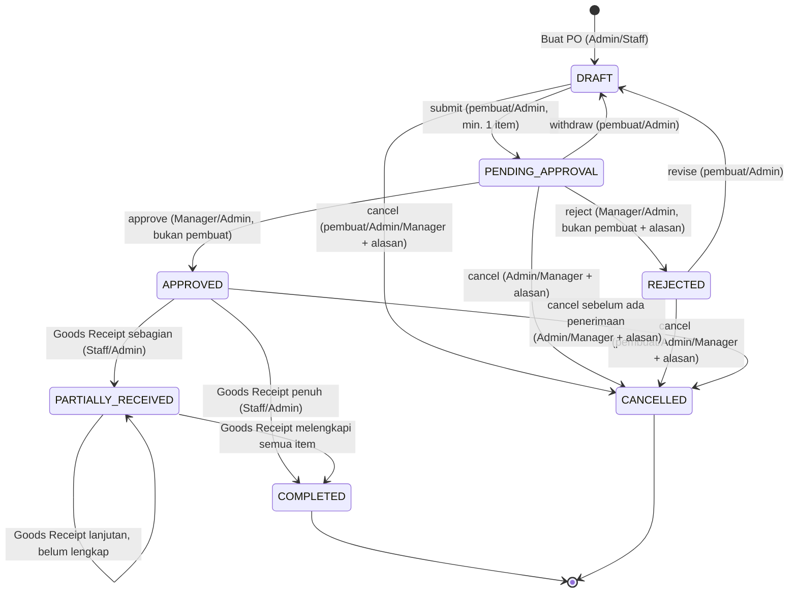
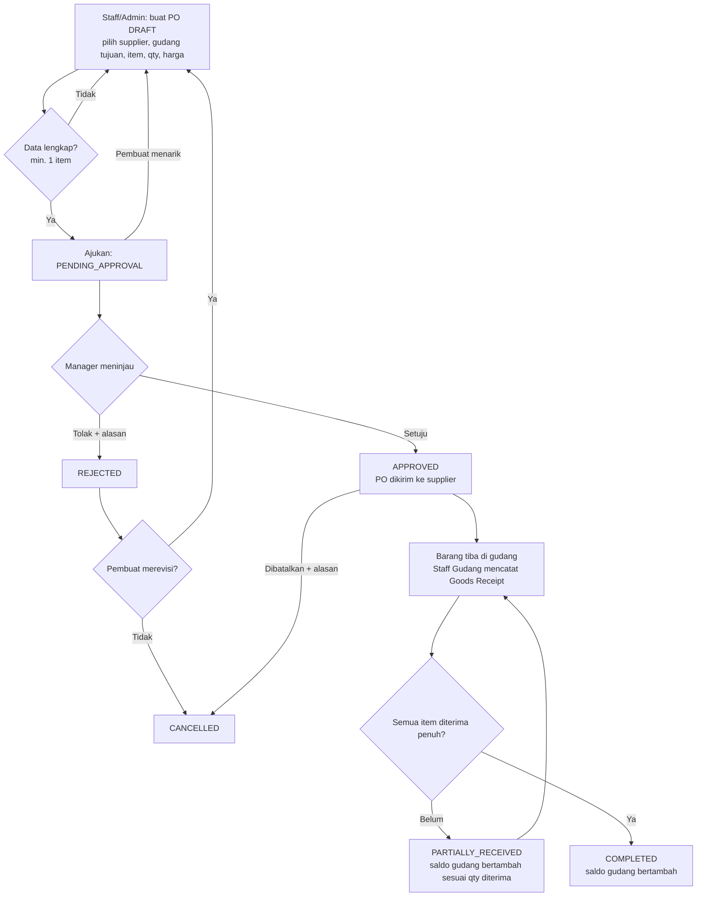

# Arsitektur Modul Purchase Order & Penerimaan Barang Multi-Gudang

> Modul: Pengadaan Barang (Purchase Order) & Penerimaan Barang Multi-Gudang (Goods Receipt)  
> Target: MINGGU 1 — Pembagian Modul Aplikasi, Arsitektur Kode, & Penentuan Logika Bisnis

Dokumen ini menjadi acuan utama perancangan teknis dan fungsional modul Purchase Order (PO) dan Goods Receipt. Dokumen ini merangkum struktur data, state-machine transisi status, pemisahan peran aktor, aturan bisnis, serta penanganan error dan contoh kode.

---

## 1. Artefak & Lokasi File Modul

| Artefak | Lokasi File |
|---|---|
| Enum Status & Peta Transisi | [`app/Enums/PurchaseOrderStatus.php`](../app/Enums/PurchaseOrderStatus.php) |
| State-Machine & Guard Transisi | [`app/Services/PurchaseOrderStateMachine.php`](../app/Services/PurchaseOrderStateMachine.php) |
| Domain Exception (403/422) | [`app/Exceptions/InvalidPurchaseOrderTransitionException.php`](../app/Exceptions/InvalidPurchaseOrderTransitionException.php) |
| Migration Database PO & Items | [`database/migrations/2026_10_26_100000_create_purchase_orders_and_items_tables.php`](../database/migrations/2026_10_26_100000_create_purchase_orders_and_items_tables.php) |
| Migration Database Status Histories | [`database/migrations/2026_10_29_090000_create_purchase_order_status_histories_table.php`](../database/migrations/2026_10_29_090000_create_purchase_order_status_histories_table.php) |
| Migration Database Goods Receipts & Items | [`database/migrations/2026_10_29_100000_create_goods_receipts_and_items_tables.php`](../database/migrations/2026_10_29_100000_create_goods_receipts_and_items_tables.php) |
| Model Header PO | [`app/Models/PurchaseOrder.php`](../app/Models/PurchaseOrder.php) |
| Model Rincian Item PO | [`app/Models/PurchaseOrderItem.php`](../app/Models/PurchaseOrderItem.php) |
| Model Riwayat Status PO | [`app/Models/PurchaseOrderStatusHistory.php`](../app/Models/PurchaseOrderStatusHistory.php) |
| Model Header Goods Receipt (GRN) | [`app/Models/GoodsReceipt.php`](../app/Models/GoodsReceipt.php) |
| Model Rincian Item Goods Receipt | [`app/Models/GoodsReceiptItem.php`](../app/Models/GoodsReceiptItem.php) |
| Policy Otorisasi PO & GRN | [`app/Policies/PurchaseOrderPolicy.php`](../app/Policies/PurchaseOrderPolicy.php) |
| Business Service Modul PO & GRN | [`app/Services/PurchaseOrderService.php`](../app/Services/PurchaseOrderService.php) |
| Layanan Pembuatan PDF PO | [`app/Services/PurchaseOrderPdfService.php`](../app/Services/PurchaseOrderPdfService.php) |
| Layanan Pembuatan PDF GRN | [`app/Services/GoodsReceiptPdfService.php`](../app/Services/GoodsReceiptPdfService.php) |
| Notifikasi Modul PO | [`app/Notifications/PurchaseOrderNotification.php`](../app/Notifications/PurchaseOrderNotification.php) |
| Integrasi Notification Center | [`app/Services/NotificationCenterService.php`](../app/Services/NotificationCenterService.php) |
| Controller UI & Aksi PO | [`app/Http/Controllers/PurchaseOrderController.php`](../app/Http/Controllers/PurchaseOrderController.php) |
| Controller Dokumen Goods Receipt | [`app/Http/Controllers/GoodsReceiptController.php`](../app/Http/Controllers/GoodsReceiptController.php) |
| Controller Aksi Notifikasi PO | [`app/Http/Controllers/PurchaseOrderNotificationController.php`](../app/Http/Controllers/PurchaseOrderNotificationController.php) |
| Controller API REST PO | [`app/Http/Controllers/Api/PurchaseOrderApiController.php`](../app/Http/Controllers/Api/PurchaseOrderApiController.php) |
| Console Command Cek PO Terlambat | [`app/Console/Commands/CheckOverduePurchaseOrdersCommand.php`](../app/Console/Commands/CheckOverduePurchaseOrdersCommand.php) |
| Data Transfer Object (DTO) PO | [`app/DTO/PurchaseOrderData.php`](../app/DTO/PurchaseOrderData.php), [`app/DTO/PurchaseOrderItemData.php`](../app/DTO/PurchaseOrderItemData.php) |
| API Resource PO | [`app/Http/Resources/PurchaseOrderResource.php`](../app/Http/Resources/PurchaseOrderResource.php), [`app/Http/Resources/PurchaseOrderItemResource.php`](../app/Http/Resources/PurchaseOrderItemResource.php) |
| Routing API & Web PO | [`routes/api.php`](../routes/api.php), [`routes/web.php`](../routes/web.php), [`routes/console.php`](../routes/console.php) |
| View Daftar PO (Index, Filter & Overdue) | [`resources/views/purchase-orders/index.blade.php`](../resources/views/purchase-orders/index.blade.php) |
| View Buat & Edit PO (Form Dinamis) | [`resources/views/purchase-orders/create.blade.php`](../resources/views/purchase-orders/create.blade.php), [`edit.blade.php`](../resources/views/purchase-orders/edit.blade.php), [`partials/form.blade.php`](../resources/views/purchase-orders/partials/form.blade.php) |
| View Detail PO (GRN Table & Status Timeline) | [`resources/views/purchase-orders/show.blade.php`](../resources/views/purchase-orders/show.blade.php) |
| Form Request Buat PO | [`app/Http/Requests/StorePurchaseOrderRequest.php`](../app/Http/Requests/StorePurchaseOrderRequest.php) |
| Form Request Ubah PO (Draft Only) | [`app/Http/Requests/UpdatePurchaseOrderRequest.php`](../app/Http/Requests/UpdatePurchaseOrderRequest.php) |
| Form Request Penerimaan Fisik Barang | [`app/Http/Requests/ReceivePurchaseOrderItemRequest.php`](../app/Http/Requests/ReceivePurchaseOrderItemRequest.php) |
| Unit Test State Machine | [`tests/Unit/PurchaseOrderStateMachineTest.php`](../tests/Unit/PurchaseOrderStateMachineTest.php) |
| Feature Test Database & Relasi | [`tests/Feature/PurchaseOrderDatabaseRelationshipTest.php`](../tests/Feature/PurchaseOrderDatabaseRelationshipTest.php) |
| Feature Test Form Request Validations | [`tests/Feature/PurchaseOrderValidationRequestTest.php`](../tests/Feature/PurchaseOrderValidationRequestTest.php) |
| Feature Test Logika Bisnis & Transaksi Atomik | [`tests/Feature/PurchaseOrderLogicTest.php`](../tests/Feature/PurchaseOrderLogicTest.php) |
| Feature Test Antarmuka UI (Index & Form Dinamis) | [`tests/Feature/PurchaseOrderUiTest.php`](../tests/Feature/PurchaseOrderUiTest.php) |
| Feature Test API Endpoint & Resource | [`tests/Feature/PurchaseOrderApiTest.php`](../tests/Feature/PurchaseOrderApiTest.php) |
| Feature Test Penanganan Error & Edge-Cases | [`tests/Feature/PurchaseOrderRobustErrorHandlingTest.php`](../tests/Feature/PurchaseOrderRobustErrorHandlingTest.php) |
| Feature Test Dokumen GRN & Peringatan Terlambat | [`tests/Feature/GoodsReceiptAndOverdueFeatureTest.php`](../tests/Feature/GoodsReceiptAndOverdueFeatureTest.php) |
| Layanan Three-Way Matching OCR | [`app/Services/ThreeWayMatchingService.php`](../app/Services/ThreeWayMatchingService.php) |
| Layanan & Analitik Kinerja Rekanan | [`app/Services/SupplierPerformanceService.php`](../app/Services/SupplierPerformanceService.php) |
| Controller Dashboard Kinerja Rekanan | [`app/Http/Controllers/SupplierPerformanceController.php`](../app/Http/Controllers/SupplierPerformanceController.php) |
| Seeder Data Demo Skala Besar (>50 Data) | [`database/seeders/ProcurementDemoDataSeeder.php`](../database/seeders/ProcurementDemoDataSeeder.php) |
| Feature Test Three-Way Matching & Vendor KPI | [`tests/Feature/ThreeWayMatchingAndSupplierPerformanceTest.php`](../tests/Feature/ThreeWayMatchingAndSupplierPerformanceTest.php) |

---

## 2. Aktor & Tanggung Jawab (Multi-Peran)

| Peran di Sistem (`users.role`) | Peran Bisnis | Tanggung Jawab di Modul PO |
|---|---|---|
| `admin` | Admin Sistem / Gudang | Membuat dan mengajukan PO, menyetujui atau menolak PO (dengan prinsip *Segregation of Duty*: bukan pembuat PO), membatalkan PO, mencatat penerimaan barang fisik di gudang, cetak PDF resmi. |
| `manager` | Manager Pengadaan / Operasional | Menyetujui atau menolak PO (dengan prinsip *Segregation of Duty*: bukan pembuat PO, wajib alasan jika menolak), membatalkan PO, cetak PDF resmi. |
| `staff` | Staff Gudang | Membuat dan mengajukan PO miliknya, merevisi PO miliknya yang ditolak, mencatat penerimaan barang fisik di gudang, cetak PDF resmi. |

---

## 3. Struktur Skema Database & Relasi Eloquent

### 3.1 Tabel `purchase_orders`
Menyimpan informasi header pesanan pembelian.
- `id`: Primary key (BIGINT UNSIGNED)
- `nomor_po`: Nomor unik PO dengan format otomatis `PO-YYYYMMDD-XXXX` (VARCHAR 30, Indexed)
- `supplier_id`: Foreign key ke tabel `suppliers` (RESTRICT on delete)
- `warehouse_id`: Foreign key ke tabel `warehouses` sebagai gudang tujuan barang (RESTRICT on delete)
- `status`: Status siklus PO (`draft`, `pending_approval`, `approved`, `rejected`, `partially_received`, `completed`, `cancelled`)
- `tanggal_pesan`: Tanggal pembuatan/penerbitan PO (DATE)
- `estimasi_tiba`: Tanggal estimasi pengiriman barang sampai di gudang (DATE, nullable)
- `total_biaya`: Akumulasi nilai finansial pembelian (DECIMAL 15,2)
- `catatan`: Catatan operasional atau spesifikasi tambahan (TEXT, nullable)
- `created_by`: Foreign key ke `users` (pembuat PO)
- `approved_by`: Foreign key ke `users` (penyetuju PO / Manager / Admin, nullable)
- `timestamps`: `created_at` dan `updated_at`

### 3.2 Tabel `purchase_order_items`
Menyimpan rincian item barang yang dipesan dalam PO.
- `id`: Primary key (BIGINT UNSIGNED)
- `purchase_order_id`: Foreign key ke `purchase_orders` (CASCADE on delete)
- `barang_id`: Foreign key ke `barang` (RESTRICT on delete)
- `jumlah_pesan`: Kuantitas barang yang dipesan (INT UNSIGNED)
- `jumlah_diterima`: Kuantitas fisik barang yang telah diterima bertahap (INT UNSIGNED, default 0)
- `harga_satuan`: Harga per unit pada saat PO diterbitkan (DECIMAL 15,2)
- `subtotal`: Hasil perkalian `jumlah_pesan * harga_satuan` (DECIMAL 15,2)
- `timestamps`: `created_at` dan `updated_at`

### 3.3 Tabel `purchase_order_status_histories`
Menyimpan jejak audit kronologis perpindahan status PO (*status audit trail*).
- `id`: Primary key (BIGINT UNSIGNED)
- `purchase_order_id`: Foreign key ke `purchase_orders` (CASCADE on delete)
- `from_status`: Status asal (VARCHAR 30, nullable)
- `to_status`: Status tujuan (VARCHAR 30, indexed)
- `user_id`: Pengguna yang melakukan transisi status (FK ke `users`, nullable on delete)
- `reason`: Catatan alasan / keterangan operasional penolakan, pembatalan, atau penerimaan (TEXT, nullable)
- `metadata`: Snapshot rincian tambahan dalam format JSON (nullable)
- `timestamps`: `created_at` dan `updated_at`

### 3.4 Tabel `goods_receipts`
Menyimpan dokumen resmi Berita Acara Penerimaan Barang Fisik (Goods Receipt Note / GRN). Satu PO dapat memiliki beberapa dokumen GRN (penerimaan bertahap).
- `id`: Primary key (BIGINT UNSIGNED)
- `nomor_grn`: Nomor unik dokumen penerimaan berformat `GRN-YYYYMMDD-XXXX` (VARCHAR 35, Indexed)
- `purchase_order_id`: Foreign key ke `purchase_orders` (CASCADE on delete)
- `warehouse_id`: Foreign key ke `warehouses` sebagai lokasi gudang fisik penerima
- `tanggal_terima`: Tanggal fisik barang diterima di gudang (DATE)
- `nomor_surat_jalan`: Nomor surat jalan / Delivery Order (DO) vendor rekanan (VARCHAR 120, nullable)
- `foto_surat_jalan`: Path berkas gambar/PDF bukti fisik surat jalan pada disk `public` (VARCHAR 255, nullable)
- `catatan`: Catatan kondisi fisik kemasan atau nomor resi kurir (TEXT, nullable)
- `received_by`: Foreign key ke `users` (staf/admin yang memverifikasi penerimaan fisik)
- `timestamps`: `created_at` dan `updated_at`

### 3.5 Tabel `goods_receipt_items`
Menyimpan rincian kuantitas barang yang tiba pada dokumen penerimaan tertentu.
- `id`: Primary key (BIGINT UNSIGNED)
- `goods_receipt_id`: Foreign key ke `goods_receipts` (CASCADE on delete)
- `purchase_order_item_id`: Foreign key ke `purchase_order_items` (RESTRICT on delete)
- `barang_id`: Foreign key ke `barang` (RESTRICT on delete)
- `jumlah_diterima`: Kuantitas fisik barang yang diterima pada transaksi ini (INT UNSIGNED)
- `catatan`: Catatan spesifik per baris barang (VARCHAR 255, nullable)
- `timestamps`: `created_at` dan `updated_at`

### 3.6 Pemetaan Relasi Eloquent
```
[Supplier] (1) <---> (N) [PurchaseOrder]
[Warehouse] (1) <---> (N) [PurchaseOrder]
[User (Creator)] (1) <---> (N) [PurchaseOrder]
[User (Approver)] (1) <---> (N) [PurchaseOrder]
[PurchaseOrder] (1) <---> (N) [PurchaseOrderStatusHistory]

[PurchaseOrder] (1) <---> (N) [PurchaseOrderItem] (CASCADE on delete)
[Barang] (1) <---> (N) [PurchaseOrderItem]

[PurchaseOrder] (1) <---> (N) [GoodsReceipt] (CASCADE on delete)
[Warehouse] (1) <---> (N) [GoodsReceipt]
[User (Recipient)] (1) <---> (N) [GoodsReceipt]
[GoodsReceipt] (1) <---> (N) [GoodsReceiptItem] (CASCADE on delete)
[PurchaseOrderItem] (1) <---> (N) [GoodsReceiptItem]
[Barang] (1) <---> (N) [GoodsReceiptItem]
```

---

## 4. Definisi Status & State-Machine PO

Siklus hidup pesanan pembelian diatur oleh state machine terpusat (`PurchaseOrderStateMachine`) dengan memanfaatkan Enum bertipe string (`PurchaseOrderStatus`).

### 4.1 Definisi 7 Status PO

| Status | Nilai DB | Label UI | Badge | Arti | Dapat Diedit? | Boleh Terima Barang? | Terminal? |
|---|---|---|---|---|:---:|:---:|:---:|
| DRAFT | `draft` | Draft | `badge-secondary` | Pesanan dibuat staf/admin gudang. | Ya | Tidak | Tidak |
| PENDING_APPROVAL | `pending_approval` | Menunggu Persetujuan | `badge-warning` | Menunggu persetujuan Manager. | Tidak | Tidak | Tidak |
| APPROVED | `approved` | Disetujui | `badge-info` | Disetujui, pesanan resmi dikirim ke supplier. | Tidak | Ya | Tidak |
| REJECTED | `rejected` | Ditolak | `badge-danger` | Ditolak oleh Manager, dengan catatan alasan. | Tidak | Tidak | Tidak* |
| PARTIALLY_RECEIVED | `partially_received` | Diterima Sebagian | `badge-primary` | Sebagian barang sudah sampai di gudang fisik. | Tidak | Ya | Tidak |
| COMPLETED | `completed` | Selesai | `badge-success` | Seluruh barang sudah sampai dan saldo fisik bertambah. | Tidak | Tidak | **Ya** |
| CANCELLED | `cancelled` | Dibatalkan | `badge-dark` | Pesanan dibatalkan. | Tidak | Tidak | **Ya** |

\* PO yang ditolak dapat direvisi kembali ke `DRAFT` agar staf tidak perlu mengulang input dari nol.

### 4.2 State Diagram Transisi Status (Mermaid)



### 4.3 Alur Bisnis Lintas Peran (Flowchart)



---

## 5. Matriks Transisi & Hak Akses

Kunci aturan di kode: `PurchaseOrderStateMachine::RULES`.

| # | Dari → Ke | Aksi | Admin | Manager | Staff | Pembuat PO | Alasan Wajib | Guard Tambahan |
|---|---|---|:---:|:---:|:---:|:---:|:---:|---|
| 1 | DRAFT → PENDING_APPROVAL | `submit` | ✅ | — | — | ✅ | — | Minimal terdapat 1 item. |
| 2 | DRAFT → CANCELLED | `cancel` | ✅ | ✅ | — | ✅ | ✅ | — |
| 3 | PENDING_APPROVAL → APPROVED | `approve` | ✅ | ✅ | ❌ | ❌ dilarang | — | Separation of Duty: Penyetuju ≠ Pembuat PO. |
| 4 | PENDING_APPROVAL → REJECTED | `reject` | ✅ | ✅ | ❌ | ❌ dilarang | ✅ | Separation of Duty: Penyetuju ≠ Pembuat PO. |
| 5 | PENDING_APPROVAL → DRAFT | `withdraw` | ✅ | — | — | ✅ | — | Tarik kembali untuk perbaikan. |
| 6 | PENDING_APPROVAL → CANCELLED | `cancel` | ✅ | ✅ | ❌ | — | ✅ | — |
| 7 | REJECTED → DRAFT | `revise` | ✅ | — | — | ✅ | — | Revisi kembali ke mode edit. |
| 8 | REJECTED → CANCELLED | `cancel` | ✅ | ✅ | — | ✅ | ✅ | — |
| 9 | APPROVED → PARTIALLY_RECEIVED | `receive` | ✅ | ❌ | ✅ | — | — | Kuantitas diterima > 0, akumulasi < kuantitas dipesan. |
| 10 | APPROVED → COMPLETED | `receive` | ✅ | ❌ | ✅ | — | — | Seluruh akumulasi kuantitas diterima == dipesan. |
| 11 | APPROVED → CANCELLED | `cancel` | ✅ | ✅ | ❌ | — | ✅ | Belum pernah ada penerimaan fisik barang. |
| 12 | PARTIALLY_RECEIVED → COMPLETED | `receive` | ✅ | ❌ | ✅ | — | — | Seluruh akumulasi kuantitas diterima == dipesan. |

### Transisi yang Dilarang Keras
- **DRAFT → APPROVED**: PO wajib melewati evaluasi dan persetujuan Manager.
- **DRAFT / PENDING_APPROVAL → COMPLETED**: Barang fisik tidak sah diterima sebelum PO disetujui.
- **REJECTED → APPROVED**: PO yang ditolak wajib direvisi ke DRAFT dan diajukan ulang.
- **PARTIALLY_RECEIVED → CANCELLED**: Barang fisik sudah bertambah di gudang; pembatalan merusak jejak audit inventaris.
- **COMPLETED / CANCELLED → status apa pun**: Status terminal bersifat final dan terkunci permanen.

---

## 6. Aturan Bisnis (Business Rules)

| Kode | Aturan | Implementasi |
|---|---|---|
| BR-PO-01 | Header dan item PO hanya dapat diubah saat berstatus DRAFT. | `PurchaseOrderStatus::isEditable()` |
| BR-PO-02 | PO hanya dapat diajukan jika memiliki minimal satu item. | Guard `itemCount < 1` di `transition()` |
| BR-PO-03 | Manager dan Admin dapat menyetujui atau menolak PO (jika bukan pembuat PO). | Rule `approve`/`reject` untuk `manager` dan `admin` |
| BR-PO-04 | Pemisahan tugas (Separation of Duty): pembuat PO tidak boleh menyetujui/menolak PO miliknya sendiri. | Guard `not_creator` di state machine |
| BR-PO-05 | Penolakan dan pembatalan wajib disertai catatan alasan yang tidak kosong. | `PurchaseOrderStatus::requiresReason()` |
| BR-PO-06 | Goods Receipt hanya boleh dicatat untuk PO APPROVED atau PARTIALLY_RECEIVED. | `PurchaseOrderStatus::canReceiveGoods()` |
| BR-PO-07 | Qty diterima kumulatif per item tidak boleh melebihi qty dipesan (pencegahan over-receipt). | `resolveReceivingStatus()` |
| BR-PO-08 | Status setelah penerimaan ditentukan otomatis oleh sistem: semua item lengkap → COMPLETED, selain itu → PARTIALLY_RECEIVED. | `resolveReceivingStatus()` |
| BR-PO-09 | Setiap Goods Receipt menambah saldo `warehouse_stocks` di gudang tujuan dan dicatat di `stok_transactions`/`stok_histories` dengan mekanisme mutasi masuk. | Integrasi operasional |
| BR-PO-10 | COMPLETED dan CANCELLED adalah status terminal (terkunci permanen). | `PurchaseOrderStatus::isTerminal()` |

---

## 7. Penanganan Error (Domain Exceptions)

Semua pelanggaran aturan melempar `InvalidPurchaseOrderTransitionException` dengan kode error dan mapping status HTTP yang terstandarisasi:

| `errorCode` | Penyebab Terjadi | HTTP Status |
|---|---|:---:|
| `transition_not_allowed` | Transisi status tidak ada dalam peta resmi state machine. | `422 Unprocessable Content` |
| `unauthorized_role` | Peran pengguna tidak berhak mengeksekusi aksi transisi tersebut. | `403 Forbidden` |
| `reason_required` | Aksi penolakan (`reject`) atau pembatalan (`cancel`) tanpa menyertakan alasan. | `422 Unprocessable Content` |
| `guard_failed` | Melanggar guard bisnis (PO kosong, pembuat approve sendiri, over-receipt). | `422 Unprocessable Content` |

---

## 8. Contoh Pemakaian pada Controller

```php
use App\Enums\PurchaseOrderStatus;
use App\Services\PurchaseOrderStateMachine;
use Illuminate\Support\Facades\DB;

// 1. Menampilkan opsi aksi yang diizinkan untuk UI tombol aksi
$availableActions = app(PurchaseOrderStateMachine::class)->availableTransitions(
    $po->status,
    $request->user()->role,
    $po->created_by === $request->user()->id,
);

// 2. Mengeksekusi transisi status (misal approval oleh Manager)
DB::transaction(function () use ($po, $request) {
    $poLocked = PurchaseOrder::where('id', $po->id)->lockForUpdate()->firstOrFail();

    $machine = app(PurchaseOrderStateMachine::class);
    $poLocked->status = $machine->transition(
        from: $poLocked->status,
        to: PurchaseOrderStatus::APPROVED,
        role: $request->user()->role,
        actorIsCreator: $poLocked->created_by === $request->user()->id,
    );

    $poLocked->approved_by = $request->user()->id;
    $poLocked->save();
});
```

---

## 9. Penanganan Error & Edge-Cases (Robust Error Handling)

Modul mengimplementasikan perlindungan berlapis untuk menjamin integritas data operasional gudang:

### 9.1 Pencegahan Double Submit
- **Frontend Layer**: Saat tombol formulir penerimaan barang atau aksi modal ditekan, JavaScript langsung mendisabel tombol pengiriman (`disabled = true`), mengganti label dengan spinner loading, dan menonaktifkan tombol penutup modal.
- **Backend Atomic Lock**: Pada level server, `PurchaseOrderService::receiveItems` menggunakan `Cache::lock("purchase_order:receive:{$po->id}", 15)->block(0)`. Jika request duplikat datang bersamaan (misal koneksi jaringan lambat atau bypass JavaScript), request kedua langsung ditolak dengan `ValidationException` yang informatif.

### 9.2 Pencegahan Race Condition & Deadlock
- **Pessimistic Locking**: Baris header `purchase_orders`, `purchase_order_items`, serta `warehouse_stocks` dikunci secara eksklusif menggunakan `lockForUpdate()`.
- **Urutan Penguncian Deterministik**: Item dikunci secara terurut berdasarkan `id` (`orderBy('id')->lockForUpdate()`). Hal ini mencegah *circular wait* (deadlock AB-BA) ketika dua transaksi berjalan bersamaan.
- **Automatic Deadlock Retry**: Blok database transaction dikonfigurasi dengan toleransi retry otomatis sebanyak 3 kali (`DB::transaction(..., 3)`).

### 9.3 Pesan Error Ramah Pengguna (User-Friendly Flash Messages)
- Seluruh error teknis database (`QueryException` dengan kode deadlock 40001/1213/1205), validasi over-receipt, dan pelanggaran transisi status dipetakan ke pesan bahasa Indonesia yang sopan dan solutif.
- Tampilan Blade `purchase-orders.show` memiliki visual alert khusus untuk `success`, `error`, `warning`, `info`, dan daftar validasi `$errors`.

---

## 10. Fitur Pendukung & Penguatan Modul (Prioritas Tinggi)

Untuk memastikan modul pengadaan memiliki tata kelola operasional berstandar enterprise, empat fitur penguatan utama telah diimplementasikan:

### 10.1 Riwayat Audit Perubahan Status (Timeline Audit Trail)
Setiap mutasi status pada pesanan pembelian dicatat secara otomatis ke dalam tabel `purchase_order_status_histories`:
- **Data yang Direkam**: Status asal (`from_status`), status baru (`to_status`), aktor pelaksana (`user_id`), alasan/catatan perubahan (`reason`), serta timestamp.
- **Titik Transisi**:
  - Saat pembuatan PO (`DRAFT`).
  - Pengajuan persetujuan ke Manager (`PENDING_APPROVAL`).
  - Persetujuan PO oleh Manager/Admin (`APPROVED`).
  - Penolakan PO dengan alasan wajib (`REJECTED`).
  - Pembatalan PO dengan alasan wajib (`CANCELLED`).
  - Penerimaan fisik barang bertahap maupun lengkap (`PARTIALLY_RECEIVED` / `COMPLETED`).
- **Visualisasi UI**: Ditampilkan pada kartu tersendiri *Riwayat Perubahan Status PO* di halaman detail PO (`resources/views/purchase-orders/show.blade.php`), lengkap dengan avatar nama aktor, role, badge status visual, dan alasan operasional.

### 10.2 Dokumen Penerimaan Barang (Goods Receipt Notes / GRN) Terpisah
Proses penerimaan barang fisik tidak hanya memperbarui akumulasi kolom `jumlah_diterima`, melainkan menerbitkan dokumen legal penerimaan tersendiri:
- **Format Nomor Dokumen**: Dihasilkan otomatis dengan format unik `GRN-YYYYMMDD-XXXX` menggunakan penguncian nomor sequence database (`lockForUpdate()`).
- **Penerimaan Multi-Tahap**: Satu Purchase Order dapat memiliki beberapa dokumen GRN jika pengiriman dari supplier dilakukan bertahap (parsial).
- **Lampiran Bukti Surat Jalan**: Staf gudang dapat mengunggah foto atau pindaian dokumen surat jalan/Delivery Order vendor (format JPG, PNG, PDF maks 3MB) yang disimpan di storage publik (`surat_jalan/`).
- **Cetak PDF Resmi GRN**: Dokumen Berita Acara Penerimaan Barang dapat diunduh langsung dalam format PDF 1.4 resmi siap arsip via route `goods-receipts.pdf`.
- **Integrasi Stok Otomatis**: Setiap item GRN langsung menambah stok riil pada tabel `warehouse_stocks` di gudang tujuan dan mencatat mutasi jenis `masuk` pada `stok_transactions`.

### 10.3 Notifikasi Terintegrasi (Notification Center)
Modul terhubung penuh dengan `NotificationCenterService` aplikasi (`notifications` table):
- **Event Notifikasi**:
  1. `submitted`: Saat PO diajukan oleh staf gudang, seluruh Manager dan Admin menerima notifikasi persetujuan di navbar lonceng.
  2. `approved`: Saat PO disetujui, staf pembuat PO menerima pemberitahuan bahwa barang siap diterima saat tiba di gudang.
  3. `rejected`: Saat PO ditolak, staf menerima pemberitahuan beserta catatan alasan penolakan untuk direvisi.
  4. `overdue`: Peringatan otomatis bagi PO berstatus disetujui yang telah melewati estimasi kedatangan.
- **Aksi Satu Klik**: Mengklik notifikasi pada dropdown mengarahkan pengguna langsung ke detail PO (`po-notifications.open`) sekaligus menandai notifikasi tersebut telah dibaca.

### 10.4 Deteksi & Peringatan Otomatis PO Terlambat (Overdue Detection)
Menjamin visibilitas pesanan yang terhambat agar tim logistik dapat segera mengambil tindakan mitigasi:
- **Kriteria Terlambat**: PO berstatus `approved` atau `partially_received` yang memiliki tanggal `estimasi_tiba` sebelum tanggal hari ini (`< now()->startOfDay()`).
- **Scheduled Console Command**: Command `php artisan po:check-overdue {--notify}` dijadwalkan berjalan otomatis setiap hari pukul 08:00 WIB via `routes/console.php`. Command ini mendeteksi PO terlambat dan mengirim notifikasi peringatan idempotent ke tim manajerial.
- **Badge Visual & Filter Indeks**:
  - Halaman indeks PO memiliki sakelar filter cepat `Hanya PO Terlambat` (`?overdue=1`).
  - Badge merah mencolok `Terlambat` tampil di samping estimasi tiba pada tabel daftar PO maupun kartu detail PO.
  - Halaman detail PO menampilkan banner peringatan merah jika pesanan telah melewati tenggat jadwal kedatangan.

### 10.5 Auto-Generate Purchase Order dari Prediksi Stok (Smart Restock)
Mengintegrasikan modul analitik prediksi stok (`StockPrediction`) dengan modul pengadaan barang (`PurchaseOrder`):
- **Alur Smart Restock**:
  1. Pada halaman Prediksi Stok (`/prediksi-stok`), Manager atau Admin meninjau hasil analisis risiko (misal status *Perlu Restock* atau *Mendesak*).
  2. Tombol **"Buat PO dari Rekomendasi"** tersedia pada baris tabel maupun laci detail prediksi untuk setiap barang yang memiliki saran kuantitas restock (`recommended_restock > 0`).
  3. Mengklik tombol ini mengarahkan pengguna ke route `/purchase-orders/create?from_prediction={id}` (atau `/prediksi-stok/{id}/create-po`).
- **Otomatisasi Pengisian Formulir (`prepareSmartRestockData`)**:
  - **Supplier Rekanan**: Otomatis memilih supplier aktif yang terasosiasi pada master barang.
  - **Gudang yang Defisit**: Sistem menganalisis seluruh saldo gudang fisik pada tabel `warehouse_stocks` untuk barang tersebut, lalu otomatis menetapkan gudang aktif yang memiliki saldo terendah sebagai gudang tujuan pesanan.
  - **Kuantitas & Harga Beli**: Baris rincian barang otomatis terisi dengan kuantitas sesuai rekomendasi algoritma prediksi (`recommended_restock`) dan harga beli satuan master barang (`harga_beli`).
  - **Estimasi Tanggal Tiba**: Dihitung otomatis berdasarkan tanggal perkiraan kehabisan stok (`predicted_depletion_date`).
  - **Catatan Jejak Prediksi**: Kolom catatan operasional otomatis mencantumkan referensi ID prediksi, status risiko, nama gudang defisit, dan estimasi kebutuhan konsumsi 30 hari.
  - **Banner Panduan Interaktif**: Formulir PO menampilkan banner visual biru yang menginformasikan bahwa data diisi dari hasil prediksi AI, dengan fleksibilitas penuh bagi pengguna untuk menyesuaikan kembali item sebelum disimpan.

---

## 11. Verifikasi Dokumen & Three-Way Matching (PO vs GRN vs Dokumen Vendor OCR)

Untuk memastikan akurasi finansial dan mencegah kelebihan bayar (*overbilling*) atau pengiriman fiktif, modul pengadaan diintegrasikan dengan mesin verifikasi dokumen OCR Tesseract:

### 11.1 Alur Pencocokan Tiga Arah (Three-Way Matching Matrix)
1. **Purchase Order (PO)**: Sumber kebenaran komitmen awal (kuantitas dipesan dan harga kesepakatan).
2. **Goods Receipt Note (GRN)**: Sumber kebenaran fisik yang diterima nyata di gudang (`warehouse_stocks`).
3. **Dokumen OCR (Invoice / Surat Jalan)**: Berkas pindaian fisik dari vendor yang diekstraksi secara otomatis oleh modul OCR.

### 11.2 Logika Deteksi Selisih (*Discrepancy Engine*)
- **Pencocokan Header**:
  - Nomor PO sistem dicocokkan dengan `purchase_order_number` pada dokumen OCR.
  - Nomor referensi Surat Jalan dicocokkan dengan `nomor_surat_jalan` pada dokumen GRN.
  - Nama vendor dicocokkan dengan entitas pengirim dokumen.
  - Total tagihan finansial dibandingkan antara total biaya PO dan `total_amount` invoice.
- **Pencocokan Tingkat Baris Item**:
  - Kuantitas ditagih (`qty_invoiced`) vs kuantitas fisik tiba (`qty_received`): Jika ditagih > fisik tiba, sistem menandai selisih (`DISCREPANCY`).
  - Harga satuan pesanan (`price_ordered`) vs harga satuan ditagih (`price_invoiced`): Jika harga invoice lebih tinggi, sistem memunculkan peringatan selisih harga.
  - Penerimaan bertahap (`PARTIALLY_MATCHED`): Jika barang masih dalam proses pengiriman bertahap.
  - Cocok sempurna (`MATCHED`): Kuantitas, fisik tiba, dan harga tagihan 100% konsisten.
- **Deep Linking Dua Arah**:
  - Halaman detail PO menampilkan kartu *Three-Way Matching* dengan dokumen OCR terkait.
  - Halaman hasil verifikasi dokumen OCR menampilkan kartu ringkasan pesanan PO dan tautan langsung ke matriks Three-Way Matching.

---

## 12. Vendor Performance Dashboard & Lead Time Tracking

Modul analitik ekosistem pengadaan untuk memantau keandalan rekanan supplier secara objektif berbasis data transaksi nyata:

### 12.1 Metrik Kinerja Utama (Vendor KPIs)
1. **On-Time Delivery Rate (%)**:
   $$\text{On-Time Delivery Rate} = \left( \frac{\text{Jumlah Pengiriman Tepat Waktu}}{\text{Total Pengiriman}} \right) \times 100\%$$
   Kiriman dihitung tepat waktu jika tanggal penerimaan fisik pada GRN $\le$ tanggal estimasi tiba pada PO.
2. **Rata-rata Keterlambatan (Average Delay Days)**:
   Menghitung rata-rata selisih hari keterlambatan untuk pengiriman yang terlambat.
3. **Fulfillment Rate (%)**:
   $$\text{Fulfillment Rate} = \left( \frac{\text{Total Kuantitas Fisik Tiba}}{\text{Total Kuantitas Dipesan}} \right) \times 100\%$$
4. **Skor Komposit & Peringkat Performa**:
   $$\text{Score} = 0.5 \times \text{On-Time Delivery Rate} + 0.5 \times \min(100, \text{Fulfillment Rate})$$
   - $\ge 90\%$: **Sangat Baik** (Hijau)
   - $75\% - 89.9\%$: **Baik** (Biru)
   - $50\% - 74.9\%$: **Perlu Evaluasi** (Kuning)
   - $< 50\%$: **Kritis** (Merah)

### 12.2 Halaman & Tampilan
- **Dashboard Global (`/suppliers/performance`)**: Ringkasan eksekutif rata-rata ketepatan waktu, rasio pemenuhan, total belanja, serta tabel peringkat supplier dengan filter rating dan pencarian.
- **Scorecard Audit Vendor (`/suppliers/{supplier}/performance`)**: Analisis mendalam per supplier lengkap dengan riwayat logistik pengiriman fisik (nomor GRN, nomor PO, tanggal terima vs estimasi, dan status tepat waktu/terlambat).

---

## 13. Riwayat Perubahan & Catatan Rilis Modul (Changelog)

Catatan kronologis evolusi dan peningkatan teknis Modul Pengadaan (*Purchase Order & Goods Receipt*):

### [v1.5.0] — 2026-10-29: Demo Data Seeder Skala Besar (>50 Data per Entitas)
- **Penambahan Seeder Komprehensif**: `ProcurementDemoDataSeeder.php` dibuat dan didaftarkan pada `DatabaseSeeder.php` untuk memasok data pengujian realistis bagi seluruh fitur pengadaan.
- **Volume Data Baru**:
  - `purchase_orders`: 80 record melingkupi seluruh 7 status siklus hidup (termasuk pesanan berstatus tepat waktu dan terlambat/overdue).
  - `goods_receipts`: 52 dokumen Berita Acara Penerimaan Barang resmi (`GRN-YYYYMMDD-XXXX`) lengkap dengan nomor surat jalan dan catatan kondisi.
  - `document_verifications`: 83 dokumen (termasuk 60 invoice/surat jalan hasil ekstraksi OCR Tesseract untuk pengujian Three-Way Matching).
  - `purchase_order_status_histories`: >200 entri jejak audit linimasa.
- **Integritas Stok & Mutasi**: Sinkronisasi saldo fisik `warehouse_stocks` dan pencatatan buku besar `stok_transactions` terintegrasi sempurna tanpa inkonsistensi saldo.

### [v1.4.0] — 2026-10-29: Three-Way Matching OCR & Vendor Performance Dashboard (Saran B)
- **Pencocokan Tiga Arah (Three-Way Matching)**:
  - Layanan `ThreeWayMatchingService.php` mencocokkan data PO sistem, kuantitas fisik tiba pada GRN, dan dokumen tagihan vendor hasil pindaian OCR Tesseract.
  - Deteksi dini *overbilling* (tagihan melebihi fisik tiba), selisih harga per unit (*price discrepancy*), dan penerimaan bertahap (*partially matched*).
  - Deep linking dua arah antara detail PO dan hasil verifikasi dokumen OCR.
- **Dashboard Kinerja Rekanan (Vendor Performance)**:
  - Layanan `SupplierPerformanceService.php` dan `SupplierPerformanceController.php`.
  - Pelacakan metrik logistik: *On-Time Delivery Rate (%)*, *Average Delay Days*, *Fulfillment Rate (%)*, dan skor komposit performa berbobot.
  - Antarmuka eksekutif `/suppliers/performance` dan kartu audit per vendor `/suppliers/{supplier}/performance`.
- **Automated Testing Suite**: Penambahan test `tests/Feature/ThreeWayMatchingAndSupplierPerformanceTest.php` (12 test cases lulus 100%).

### [v1.3.0] — 2026-10-29: Smart Restock Integrasi Modul Prediksi Stok AI (Saran B)
- **Auto-Generate Purchase Order**: Tombol "Buat PO dari Rekomendasi" pada halaman hasil prediksi restock AI (`/prediksi-stok`).
- **Otomasi Prefill Form**: Membawa parameter query `from_prediction` untuk mengisi secara instan: supplier rekanan, gudang defisit yang membutuhkan alokasi barang, kuantitas restock rekomendasi, harga beli master, dan estimasi tanggal tiba.
- **User Experience**: Banner visual biru di formulir pembuatan PO mengonfirmasi asal usul data dari modul prediksi cerdas.

### [v1.2.0] — 2026-10-29: Dokumen GRN Mandiri, Jejak Audit, Notifikasi & Peringatan Overdue (Saran A)
- **Entitas Dokumen Goods Receipt (GRN)**:
  - Tabel `goods_receipts` dan `goods_receipt_items` untuk mendukung penerimaan bertahap (*multi-stage delivery*) dengan format unik `GRN-YYYYMMDD-XXXX`.
  - Ekspor dokumen Berita Acara Penerimaan Barang ke format PDF resmi via `GoodsReceiptPdfService.php`.
- **Jejak Audit Kronologis Status PO**:
  - Tabel `purchase_order_status_histories` merekam aktor, stempel waktu, status asal, status tujuan, alasan penolakan/pembatalan, dan metadata transaksi.
  - Komponen linimasa visual interaktif (*status timeline*) di halaman detail PO.
- **Pusat Notifikasi Siklus Hidup PO**:
  - `PurchaseOrderNotification.php` dan `NotificationCenterService.php` mengirimkan notifikasi instan ke dropdown lonceng navbar (`notifications`).
- **Peringatan Otomatis PO Terlambat (Overdue)**:
  - Scheduled command `php artisan po:check-overdue --notify` yang menandai PO `Approved`/`Partially Received` yang telah melewati `estimasi_tiba`.
  - Badge merah `Terlambat`, banner peringatan di halaman detail, dan filter cepat pada tabel index PO.
- **Automated Testing Suite**: Penambahan test `tests/Feature/GoodsReceiptAndOverdueFeatureTest.php` (13 test cases lulus 100%).

### [v1.1.0] — 2026-10-28: Penguatan Tata Kelola, Otorisasi Policy & Mitigasi Bentrok Nomor PO
- **Penyelarasan Hak Approve/Reject (Maker-Checker)**:
  - Memperbarui `PurchaseOrderPolicy.php` dan `PurchaseOrderStateMachine.php` agar Admin dan Manager berhak menyetujui/menolak PO, dengan aturan wajib: `approver_id !== created_by` (*Segregation of Duties*).
- **Penyelarasan Hak Penerimaan Fisik**:
  - Standarisasi aksi terima barang fisik eksklusif untuk Admin dan Staff Gudang di FormRequest, Policy, Controller, dan UI.
- **Pencegahan Bentrok Nomor PO Konkuren**:
  - Penomoran PO otomatis menggunakan *pessimistic locking* (`lockForUpdate`) atau mekanisme *auto-retry* saat terjadi perlombaan nomor.
- **Restrukturisasi Alasan Penolakan & Pembatalan**:
  - Alasan penolakan dan pembatalan dipisahkan dari kolom `catatan` dan dicatat secara terstruktur pada tabel riwayat audit `purchase_order_status_histories`.
- **Pengamanan Rute PDF**:
  - Akses unduh PDF PO diikat ke kebijakan otorisasi `viewPdf` pada `PurchaseOrderPolicy`.

### [v1.0.0] — 2026-10-26: Rilis Awal Modul Pengadaan (Roadmap Bulan ke-3 Minggu 1 s/d 4)
- Perancangan arsitektur awal dan siklus hidup 7 status PO (`PurchaseOrderStateMachine`).
- Skema dasar `purchase_orders` dan `purchase_order_items`.
- Pemisahan lapisan bisnis pada `PurchaseOrderService.php` dengan transaksi atomik `DB::transaction()`.
- Validasi ketat via FormRequest (`StorePurchaseOrderRequest`, `UpdatePurchaseOrderRequest`, `ReceivePurchaseOrderItemRequest`).
- Antarmuka Blade dinamis: tabel index dengan filter status, formulir penambahan/penghapusan baris item interaktif, dan halaman detail.
- Layanan cetak PDF resmi `PurchaseOrderPdfService.php`.
- Proteksi konkurensi: *distributed cache lock* dan *pessimistic locking*.
- Standarisasi Clean Code: *Zero Raw SQL*, DTO, API Resource, dan kepatuhan PSR-12 via Laravel Pint.
- Pencapaian test suite awal: 439 test cases berstatus 100% HIJAU.


