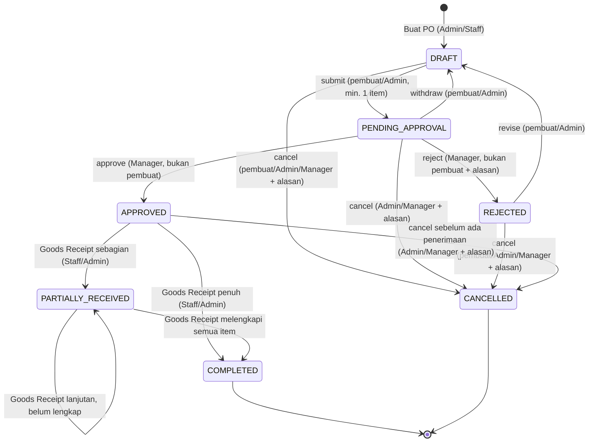
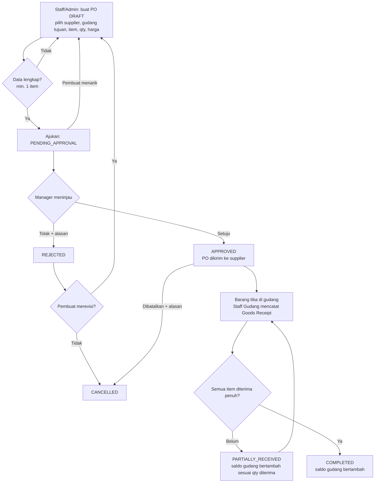

# Arsitektur Modul Purchase Order & Penerimaan Barang Multi-Gudang

> Modul: Pengadaan Barang (Purchase Order) & Penerimaan Barang Multi-Gudang (Goods Receipt)  
> Target: MINGGU 1 — Pembagian Modul Aplikasi, Arsitektur Kode, & Penentuan Logika Bisnis

Dokumen ini menjadi acuan utama perancangan teknis dan fungsional modul Purchase Order (PO) dan Goods Receipt. Dokumen ini merangkum struktur data, state-machine transisi status, pemisahan peran aktor, aturan bisnis, serta penanganan error dan contoh kode.

---

## 1. Artefak & Lokasi File Modul

| Artefak | Lokasi File |
|---|---|
| Enum Status & Peta Transisi | [`app/Enums/PurchaseOrderStatus.php`](../app/Enums/PurchaseOrderStatus.php) |
| State-Machine & Guard Transisi | [`app/Services/PurchaseOrderStateMachine.php`](../app/Services/PurchaseOrderStateMachine.php) |
| Domain Exception (403/422) | [`app/Exceptions/InvalidPurchaseOrderTransitionException.php`](../app/Exceptions/InvalidPurchaseOrderTransitionException.php) |
| Migration Database PO & Items | [`database/migrations/2026_10_26_100000_create_purchase_orders_and_items_tables.php`](../database/migrations/2026_10_26_100000_create_purchase_orders_and_items_tables.php) |
| Model Header PO | [`app/Models/PurchaseOrder.php`](../app/Models/PurchaseOrder.php) |
| Model Rincian Item PO | [`app/Models/PurchaseOrderItem.php`](../app/Models/PurchaseOrderItem.php) |
| Form Request Buat PO | [`app/Http/Requests/StorePurchaseOrderRequest.php`](../app/Http/Requests/StorePurchaseOrderRequest.php) |
| Form Request Ubah PO (Draft Only) | [`app/Http/Requests/UpdatePurchaseOrderRequest.php`](../app/Http/Requests/UpdatePurchaseOrderRequest.php) |
| Form Request Penerimaan Fisik Barang | [`app/Http/Requests/ReceivePurchaseOrderItemRequest.php`](../app/Http/Requests/ReceivePurchaseOrderItemRequest.php) |
| Unit Test State Machine | [`tests/Unit/PurchaseOrderStateMachineTest.php`](../tests/Unit/PurchaseOrderStateMachineTest.php) |
| Feature Test Database & Relasi | [`tests/Feature/PurchaseOrderDatabaseRelationshipTest.php`](../tests/Feature/PurchaseOrderDatabaseRelationshipTest.php) |
| Feature Test Form Request Validations | [`tests/Feature/PurchaseOrderValidationRequestTest.php`](../tests/Feature/PurchaseOrderValidationRequestTest.php) |

---

## 2. Aktor & Tanggung Jawab (Multi-Peran)

| Peran di Sistem (`users.role`) | Peran Bisnis | Tanggung Jawab di Modul PO |
|---|---|---|
| `admin` | Admin Gudang | Membuat dan mengajukan PO, membatalkan PO, mencatat penerimaan barang fisik. **Tidak menyetujui PO** (Separation of Duty). |
| `manager` | Manager | Menyetujui atau menolak PO (dengan catatan alasan), membatalkan PO. |
| `staff` | Staff Gudang | Membuat dan mengajukan PO miliknya, merevisi PO miliknya yang ditolak, mencatat penerimaan barang fisik di gudang. |

---

## 3. Struktur Skema Database & Relasi Eloquent

### 3.1 Tabel `purchase_orders`
Menyimpan informasi header pesanan pembelian.
- `id`: Primary key (BIGINT UNSIGNED)
- `nomor_po`: Nomor unik PO dengan format otomatis `PO-YYYYMMDD-XXXX` (VARCHAR 30, Indexed)
- `supplier_id`: Foreign key ke tabel `suppliers` (RESTRICT on delete)
- `warehouse_id`: Foreign key ke tabel `warehouses` sebagai gudang tujuan barang (RESTRICT on delete)
- `status`: Status siklus PO (`draft`, `pending_approval`, `approved`, `rejected`, `partially_received`, `completed`, `cancelled`)
- `tanggal_pesan`: Tanggal pembuatan/penerbitan PO (DATE)
- `estimasi_tiba`: Tanggal estimasi pengiriman barang sampai di gudang (DATE, nullable)
- `total_biaya`: Akumulasi nilai finansial pembelian (DECIMAL 15,2)
- `catatan`: Catatan operasional, spesifikasi tambahan, atau alasan pembatalan/penolakan (TEXT, nullable)
- `created_by`: Foreign key ke `users` (pembuat PO)
- `approved_by`: Foreign key ke `users` (penyetuju PO / Manager, nullable)
- `timestamps`: `created_at` dan `updated_at`

### 3.2 Tabel `purchase_order_items`
Menyimpan rincian item barang yang dipesan dalam PO.
- `id`: Primary key (BIGINT UNSIGNED)
- `purchase_order_id`: Foreign key ke `purchase_orders` (CASCADE on delete)
- `barang_id`: Foreign key ke `barang` (RESTRICT on delete)
- `jumlah_pesan`: Kuantitas barang yang dipesan (INT UNSIGNED)
- `jumlah_diterima`: Kuantitas fisik barang yang telah diterima bertahap (INT UNSIGNED, default 0)
- `harga_satuan`: Harga per unit pada saat PO diterbitkan (DECIMAL 15,2)
- `subtotal`: Hasil perkalian `jumlah_pesan * harga_satuan` (DECIMAL 15,2)
- `timestamps`: `created_at` dan `updated_at`

### 3.3 Pemetaan Relasi Eloquent
```
[Supplier] (1) <---> (N) [PurchaseOrder]
[Warehouse] (1) <---> (N) [PurchaseOrder]
[User (Creator)] (1) <---> (N) [PurchaseOrder]
[User (Approver)] (1) <---> (N) [PurchaseOrder]

[PurchaseOrder] (1) <---> (N) [PurchaseOrderItem] (CASCADE on delete)
[Barang] (1) <---> (N) [PurchaseOrderItem]
```

---

## 4. Definisi Status & State-Machine PO

Siklus hidup pesanan pembelian diatur oleh state machine terpusat (`PurchaseOrderStateMachine`) dengan memanfaatkan Enum bertipe string (`PurchaseOrderStatus`).

### 4.1 Definisi 7 Status PO

| Status | Nilai DB | Label UI | Badge | Arti | Dapat Diedit? | Boleh Terima Barang? | Terminal? |
|---|---|---|---|---|:---:|:---:|:---:|
| DRAFT | `draft` | Draft | `badge-secondary` | Pesanan dibuat staf/admin gudang. | Ya | Tidak | Tidak |
| PENDING_APPROVAL | `pending_approval` | Menunggu Persetujuan | `badge-warning` | Menunggu persetujuan Manager. | Tidak | Tidak | Tidak |
| APPROVED | `approved` | Disetujui | `badge-info` | Disetujui, pesanan resmi dikirim ke supplier. | Tidak | Ya | Tidak |
| REJECTED | `rejected` | Ditolak | `badge-danger` | Ditolak oleh Manager, dengan catatan alasan. | Tidak | Tidak | Tidak* |
| PARTIALLY_RECEIVED | `partially_received` | Diterima Sebagian | `badge-primary` | Sebagian barang sudah sampai di gudang fisik. | Tidak | Ya | Tidak |
| COMPLETED | `completed` | Selesai | `badge-success` | Seluruh barang sudah sampai dan saldo fisik bertambah. | Tidak | Tidak | **Ya** |
| CANCELLED | `cancelled` | Dibatalkan | `badge-dark` | Pesanan dibatalkan. | Tidak | Tidak | **Ya** |

\* PO yang ditolak dapat direvisi kembali ke `DRAFT` agar staf tidak perlu mengulang input dari nol.

### 4.2 State Diagram Transisi Status (Mermaid)



### 4.3 Alur Bisnis Lintas Peran (Flowchart)



---

## 5. Matriks Transisi & Hak Akses

Kunci aturan di kode: `PurchaseOrderStateMachine::RULES`.

| # | Dari → Ke | Aksi | Admin | Manager | Staff | Pembuat PO | Alasan Wajib | Guard Tambahan |
|---|---|---|:---:|:---:|:---:|:---:|:---:|---|
| 1 | DRAFT → PENDING_APPROVAL | `submit` | ✅ | — | — | ✅ | — | Minimal terdapat 1 item. |
| 2 | DRAFT → CANCELLED | `cancel` | ✅ | ✅ | — | ✅ | ✅ | — |
| 3 | PENDING_APPROVAL → APPROVED | `approve` | ❌ | ✅ | ❌ | ❌ dilarang | — | Separation of Duty: Penyetuju ≠ Pembuat PO. |
| 4 | PENDING_APPROVAL → REJECTED | `reject` | ❌ | ✅ | ❌ | ❌ dilarang | ✅ | Separation of Duty: Penyetuju ≠ Pembuat PO. |
| 5 | PENDING_APPROVAL → DRAFT | `withdraw` | ✅ | — | — | ✅ | — | Tarik kembali untuk perbaikan. |
| 6 | PENDING_APPROVAL → CANCELLED | `cancel` | ✅ | ✅ | ❌ | — | ✅ | — |
| 7 | REJECTED → DRAFT | `revise` | ✅ | — | — | ✅ | — | Revisi kembali ke mode edit. |
| 8 | REJECTED → CANCELLED | `cancel` | ✅ | ✅ | — | ✅ | ✅ | — |
| 9 | APPROVED → PARTIALLY_RECEIVED | `receive` | ✅ | ❌ | ✅ | — | — | Kuantitas diterima > 0, akumulasi < kuantitas dipesan. |
| 10 | APPROVED → COMPLETED | `receive` | ✅ | ❌ | ✅ | — | — | Seluruh akumulasi kuantitas diterima == dipesan. |
| 11 | APPROVED → CANCELLED | `cancel` | ✅ | ✅ | ❌ | — | ✅ | Belum pernah ada penerimaan fisik barang. |
| 12 | PARTIALLY_RECEIVED → COMPLETED | `receive` | ✅ | ❌ | ✅ | — | — | Seluruh akumulasi kuantitas diterima == dipesan. |

### Transisi yang Dilarang Keras
- **DRAFT → APPROVED**: PO wajib melewati evaluasi dan persetujuan Manager.
- **DRAFT / PENDING_APPROVAL → COMPLETED**: Barang fisik tidak sah diterima sebelum PO disetujui.
- **REJECTED → APPROVED**: PO yang ditolak wajib direvisi ke DRAFT dan diajukan ulang.
- **PARTIALLY_RECEIVED → CANCELLED**: Barang fisik sudah bertambah di gudang; pembatalan merusak jejak audit inventaris.
- **COMPLETED / CANCELLED → status apa pun**: Status terminal bersifat final dan terkunci permanen.

---

## 6. Aturan Bisnis (Business Rules)

| Kode | Aturan | Implementasi |
|---|---|---|
| BR-PO-01 | Header dan item PO hanya dapat diubah saat berstatus DRAFT. | `PurchaseOrderStatus::isEditable()` |
| BR-PO-02 | PO hanya dapat diajukan jika memiliki minimal satu item. | Guard `itemCount < 1` di `transition()` |
| BR-PO-03 | Hanya Manager yang dapat menyetujui atau menolak PO. | Rule `approve`/`reject` hanya `manager` |
| BR-PO-04 | Pemisahan tugas (Separation of Duty): pembuat PO tidak boleh menyetujui/menolak PO miliknya sendiri. | Guard `not_creator` di state machine |
| BR-PO-05 | Penolakan dan pembatalan wajib disertai catatan alasan yang tidak kosong. | `PurchaseOrderStatus::requiresReason()` |
| BR-PO-06 | Goods Receipt hanya boleh dicatat untuk PO APPROVED atau PARTIALLY_RECEIVED. | `PurchaseOrderStatus::canReceiveGoods()` |
| BR-PO-07 | Qty diterima kumulatif per item tidak boleh melebihi qty dipesan (pencegahan over-receipt). | `resolveReceivingStatus()` |
| BR-PO-08 | Status setelah penerimaan ditentukan otomatis oleh sistem: semua item lengkap → COMPLETED, selain itu → PARTIALLY_RECEIVED. | `resolveReceivingStatus()` |
| BR-PO-09 | Setiap Goods Receipt menambah saldo `warehouse_stocks` di gudang tujuan dan dicatat di `stok_transactions`/`stok_histories` dengan mekanisme mutasi masuk. | Integrasi operasional |
| BR-PO-10 | COMPLETED dan CANCELLED adalah status terminal (terkunci permanen). | `PurchaseOrderStatus::isTerminal()` |

---

## 7. Penanganan Error (Domain Exceptions)

Semua pelanggaran aturan melempar `InvalidPurchaseOrderTransitionException` dengan kode error dan mapping status HTTP yang terstandarisasi:

| `errorCode` | Penyebab Terjadi | HTTP Status |
|---|---|:---:|
| `transition_not_allowed` | Transisi status tidak ada dalam peta resmi state machine. | `422 Unprocessable Content` |
| `unauthorized_role` | Peran pengguna tidak berhak mengeksekusi aksi transisi tersebut. | `403 Forbidden` |
| `reason_required` | Aksi penolakan (`reject`) atau pembatalan (`cancel`) tanpa menyertakan alasan. | `422 Unprocessable Content` |
| `guard_failed` | Melanggar guard bisnis (PO kosong, pembuat approve sendiri, over-receipt). | `422 Unprocessable Content` |

---

## 8. Contoh Pemakaian pada Controller

```php
use App\Enums\PurchaseOrderStatus;
use App\Services\PurchaseOrderStateMachine;
use Illuminate\Support\Facades\DB;

// 1. Menampilkan opsi aksi yang diizinkan untuk UI tombol aksi
$availableActions = app(PurchaseOrderStateMachine::class)->availableTransitions(
    $po->status,
    $request->user()->role,
    $po->created_by === $request->user()->id,
);

// 2. Mengeksekusi transisi status (misal approval oleh Manager)
DB::transaction(function () use ($po, $request) {
    $poLocked = PurchaseOrder::where('id', $po->id)->lockForUpdate()->firstOrFail();

    $machine = app(PurchaseOrderStateMachine::class);
    $poLocked->status = $machine->transition(
        from: $poLocked->status,
        to: PurchaseOrderStatus::APPROVED,
        role: $request->user()->role,
        actorIsCreator: $poLocked->created_by === $request->user()->id,
    );

    $poLocked->approved_by = $request->user()->id;
    $poLocked->save();
});
```
