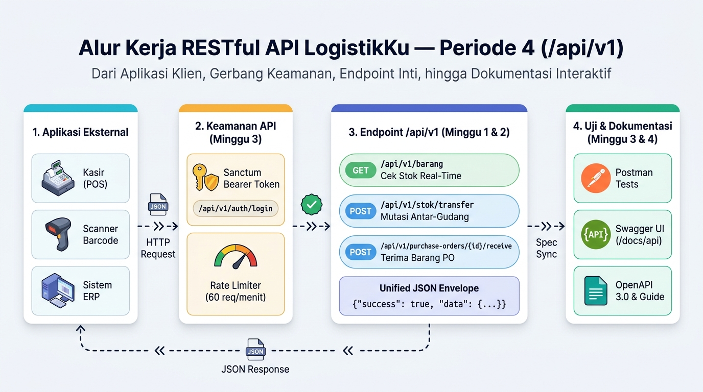

# Arsitektur RESTful API LogistikKu (`/api/v1`)

> **Dokumen Arsitektur Teknis — Periode 4 (Minggu 1 & Minggu 2)**  
> **Target:** Perancangan Arsitektur RESTful API, Unified API Response Contract, Penanganan Exception Global, Matriks Hak Akses API, & Implementasi Endpoint Integrasi Internal `/api/v1/*`  
> **Referensi Standar Industri:** [Microsoft Azure Architecture Center — Desain Web API Terbaik](https://learn.microsoft.com/id-id/azure/architecture/best-practices/api-design)  
> **Artefak Kode Terkait:** [`app/Traits/ApiResponses.php`](../app/Traits/ApiResponses.php) · [`app/Http/Controllers/Controller.php`](../app/Http/Controllers/Controller.php) · [`app/Http/Controllers/Api/V1/`](../app/Http/Controllers/Api/V1/) · [`app/Http/Requests/Api/V1/`](../app/Http/Requests/Api/V1/) · [`app/Http/Resources/`](../app/Http/Resources/) · [`bootstrap/app.php`](../bootstrap/app.php) · [`routes/api.php`](../routes/api.php)



---

## 1. Prinsip Dasar RESTful API & Richardson Maturity Model

API **LogistikKu (`/api/v1`)** dirancang sebagai antarmuka integrasi sistem eksternal (mesin Kasir/POS, pemindai *barcode* gudang, sistem ERP/pengadaan, serta Postman/Swagger UI) dengan menerapkan prinsip arsitektur REST berstandar industri.

### 1.1 Model Kematangan REST (*Richardson Maturity Model*)

Mengacu pada pedoman desain Web API Microsoft Azure Architecture Center, kematangan RESTful API terbagi menjadi empat tingkat:

| Tingkat | Karakteristik Utama | Penerapan di LogistikKu `/api/v1` |
|---|---|---|
| **Level 0** *(Swamp of POX)* | Hanya memakai satu URI dan satu metode HTTP (`POST`) bergaya RPC untuk semua aksi. | Tidak digunakan (*dihindari*). |
| **Level 1** *(Resources)* | Memisahkan setiap entitas bisnis ke dalam URI sumber daya berbeda (`/barang`, `/purchase-orders`). | Diterapkan penuh pada struktur URI `/api/v1/{resource}`. |
| **Level 2** *(HTTP Verbs & Status Codes)* | Memanfaatkan semantik metode HTTP (`GET`, `POST`, `PUT`, `PATCH`, `DELETE`) dan kode status HTTP standar (`200`, `201`, `202`, `204`, `400`, `401`, `403`, `404`, `405`, `409`, `415`, `422`, `429`, `500`, `503`). | **Standar wajib penuh** di seluruh rute `/api/v1/*` dan `bootstrap/app.php`. |
| **Level 3** *(HATEOAS / Hypermedia Controls)* | Respon API menyertakan tautan navigasi (*hypermedia links*) agar klien tidak perlu menebak URL halaman berikutnya atau tautan aksi terkait. | Diterapkan melalui `links.self` pada endpoint status, `meta.links` (`first`, `last`, `prev`, `next`) pada respon paginasi, serta `meta.status_url` / header `Location` pada `201`/`202`. |

LogistikKu `/api/v1` mengimplementasikan **Richardson Maturity Model Level 2 penuh dengan dukungan elemen Level 3 (REST + HATEOAS)**.

### 1.2 Prinsip Arsitektur Inti

1. **Stateless (Tanpa State Sesi):** Setiap permintaan ke `/api/v1/*` harus berdiri sendiri (*self-contained*), menyertakan `Authorization: Bearer <sanctum-token>` serta `Accept: application/json`, dan **tidak bergantung pada cookie sesi browser atau token CSRF**.
2. **Data Abstraction & Schema Decoupling:** API tidak mengekspos langsung skema tabel fisik database ataupun objek model Eloquent mentah. Transformasi dikendalikan melalui lapisan **Laravel `JsonResource`** (contoh: `PurchaseOrderResource`), sehingga perubahan nama kolom internal atau relasi database tidak memutus kompatibilitas klien eksternal.
3. **Backward Compatibility:** Rute pra-v1 (`/api/login`, `/api/purchase-orders/*`) tetap dipertahankan terpisah selama fase transisi agar integrasi/test awal tetap berjalan 100%, sementara seluruh standar arsitektur baru ditegakkan di namespace `/api/v1/*`.

---

## 2. Pengorganisasian URI Berbasis Sumber Daya (*Organize Around Resources*)

Mengikuti prinsip *"Organize the API design around resources"* dari Microsoft Learn:

### 2.1 Aturan Penamaan URI
- **Gunakan Kata Benda (*Nouns*), Hindari Kata Kerja (*Verbs*) di URI Dasar:**
  - Benar: `GET /api/v1/purchase-orders`, `POST /api/v1/purchase-orders`
  - Salah (*RPC-style*): `POST /api/v1/create-purchase-order`, `GET /api/v1/get-all-barang`
- **Gunakan Huruf Kecil dan *Kebab-Case*:** Contoh `/api/v1/purchase-orders`, `/api/v1/barang/{id}/check-stock`.
- **Pemisahan *Collection URI* vs *Item URI*:**
  - *Collection URI*: `/api/v1/barang` (merujuk kumpulan seluruh data barang).
  - *Item URI*: `/api/v1/barang/{id}` (merujuk tepat satu entitas barang spesifik).
- **Hindari Hierarki URI yang Terlalu Dalam (*Avoid Deep URI Hierarchies*):**
  Batasi kedalaman URI maksimal menjadi `collection/{id}/sub-resource` atau aksi domain terikat (misalnya `/api/v1/purchase-orders/{id}/receive` atau `/api/v1/barang/{id}/check-stock`), alih-alih rantai bersarang panjang seperti `/warehouses/{wId}/suppliers/{sId}/purchase-orders/{poId}/items/{itemId}`. Gunakan parameter query (`?warehouse_id=...&supplier_id=...`) untuk relasi penyaringan lintas entitas.

### 2.2 Peta Status Implementasi Endpoint
- **Aktif pada Minggu 1 (Fondasi Kontrak & Status API):**
  - `GET /api/v1/status` (`api.v1.status`) — Endpoint informasi layanan, arsitektur, tingkat kematangan REST, kata kerja HTTP yang didukung, dan tautan *self*.
- **Aktif pada Minggu 2 (Endpoint Integrasi Sistem Internal — 12 Rute: 1 Login Publik + 11 Rute Terlindungi `auth:sanctum`):**
  - Autentikasi: `POST /api/v1/auth/login`, `POST /api/v1/auth/logout`, `GET /api/v1/auth/me`
  - Master Barang & Ketersediaan Stok Real-Time: `GET /api/v1/barang`, `GET /api/v1/barang/{barang}`, `GET /api/v1/barang/{barang}/check-stock`
  - Mutasi & Transfer Stok Antar-Gudang: `POST /api/v1/stok/adjust`, `POST /api/v1/stok/transfer`
  - Pengadaan & Penerimaan Barang: `GET /api/v1/purchase-orders`, `POST /api/v1/purchase-orders`, `GET /api/v1/purchase-orders/{purchaseOrder}`, `POST /api/v1/purchase-orders/{purchaseOrder}/receive`
- **Belum tersedia di `/api/v1` (hanya di rute legacy `/api/purchase-orders/*` atau modul web):** `PUT`/`PATCH` PO, `revise`, `withdraw`, `approve`, `reject`, CRUD master barang, dan reversal transaksi stok. Perluasan ke v1 dicatat sebagai *roadmap* pasca-Periode 4 dan **bukan** bagian dari 12 rute aktif di atas.
- **Aktif pada Minggu 3 (Keamanan Data & Pengujian Postman):**
  - Penegakan granular *Sanctum Token Abilities* (`User::ROLE_API_ABILITIES` + middleware `ability:...`), `RateLimiter::for('api')` (60 req/menit), konfigurasi `config/cors.php`, *Data Masking* (`harga_beli` untuk staff & penyembunyian email internal pada `PurchaseOrderResource`), serta artefak Postman Collection (`docs/postman/LogistikKu_API_v1.postman_collection.json`) & `ApiEndpointsSecurityTest`.

---

## 3. Semantik Metode HTTP, *Safety*, *Idempotency*, & Header Protokol

### 3.1 Matriks Semantik HTTP Verbs

| HTTP Verb | Operasi | *Safe*? | *Idempotent*? | Respon Sukses Standar | Aturan Penggunaan di LogistikKu |
|---|---|---|---|---|---|
| `GET` | Membaca representasi resource (daftar, detail, cek stok) | Ya | Ya | `200 OK` | Tidak boleh mengubah state database; aman di-*cache* atau diulang saat jaringan terputus. |
| `POST` | Membuat resource baru atau memicu aksi transaksional non-idempoten | Tidak | Tidak* | `201 Created` (`+ Location`), `200 OK`, atau `202 Accepted` | Digunakan untuk pembuatan PO, mutasi stok, transfer gudang, serta penerimaan barang PO. |
| `PUT` | Mengganti seluruh representasi resource secara utuh (atau membuat baru di URI tetap) | Tidak | Ya | `200 OK` / `201 Created` / `204 No Content` | Membutuhkan payload field lengkap resource (misal pembaruan penuh draft PO). |
| `PATCH` | Memperbarui sebagian atribut resource secara parsial | Tidak | Tidak selalu** | `200 OK` / `204 No Content` | Memperbarui hanya field yang dikirim di body tanpa menimpa field lain. |
| `DELETE` | Menghapus / membatalkan resource pada URI terkait | Tidak | Ya | `200 OK` / `204 No Content` | Menghapus resource target atau menandainya terhapus (*soft delete* yang aman dipanggil ulang). |

> `*` & `**` **Strategi *Idempotency* pada Aksi Transaksional Kritis LogistikKu:** Karena gangguan jaringan atau double-tap *barcode scanner* di gudang bisa mengirim ulang request `POST` yang sama, operasi krusial wajib mendukung pengaman idempotensi: `POST /purchase-orders/{id}/receive` menggunakan `receipt_token` agar penerimaan tidak tercatat ganda; `POST /stok/transfer` memakai nomor referensi unik (di-*generate* otomatis `TRF-YYYYMMDD-XXXXXX` bila kosong, duplikat → `409`); sedangkan `POST /stok/adjust` menolak dengan `409 CONFLICT` bila `reference_number` (opsional) yang sama sudah dipakai untuk kombinasi barang + gudang + `jenis` + `reference_type` yang sama. `adjust` tanpa `reference_number` **tidak** idempoten, sehingga sistem eksternal wajib mengirim `reference_number` (mis. nomor DO/surat jalan) agar aman dari *retry*.

### 3.2 *Content Negotiation* & Header Protokol Standar

| Header HTTP | Arah | Fungsi di `/api/v1` |
|---|---|---|
| `Accept: application/json` | Request (Client → Server) | Menandakan klien mengharapkan payload JSON (*media type* standar). Untuk rute `api/v1*`, server tetap mengembalikan JSON secara paksa meski header lupa dikirim. |
| `Content-Type: application/json` | Request / Response | Menyatakan format body request/response berupa JSON. Pengiriman media type tidak didukung pada endpoint ketat akan memicu `415 Unsupported Media Type`. |
| `Authorization: Bearer <token>` | Request | Token otentikasi **Laravel Sanctum** untuk seluruh rute privat. |
| `X-API-Version: v1.0` | Response (Server → Client) | Disertakan otomatis oleh `App\Traits\ApiResponses` di **setiap** respon berhasil maupun error untuk transparansi versi kontrak aktif. |
| `Location: <uri>` | Response (`201` / `202`) | Menunjuk URI resource baru yang berhasil dibuat (`createdResponse`) atau URI pemantau status job asinkron (`acceptedResponse`). |
| `Allow: GET, ...` | Response (`405`) | Daftar metode HTTP yang diizinkan ketika klien memanggil verb yang salah pada URI valid. |
| `Retry-After: <detik>` | Response (`429` / `503`) | Memberi tahu klien berapa detik harus menunggu sebelum mencoba request ulang setelah terkena *Rate Limiter*. |

---

## 4. Standar HTTP Status Code & Kode Error Internal

| HTTP Status | Nama Resmi | Kode Error (`code`) | Kapan Digunakan di LogistikKu |
|---|---|---|---|
| `200 OK` | OK | *(Sukses)* | Request `GET` berhasil, autentikasi berhasil, atau aksi transaksional selesai dengan body data. |
| `201 Created` | Created | *(Sukses)* | Resource baru berhasil dibuat (disarankan menyertakan header HTTP `Location` ke URI resource baru). |
| `202 Accepted` | Accepted | *(Sukses Asinkron)* | Permintaan pekerjaan latar belakang diterima untuk diproses asinkron via queue (contoh: OCR / prediksi batch), disertai `Location` dan `meta.status_url`. |
| `204 No Content` | No Content | *(Sukses Tanpa Body)* | Operasi selesai tanpa perlu mengembalikan body JSON (misal penghapusan item selesai). |
| `400 Bad Request` | Bad Request | `BAD_REQUEST` | Sintaks JSON rusak atau parameter permintaan tidak memenuhi prasyarat dasar protokol. |
| `401 Unauthorized` | Unauthorized | `UNAUTHENTICATED` | Token Sanctum tidak dikirim, tidak valid, sudah dicabut, atau kredensial login tidak cocok. |
| `403 Forbidden` | Forbidden | `FORBIDDEN` / `UNAUTHORIZED_ROLE` | User terautentikasi, namun role (`admin`/`manager`/`staff`) atau token abilities tidak berwenang menjalankan operasi. |
| `404 Not Found` | Not Found | `RESOURCE_NOT_FOUND` | Endpoint `/api/v1/...` tidak ditemukan atau ID data tidak tersedia di database. |
| `405 Method Not Allowed` | Method Not Allowed | `METHOD_NOT_ALLOWED` | URI endpoint benar, tetapi HTTP verb yang dipakai salah (disertai header `Allow`). |
| `409 Conflict` | Conflict | `CONFLICT` / `DATABASE_CONFLICT` | Benturan transaksi database konkuren (*deadlock*), pengubahan status PO usang, atau ketidaksesuaian kondisi stok saat eksekusi. |
| `415 Unsupported Media Type` | Unsupported Media Type | `UNSUPPORTED_MEDIA_TYPE` | Payload dikirim dengan format `Content-Type` yang tidak didukung endpoint (selain `application/json`). |
| `422 Unprocessable Content` | Unprocessable Content | `VALIDATION_ERROR` / `GUARD_FAILED` | Format JSON valid, namun isi payload gagal validasi aturan `FormRequest` atau melanggar aturan bisnis (seperti *Maker-Checker*). |
| `429 Too Many Requests` | Too Many Requests | `TOO_MANY_REQUESTS` | Melebihi batas kuota rate limiting per menit / percobaan login berulang (disertai header `Retry-After`). |
| `500 Internal Server Error` | Internal Server Error | `INTERNAL_SERVER_ERROR` | Kesalahan sistem tak terduga di server. Pada produksi (`APP_DEBUG=false`), detail error internal disembunyikan. |
| `503 Service Unavailable` | Service Unavailable | `SERVICE_UNAVAILABLE` | Layanan sedang dalam pemeliharaan atau dependensi krusial sementara tidak tersedia. |

---

## 5. Unified API Response Contract, Paginasi & HATEOAS (`app/Traits/ApiResponses.php`)

Seluruh controller API mewarisi [`App\Traits\ApiResponses`](../app/Traits/ApiResponses.php) melalui [`App\Http\Controllers\Controller`](../app/Http/Controllers/Controller.php).

### 5.1 Format Berhasil (Success Response — `200 OK` / `201 Created` / `202 Accepted`)

```json
{
  "success": true,
  "message": "Data berhasil dibuat",
  "data": {
    "id": 15,
    "nomor_po": "PO-20261118-0015",
    "status": "draft"
  },
  "meta": {
    "timestamp": "2026-11-18T10:50:00+07:00",
    "version": "v1.0"
  }
}
```
- Header respon menyertakan `X-API-Version: v1.0` dan (untuk `201 Created` atau `202 Accepted`) header `Location: https://.../api/v1/purchase-orders/15`.
- Jika `JsonResource` dikirim ke `successResponse()`, trait otomatis mengekstrak `$data->resolve(request())` agar tidak terjadi pembungkusan berulang `data.data`.

### 5.2 Filtering, Sorting, Paginasi & HATEOAS Links (`paginatedResponse`)

Mengacu pada praktik Microsoft *"Filter and paginate data"* untuk mencegah lonjakan payload & beban memori server:
- **Parameter Query Standar:**
  - Paginasi: `?page=1&per_page=15` (nilai `per_page` dibatasi **maksimal 100 item** per permintaan untuk mencegah penyalahgunaan/DoS).
  - Filtering & Pencarian: `?search=...&kategori=...&status=...&warehouse_id=...`
  - Sorting: `?sort=nama_barang&direction=asc` (hanya kolom aman yang masuk *whitelist*).
- **Struktur JSON Respon Terpaginasi:**

```json
{
  "success": true,
  "message": "Daftar barang berhasil diambil",
  "data": [
    {
      "id": 10,
      "kode_barang": "BRG-000010",
      "nama_barang": "Router Enterprise"
    }
  ],
  "meta": {
    "timestamp": "2026-11-18T10:50:00+07:00",
    "version": "v1.0",
    "current_page": 1,
    "per_page": 15,
    "total": 42,
    "last_page": 3,
    "from": 1,
    "to": 15,
    "links": {
      "first": "http://localhost/api/v1/barang?page=1",
      "last": "http://localhost/api/v1/barang?page=3",
      "prev": null,
      "next": "http://localhost/api/v1/barang?page=2"
    }
  }
}
```

### 5.3 Format Gagal (Error Response — `4xx` / `5xx`)

```json
{
  "success": false,
  "message": "Validasi gagal",
  "errors": {
    "qty": ["Kolom qty minimal bernilai 1."]
  },
  "code": "VALIDATION_ERROR"
}
```
- Field `errors` **selalu bertipe JSON Object** (`{}` jika tidak ada rincian per-field, atau `{ "field": ["pesan error..."] }` pada error validasi).
- Field `code` konsisten menggunakan gaya *UPPER_SNAKE_CASE* sehingga aman dipetakan di kode klien dengan blok `switch/match`.

---

## 6. Strategi Versioning API (*Versioning a RESTful Web API*)

Berdasarkan panduan Microsoft Learn, terdapat beberapa pendekatan versioning RESTful API:

| Pendekatan | Contoh Bentuk | Kelebihan & Alasan Pemilihan di LogistikKu |
|---|---|---|
| **URI Path Versioning *(Dipilih)*** | `GET /api/v1/barang` | Eksplisit, paling mudah di-*routing* pada Laravel (`Route::prefix('v1')`), terbaca jelas di log proxy/Nginx maupun Swagger/Postman, serta tidak memerlukan header khusus di URL browser. |
| **Header Versioning *(Pendamping Respon)*** | `X-API-Version: v1.0` | Dikembalikan pada **setiap** HTTP Response Header beserta `meta.version` agar klien dapat mengaudit versi kontrak yang melayaninya. |
| **Query String Versioning** | `/api/barang?api-version=1.0` | Tidak dipilih sebagai rute utama karena mudah tertukar dengan parameter filter bisnis (`?status=...`). |

Perubahan yang bersifat *non-breaking* (seperti menambah field opsional baru pada JSON `data` atau menambah endpoint baru di `/api/v1/*`) tetap berada dalam `v1`. Perubahan yang bersifat *breaking* (menghapus field, mengubah tipe data kunci, atau mengubah alur wajib kontrak) hanya boleh diperkenalkan pada versi mayor berikutnya (`/api/v2/*`).

---

## 7. Penanganan Exception Global (`bootstrap/app.php`)

Seluruh request yang masuk ke prefix `api/v1` dan `api/v1/*` dilindungi *Global Exception Handler* pada [`bootstrap/app.php`](../bootstrap/app.php):

1. `$exceptions->shouldRenderJsonWhen(...)` memaksa respon JSON untuk seluruh jalur `api/v1*` meskipun klien tidak mengirimkan header `Accept: application/json`.
2. `$exceptions->render(...)` memetakan exception framework maupun exception domain ke helper [`App\Traits\ApiResponses`](../app/Traits/ApiResponses.php):

```text
Request (/api/v1/*)
  │
  ├─► ValidationException                    ──► 422 · code: VALIDATION_ERROR (errors: per-field)
  ├─► AuthenticationException                ──► 401 · code: UNAUTHENTICATED
  ├─► AuthorizationException                 ──► 403 · code: FORBIDDEN
  ├─► ModelNotFound / NotFoundHttp           ──► 404 · code: RESOURCE_NOT_FOUND
  ├─► MethodNotAllowedHttpException          ──► 405 · code: METHOD_NOT_ALLOWED (+ Allow header)
  ├─► InvalidPurchaseOrderTransition         ──► 403/422 · code: strtoupper(errorCode)
  ├─► DeadlockException                      ──► 409 · code: CONFLICT
  ├─► JsonException                          ──► 400 · code: BAD_REQUEST
  ├─► ThrottleRequestsException              ──► 429 · code: TOO_MANY_REQUESTS (+ Retry-After)
  ├─► HttpExceptionInterface (400/403/409/415/503/...) ──► Status & code kanonik terstandar
  └─► Throwable tak terduga                  ──► 500 · code: INTERNAL_SERVER_ERROR
```

Seluruh respon error dari handler global ini otomatis menyertakan header `X-API-Version: v1.0` dan amplop `{success: false, message, errors: {...}, code}`.

---

## 8. Matriks Hak Akses API Per Role & Token Abilities

Autentikasi menggunakan **Laravel Sanctum Bearer Token** yang terhubung pada tabel `users.role` (`admin`, `manager`, `staff`), menegakkan batasan dari [`AppServiceProvider`](../app/Providers/AppServiceProvider.php) dan [`PurchaseOrderPolicy`](../app/Policies/PurchaseOrderPolicy.php).

> **Legenda status implementasi:** ✅ = aktif di `/api/v1`. 🕘 *Legacy* = hanya ada di rute lama `/api/purchase-orders/*` atau modul web, belum dipindah ke v1. 🗺️ *Roadmap* = belum diimplementasikan.
> **Penegakan Kemampuan Token (*Token Abilities*):** Mulai Minggu 3, `POST /api/v1/auth/login` menerbitkan token dengan *abilities* spesifik per role (`User::ROLE_API_ABILITIES`) dan seluruh rute `/api/v1/*` menegakkan middleware `ability:<scope>` berlapis dengan `users.role` (Gate/Policy/FormRequest).

| Modul & Endpoint | HTTP Verb | Admin | Manager | Staff | Kemampuan Token (*Suggested Abilities*) & Aturan Bisnis |
|---|---|---|---|---|---|
| **Status Layanan** | | | | | |
| `/api/v1/status` | `GET` | Publik | Publik | Publik | Cek konektivitas, versi kontrak (`v1.0`), dan tautan *self*. |
| **Autentikasi (`/api/v1/auth`)** | | | | | |
| `/api/v1/auth/login` | `POST` | Publik | Publik | Publik | Menghasilkan Sanctum Bearer Token sesuai role & dilindungi rate limiter. |
| `/api/v1/auth/logout` | `POST` | Ya | Ya | Ya | Mencabut token aktif (`currentAccessToken()->delete()`). |
| `/api/v1/auth/me` *(atau `/user`)* | `GET` | Ya | Ya | Ya | Mengambil profil & role user aktif tanpa membocorkan kolom sensitif (`password`, `remember_token`). |
| **Master Barang & Cek Stok Real-Time** | | | | | |
| `/api/v1/barang` | `GET` | Ya | Ya | Ya | `barang:read` — Daftar barang dengan pencarian, filter kategori, sorting, & paginasi + HATEOAS `links`. |
| `/api/v1/barang/{id}` | `GET` | Ya | Ya | Ya | `barang:read` — Detail barang lengkap beserta distribusi saldo per gudang (`warehouse_stocks`). |
| `/api/v1/barang/{id}/check-stock` | `GET` | Ya | Ya | Ya | `stok:check` — Pemeriksaan cepat ketersediaan stok gudang untuk kasir/POS. |
| CRUD Master Barang 🗺️ *Roadmap (modul web saja)* | `POST`/`PUT`/`PATCH`/`DELETE` | Ya | Tidak (`403`) | Tidak (`403`) | `barang:write` — Dibatasi khusus `admin` (`Gate::define('manage-barang')`). Belum ada rute v1. |
| **Mutasi & Transfer Stok Antar-Gudang** | | | | | |
| `/api/v1/stok/adjust` ✅ | `POST` | Ya | Ya | Ya | `stok:adjust` — Penyesuaian stok masuk/keluar (`Gate::define('update-stock')`); `reference_number` duplikat → `409`. |
| `/api/v1/stok/transfer` | `POST` | Ya | Ya | Ya | `stok:transfer` — Transfer stok atomik antar-gudang dengan referensi unik. |
| Reversal Transaksi Stok 🕘 *Legacy (modul web)* | `POST` | Ya | Ya | Tidak (`403`) | `stok:reverse` — Khusus `admin` & `manager` (`Gate::define('reverse-stock')`). |
| **Pengadaan (Purchase Order & Goods Receipt)** | | | | | |
| `/api/v1/purchase-orders` | `GET` | Ya | Ya | Ya | `po:read` — Melihat daftar/detail PO beserta filter & paginasi. |
| `/api/v1/purchase-orders` | `POST` | Ya | Ya | Ya | `po:create` — Membuat PO draft baru; respon `201 Created` dengan header `Location`. |
| `/api/purchase-orders/{id}` 🕘 *Legacy* (belum di v1) | `PUT`/`PATCH` | Ya | Ya | Ya* | `po:update` — Hanya pada status `draft`; `staff` hanya boleh mengubah PO buatannya sendiri. |
| `/api/purchase-orders/{id}/revise` / `withdraw` 🕘 *Legacy* (belum di v1; `submit` belum ada rute API) | `POST` | Ya | Tidak* (`403`) | Ya* | `po:submit` — Khusus `admin` atau pembuat PO (`created_by === user.id`). |
| `/api/purchase-orders/{id}/approve` / `reject` 🕘 *Legacy* (belum di v1) | `POST` | Ya* | Ya* | Tidak (`403`) | `po:approve` — Khusus `admin` & `manager`; **dilarang menyetujui/menolak PO buatan sendiri** (*Maker-Checker / SoD* → `422 GUARD_FAILED`). |
| `/api/v1/purchase-orders/{id}/receive` | `POST` | Ya | Tidak (`403`) | Ya | `po:receive` — Pencatatan penerimaan barang fisik via *barcode scanner* khusus `admin` & `staff`. |

> `*` **Pertahanan Berlapis (*Defense in Depth*):** Penegakan izin di atas wajib lolos di level *Sanctum Token Abilities* dan level *Policy / Gate* model bisnis sehingga token dari satu peran tidak pernah bisa menembus pembatasan domain seperti *Segregation of Duties*. Sesuai [`PurchaseOrderPolicy::create()`](../app/Policies/PurchaseOrderPolicy.php), `admin`, `manager`, dan `staff` diizinkan membuat draft PO, namun siapapun pembuat PO tetap dilarang menyetujui atau menolak PO buatannya sendiri.

---

## 9. Referensi Standar Teknis
1. [Microsoft Azure Architecture Center — Web API Design Best Practices](https://learn.microsoft.com/id-id/azure/architecture/best-practices/api-design)
2. [RFC 9110 — HTTP Semantics (Methods, Status Codes, Safety & Idempotency)](https://httpwg.org/specs/rfc9110.html)
3. [OWASP API Security Top 10](https://owasp.org/API-Security/)
